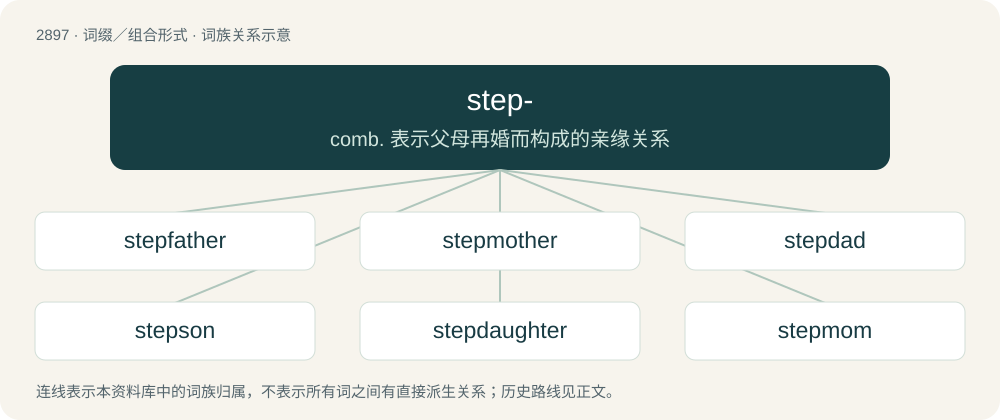

# 3008 · step- — comb. 表示父母再婚而构成的亲缘关系

[总目录](../00_总目录_按常用程度.md)

**类型**：词缀／组合形式　｜　**来源语言**：见词源记录

## 核心含义与来源

- 核心含义：comb. 表示父母再婚而构成的亲缘关系
- 英文含义：A prefix used before father, mother, brother, sister, son, daughter, child, and so forth, to indicate that the person being identified is not a blood relative but is related through the marriage of a parent.
- 词形：step-

**来源记录 1**（前缀／前置成分；A prefix used before father, mother, brother, sister, son, daughter, child, and so forth, to indicate that the person being identified is not a blood relative but is related through the marriage of a parent.）

From Middle English step-, from Old English stēop- (“deprived of a relative, step-”, prefix), from Proto-West Germanic \*steupa-, from Proto-Germanic \*steupa- (“orphaned, step-”), from Proto-Indo-European \*(s)tewp- (“to push, strike”). Cognate with Scots step- (“step-”), West Frisian stiep- (“step-”), Dutch stief- (“step-”), Low German steef- (“step-”), German stief- (“step-”), Swedish styv- (“step-”), Icelandic stjúp- (“step-”). Related to Old English stīepan (“to deprive, bereave”). Not, however, related to the familiar English noun or verb step.

## 词族图

## 单词速览（常用到不常用）

| 单词 | 音标 | 释义 |
|---|---|---|
| [stepfather](#w-1) | /ˈstep,fɑːðə/ | n. 继父；\[法\] 继父 |
| [stepmother](#w-2) | 英 /ˈstɛpmʌðə/ | n. 继母 |
| [stepdad](#w-3) |  | 继父 |
| [stepson](#w-4) | /ˈstɛpsʌn/ | n. 妻与前夫所生的儿子, 夫与前妻所生的儿子；\[法\] 妻与前夫所生的儿子, 继子 |
| [stepdaughter](#w-5) | /ˈstep,dɔːtə/ | n. 妻与前夫所生的女儿, 夫与前妻所生的女儿 |
| [stepmom](#w-6) |  | 继母 |
| [stepbrother](#w-7) | /ˈstepbrʌðə/ | n. 异父(母)兄弟；\[法\] 继父与其前妻所生的儿子, 继兄弟 |
| [stepsister](#w-8) | /ˈstepsistə/ | n. 异父(母)姊妹 |
| [stepchild](#w-9) | /ˈstɛp.tʃaɪld/ | n. 前夫(或前妻)所生子女；\[法\] 妻与前夫所生的孩子, 继子女 |

## 逐词详解

### 1. stepfather

**词性**：名词　｜　**音标**：/ˈstep,fɑːðə/

**中文释义**：n. 继父；\[法\] 继父

**英文义项**：The husband of one's biological mother after her initial marriage to or relationship with one's biological father. / The husband of one's parent distinct from one's biological father or person with a similar relationship.

**构词拆分**：step- + father

**词源与演化**：

From Middle English stepfader, from Old English stēopfæder, from Proto-Germanic \*steupafadēr (“stepfather”), equivalent to step- + father. Cognate with Saterland Frisian Stäiffoar (“stepfather”), Dutch stiefvader (“stepfather”), German Low German Steevvader (“stepfather”), German Stiefvater (“stepfather”), Swedish styvfar (“stepfather”), Icelandic stjúpfaðir (“stepfather”).

**例句**：

> I hope my new stepfather sticks around longer than the last one.

### 2. stepmother

**词性**：名词　｜　**音标**：英 /ˈstɛpmʌðə/

**中文释义**：n. 继母

**英文义项**：A person or thing likened to a stereotypical stepmother, having cold, cruel, or ungenerous qualities. / An animal, typically a bird, who raises the offspring of another animal.

**构词拆分**：step- + mother

**词源与演化**：

From Middle English stepmoder, from Old English stēopmōdor, from Proto-Germanic \*steupamōdēr (“stepmother”), corresponding to step- + mother. Cognate with Saterland Frisian Stäifmuur (“stepmother”), Dutch stiefmoeder (“stepmother”), German Low German Steevmoder (“stepmother”), German Stiefmutter (“stepmother”), Danish stedmor (“stepmother”), Swedish styvmor (“stepmother”), Icelandic stjúpmóðir (“stepmother”). Compare also West Frisian styfmem (“stepmother”).

**例句**：

> I get on well with my stepsister but not with my stepmother.

### 3. stepdad

**词性**：名词

**中文释义**：继父

**英文义项**：A stepfather.

**构词拆分**：step- + dad

**词源与演化**：

From step- + dad.

**例句**：

> Daniel cut up all his stepdad's ties and threw them under the bed.

### 4. stepson

**词性**：名词　｜　**音标**：/ˈstɛpsʌn/

**中文释义**：n. 妻与前夫所生的儿子, 夫与前妻所生的儿子；\[法\] 妻与前夫所生的儿子, 继子

**英文义项**：The son of one's spouse from a previous relationship.

**构词拆分**：step- + son

**词源与演化**：

From Middle English stepsone, stepsune, from Old English stēopsunu (“stepson”), from Proto-Germanic \*steupasunuz (“stepson”), equivalent to step- + son. Cognate with Saterland Frisian Stäifsuun (“stepson”), West Frisian styfsoan (“stepson”), Dutch stiefzoon (“stepson”), German Low German Steevsöhn (“stepson”), German Stiefsohn (“stepson”), Danish stedsøn (“stepson”), Swedish styvson (“stepson”), Icelandic stjúpsonur (“stepson”).

**例句**：

> Lorenzo was having a hard time connecting with his stepson.

### 5. stepdaughter

**词性**：名词　｜　**音标**：/ˈstep,dɔːtə/

**中文释义**：n. 妻与前夫所生的女儿, 夫与前妻所生的女儿

**英文义项**：The daughter of one's spouse from a previous relationship.

**构词拆分**：step- + daughter

**词源与演化**：

From Middle English stepdoughter, stepdoghter, steopdohter, from Old English stēopdohtor (“stepdaughter”), from Proto-Germanic \*steupaduhtēr (“stepdaughter”), equivalent to step- + daughter. Cognate with Saterland Frisian Stäifdochter (“stepdaughter”), West Frisian styfdochter (“stepdaughter”), Dutch stiefdochter (“stepdaughter”), German Low German Steevdochter (“stepdaughter”), German Stieftochter (“stepdaughter”), Danish steddatter (“stepdaughter”), Swedish styvdotter (“stepdaughter”), Icelandic stjúpdóttir (“stepdaughter”).

**例句**：

> Ziri never got the time to build an actual bond with his stepdaughter.

### 6. stepmom

**词性**：名词

**中文释义**：继母

**英文义项**：Stepmother.

**构词拆分**：step- + mom

**词源与演化**：

From step- + mom.

**例句**：

> Ziri used Photoshop to cut his stepmom out of all his pictures.

### 7. stepbrother

**词性**：名词　｜　**音标**：/ˈstepbrʌðə/

**中文释义**：n. 异父(母)兄弟；\[法\] 继父与其前妻所生的儿子, 继兄弟

**英文义项**：The son of one's stepparent by a previous relationship. / The stepson of one's parent who is not one's half-brother.

**构词拆分**：step- + brother

**词源与演化**：

From step- + brother.

**例句**：

> He has become a role model for his younger stepbrother.

### 8. stepsister

**词性**：名词　｜　**音标**：/ˈstepsistə/

**中文释义**：n. 异父(母)姊妹

**英文义项**：The daughter of one's stepparent by a previous relationship. / The stepdaughter of one's parent which is not one's half-sister.

**构词拆分**：step- + sister

**词源与演化**：

From step- + sister.

**例句**：

> I get on well with my stepsister but not with my stepmother.

### 9. stepchild

**词性**：名词　｜　**音标**：/ˈstɛp.tʃaɪld/

**中文释义**：n. 前夫(或前妻)所生子女；\[法\] 妻与前夫所生的孩子, 继子女

**英文义项**：The child of one's spouse from a previous relationship.

**构词拆分**：step- + child

**词源与演化**：

From Middle English stepchild, stepchyld, from Old English stēopċild (“stepchild”), equivalent to step- + child. Compare Dutch stiefkind (“stepchild”), German Stiefkind (“stepchild”), Swedish styvbarn (“stepchild”).
