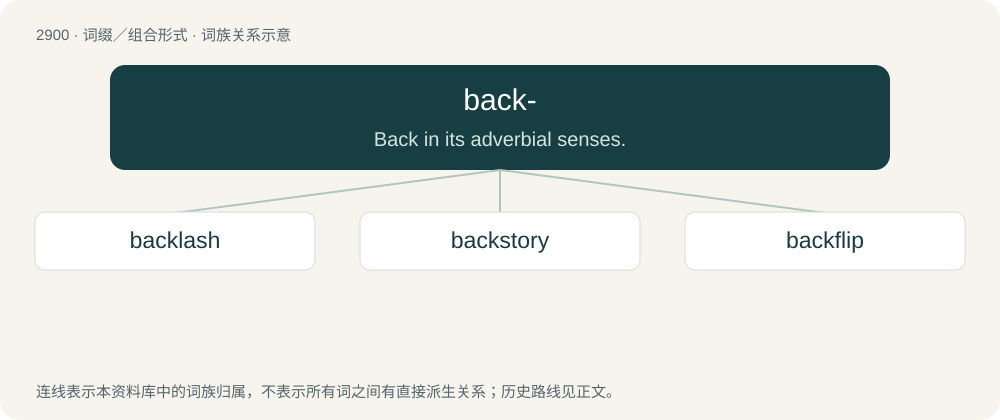

# 3011 · back- — Back in its adverbial senses.

[总目录](../00_总目录_按常用程度.md)

**类型**：词缀／组合形式　｜　**来源语言**：见词源记录

## 核心含义与来源

- 核心含义：Back in its adverbial senses.
- 英文含义：Back in its adverbial senses.
- 词形：back-

**来源记录 1**（前缀／前置成分；Back in its adverbial senses.）

From Middle English bak-, bac-, apheretic form of abak, aback (“aback”, adverb). See also aback.

## 词族图

## 单词速览（常用到不常用）

| 单词 | 音标 | 释义 |
|---|---|---|
| [backlash](#w-1) | /ˈbækˌlæʃ/ | n. 后冲, 强烈反对；\[电\] 反撞, 逆栅流 |
| [backstory](#w-2) | 英 /ˈbækˌstɔːɹi/；美 /ˈbækˌstɔɹi/ | （电影、小说等的）幕后故事, 故事背景 |
| [backflip](#w-3) | /ˈbæk.flɪp/ | n. 后翻式；后滚翻；倒翻筋斗；vi. 后空翻；表演后空翻 |

## 逐词详解

### 1. backlash

**词性**：名词　｜　**音标**：/ˈbækˌlæʃ/

**中文释义**：n. 后冲, 强烈反对；\[电\] 反撞, 逆栅流

**英文义项**：A suddenly reversed or backward motion, such as of a rope or elastic band when it snaps under tension. / A negative reaction, objection or outcry, especially of a violent or abrupt nature.

**构词拆分**：back- + lash

**词源与演化**：

From back- + lash.

**例句**：

> The public backlash to the proposal was quick and insistent.

该用例对应义项：A negative reaction, objection or outcry, especially of a violent or abrupt nature.

### 2. backstory

**词性**：名词　｜　**音标**：英 /ˈbækˌstɔːɹi/；美 /ˈbækˌstɔɹi/

**中文释义**：（电影、小说等的）幕后故事, 故事背景

**英文义项**：The previous experiences and life of a person, specifically (narratology, especially in film, television) a character in a dramatic work. / A fictitious account of a person's history designed to conceal their actual history and motives.

**构词拆分**：back- (prefix meaning ‘in, into, or towards the past’) + story

**词源与演化**：

From back- (prefix meaning ‘in, into, or towards the past’) + story.

**例句**：

> What’s the backstory of our new colleague?

该用例对应义项：The previous experiences and life of a person, specifically (narratology, especially in film, television) a character in a dramatic work.

### 3. backflip

**词性**：名词　｜　**音标**：/ˈbæk.flɪp/

**中文释义**：n. 后翻式；后滚翻；倒翻筋斗；vi. 后空翻；表演后空翻

**英文义项**：An act of rotating one's body 360 degrees in the backward direction. / A total reversal in policy or opinion.

**构词拆分**：back- + flip

**词源与演化**：

From back- + flip.

**例句**：

> The gymnast performed a backflip on a trampoline.

该用例对应义项：An act of rotating one's body 360 degrees in the backward direction.
