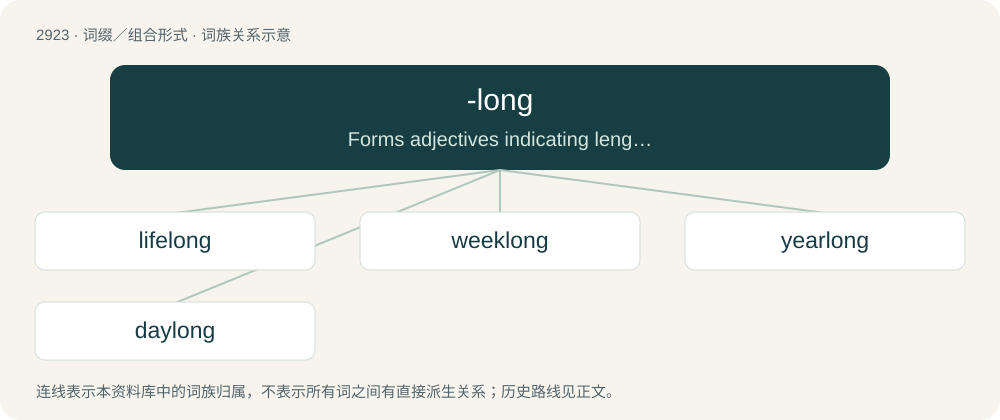

# 3034 · -long — Forms adjectives indicating length or duration when suffixed to nouns.

[总目录](../00_总目录_按常用程度.md)

**类型**：词缀／组合形式　｜　**来源语言**：见词源记录

## 核心含义与来源

- 核心含义：Forms adjectives indicating length or duration when suffixed to nouns.
- 英文含义：Forms adjectives indicating length or duration when suffixed to nouns.
- 词形：-long

**来源记录 1**（后缀／后置成分；Forms adjectives indicating length or duration when suffixed to nouns.）

From long.

## 词族图

## 单词速览（常用到不常用）

| 单词 | 音标 | 释义 |
|---|---|---|
| [lifelong](#w-1) | /ˈlaɪf.lɔːŋ/ | a. 终身的, 毕生的 |
| [weeklong](#w-2) | /ˈwiːklɔŋ;-lɔːŋ/ | a. 为时一周的,持续一星期的 |
| [yearlong](#w-3) | /ˈjəːlɔŋ/ | a. 持续一年的, 整整一年的 |
| [daylong](#w-4) | /ˈdeilɒŋ/ | a. 终日的, 一整天的；adv. 终日, 一整天 |

## 逐词详解

### 1. lifelong

**词性**：形容词　｜　**音标**：/ˈlaɪf.lɔːŋ/

**中文释义**：a. 终身的, 毕生的

**英文义项**：Extending for the entire duration of life.

**构词拆分**：life + -long

**词源与演化**：

From life + -long.

**例句**：

> They were lifelong friends; they met in elementary school and ended their lives in the same rest home.

该用例对应义项：Extending for the entire duration of life.

### 2. weeklong

**词性**：形容词　｜　**音标**：/ˈwiːklɔŋ;-lɔːŋ/

**中文释义**：a. 为时一周的,持续一星期的

**英文义项**：Lasting for (approximately) one week.

**构词拆分**：week + -long

**词源与演化**：

From week + -long.

### 3. yearlong

**词性**：形容词　｜　**音标**：/ˈjəːlɔŋ/

**中文释义**：a. 持续一年的, 整整一年的

**英文义项**：Lasting one year; of a timespan of one year. / Which lasts throughout every year; which is not seasonal

**构词拆分**：year + -long

**词源与演化**：

From year + -long.

### 4. daylong

**词性**：形容词　｜　**音标**：/ˈdeilɒŋ/

**中文释义**：a. 终日的, 一整天的；adv. 终日, 一整天

**英文义项**：Which lasts a day, or approximately so.

**构词拆分**：day + -long

**词源与演化**：

From day + -long.

**例句**：

> Everyone was somewhat tired after the daylong flight.
