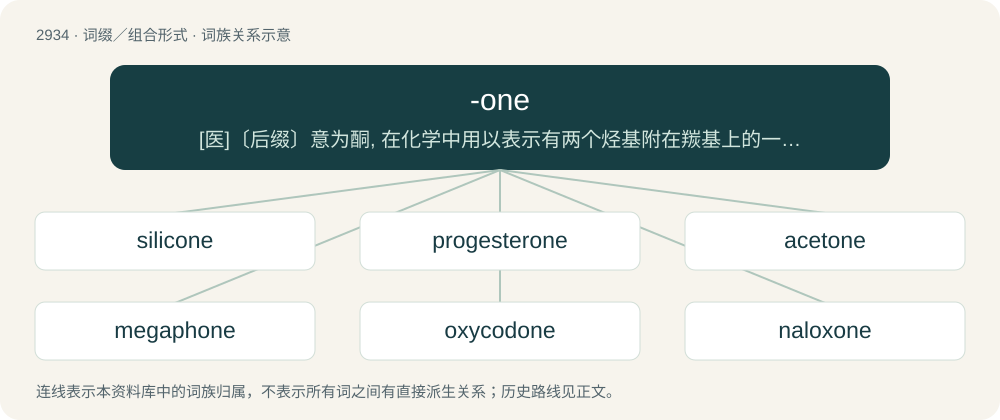

# 3044 · -one — \[医\]〔后缀〕意为酮, 在化学中用以表示有两个烃基附在羰基上的一种化合物

[总目录](../00_总目录_按常用程度.md)

**类型**：词缀／组合形式　｜　**来源语言**：见词源记录

## 核心含义与来源

- 核心含义：\[医\]〔后缀〕意为酮, 在化学中用以表示有两个烃基附在羰基上的一种化合物
- 英文含义：a ketone
- 词形：-one

**来源记录 1**（后缀／后置成分；a ketone）

Clipping of ketone, which was analogous to margarone. Further etymology is unclear.

## 词族图

## 单词速览（常用到不常用）

| 单词 | 音标 | 释义 |
|---|---|---|
| [silicone](#w-1) | /ˈsɪlɪkəʊn/ | n. 硅树脂；\[化\] 硅氧烷; 聚硅氧烷 |
| [progesterone](#w-2) | 英 /pɹəˈd͡ʒɛstəɹəʊn/；美 /pɹoʊˈd͡ʒɛstəˌɹoʊn/ | n. 孕酮, 孕激素；\[化\] 孕甾酮 |
| [acetone](#w-3) | 美 /ˈæ.sə.toʊn/ | n. 丙酮；\[化\] 丙酮 |
| [megaphone](#w-4) | 英 /ˈmɛɡ.əˌfəʊn/；美 /ˈmɛɡəˌfoʊn/ | 【英文】A cytotoxic neolignan obtained from the laurel Aniba megaphylla. |
| [oxycodone](#w-5) | 英 /ˌɒk.siˈkəʊ.dəʊn/；美 /ˌɑk.siˈkoʊˌdoʊn/ | \[化\] 羟考酮; 14-羟基二氢可待因酮；\[医\] 氧可酮, 14-羟基二氧可待因酮 |
| [naloxone](#w-6) | 英 /nəˈlɒk.səʊn/；美 /nəˈlɑkˌsoʊn/ | \[化\] 纳洛酮 |
| [hydrocodone](#w-7) | 美 /ˌhaɪ.dɹoʊˈkoʊˌdoʊn/ | \[化\] 氢可酮; 二氢可待因酮 |
| [spironolactone](#w-8) | 英 /ˌspʌɪ.ɹən.ə(ʊ)ˈlæk.təʊn/；美 /ˌspaɪ.ɹən.oʊˈlækˌtoʊn/ | n. \[药\]安体舒通,螺内酯,螺旋内酯甾酮(一种利尿药) |
| [dione](#w-9) |  | 【英文】diketone |
| [arachidonic](#w-10) | 英 /əˌɹak.ɪˈdɒn.ɪk/；美 /əˌɹæ.kəˈdɑ.nɪk/ | a. 花生四烯酸 |

## 逐词详解

### 1. silicone

**词性**：动词　｜　**音标**：/ˈsɪlɪkəʊn/

**中文释义**：n. 硅树脂；\[化\] 硅氧烷; 聚硅氧烷

**英文义项**：To join or treat (something) with a silicone-based product. / To enhance or reconstruct (a body part) with a prosthesis containing silicone.

**构词拆分**：silicon + -one

**词源与演化**：

From silicon + -one. Originally obtained by the attempted synthesis of the silicon equivalent of a ketone.

**用法示例／搭配（非完整句）**：

> silicone the bathtub to the tile

该用例对应义项：To join or treat (something) with a silicone-based product.

### 2. progesterone

**词性**：名词　｜　**音标**：英 /pɹəˈd͡ʒɛstəɹəʊn/；美 /pɹoʊˈd͡ʒɛstəˌɹoʊn/

**中文释义**：n. 孕酮, 孕激素；\[化\] 孕甾酮

**英文义项**：A steroid hormone, secreted by the ovaries, whose function is to prepare the uterus for the implantation of a fertilized ovum and to maintain pregnancy. / A synthetic version of the compound, used in contraceptive pills and other pharmaceutical products.

**构词拆分**：pro- + -one

**词源与演化**：

From pro- + Latin gestāre (“to bear, to carry”) + English -one.

**例句**：

> I always confuse estrogen with progesterone.

### 3. acetone

**词性**：名词　｜　**音标**：美 /ˈæ.sə.toʊn/

**中文释义**：n. 丙酮；\[化\] 丙酮

**英文义项**：A colourless, volatile, flammable liquid ketone, (CH₃)₂CO, used as a solvent.

**构词拆分**：acet- + -one

**词源与演化**：

From acet- from acētum (“vinegar”). The -one was taken from margarone but further etymology is unclear. Doublet of ketone.

**例句**：

> I think I forgot to rinse the condenser with acetone.

### 4. megaphone

**词性**：名词　｜　**音标**：英 /ˈmɛɡ.əˌfəʊn/；美 /ˈmɛɡəˌfoʊn/

**英文义项**：A cytotoxic neolignan obtained from the laurel Aniba megaphylla.

**构词拆分**：+ -one

**词源与演化**：

Named for the root Aniba megaphylla + -one.

### 5. oxycodone

**词性**：名词　｜　**音标**：英 /ˌɒk.siˈkəʊ.dəʊn/；美 /ˌɑk.siˈkoʊˌdoʊn/

**中文释义**：\[化\] 羟考酮; 14-羟基二氢可待因酮；\[医\] 氧可酮, 14-羟基二氧可待因酮

**英文义项**：An addictive, semisynthetic opioid (trademark OxyContin) that is similar to morphine in effect and structure; C₁₈H₂₁NO₄.

**构词拆分**：hydroxy + codeine + -one

**词源与演化**：

From (hydr)oxy + cod(eine) + -one.

### 6. naloxone

**词性**：名词　｜　**音标**：英 /nəˈlɒk.səʊn/；美 /nəˈlɑkˌsoʊn/

**中文释义**：\[化\] 纳洛酮

**英文义项**：An opioid inverse agonist used to counter the effects of an overdose on opioids (such as heroin or morphine).

**构词拆分**：nal- + hydroxy + -one

**词源与演化**：

From nal- (“opioid receptor antagonist/agonist”) + (hydr)ox(y) + -one.

**例句**：

> Naloxone is a life-saving drug that can reverse the effects of an opioid overdose.

### 7. hydrocodone

**词性**：名词　｜　**音标**：美 /ˌhaɪ.dɹoʊˈkoʊˌdoʊn/

**中文释义**：\[化\] 氢可酮; 二氢可待因酮

**英文义项**：A habit-forming compound that is derived from codeine and is administered in the form of its bitartrate C₁₈H₂₁NO₃·C₄H₆O₆ usually in combination with other drugs (as acetaminophen) as an analgesic or antitussive.

**构词拆分**：dihydro + codeine + -one

**词源与演化**：

From (di)hydro + cod(eine) + -one.

### 8. spironolactone

**词性**：名词　｜　**音标**：英 /ˌspʌɪ.ɹən.ə(ʊ)ˈlæk.təʊn/；美 /ˌspaɪ.ɹən.oʊˈlækˌtoʊn/

**中文释义**：n. \[药\]安体舒通,螺内酯,螺旋内酯甾酮(一种利尿药)

**英文义项**：A steroid drug which acts as an antimineralocorticoid (for which purpose it is used in the treatment of certain types of edema and hypertension) and an antiandrogen (for which purpose it is used as part of some types of hormone therapy, especially for transgender women).

**构词拆分**：spiro- + -one + -o- + lactone

**词源与演化**：

From spiro- + -one + -o- + lactone.

### 9. dione

**词性**：名词

**英文义项**：diketone

**构词拆分**：di- + -one

**词源与演化**：

From di- + -one.

### 10. arachidonic

**词性**：形容词　｜　**音标**：英 /əˌɹak.ɪˈdɒn.ɪk/；美 /əˌɹæ.kəˈdɑ.nɪk/

**中文释义**：a. 花生四烯酸

**英文义项**：Of or pertaining to arachidonic acid or its derivatives.

**构词拆分**：New Latin arachis (“peanut”) + -one + -ic

**词源与演化**：

Formed irregularly from arachidic, from New Latin arachis (“peanut”) + -one + -ic
