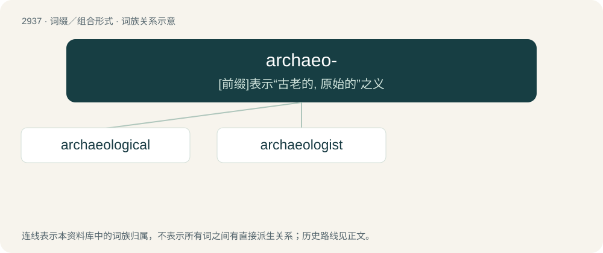

# 3046 · archaeo- — \[前缀\]表示“古老的, 原始的”之义

[总目录](../00_总目录_按常用程度.md)

**类型**：词缀／组合形式　｜　**来源语言**：见词源记录

## 核心含义与来源

- 核心含义：\[前缀\]表示“古老的, 原始的”之义
- 英文含义：ancient, early, primitive.
- 词形：archaeo-

**来源记录 1**（前缀／前置成分；ancient, early, primitive.）

Derived from Ancient Greek ᾰ̓ρχαῖος (ărkhaîos).

## 词族图

## 单词速览（常用到不常用）

| 单词 | 音标 | 释义 |
|---|---|---|
| [archaeological](#w-1) | /.ɑːkiəˈlɒdʒikl/ | a. 考古学的, 考古学上的 |
| [archaeologist](#w-2) | 英 /ˌɑː.kiˈɒl.ə.d͡ʒɪst/；美 /ˌɑɹ.kiˈɑ.lə.d͡ʒɪst/ | n. 考古学家 |

## 逐词详解

### 1. archaeological

**词性**：形容词　｜　**音标**：/.ɑːkiəˈlɒdʒikl/

**中文释义**：a. 考古学的, 考古学上的

**英文义项**：Relating to the science or research of archaeology.

**构词拆分**：archaeology + -ical + archaeo- + -logical

**词源与演化**：

From archaeology + -ical. By surface analysis, archaeo- + -logical.

**例句**：

> A dramatic archaeological discovery.

该用例对应义项：related to or dealing with or devoted to archaeology

### 2. archaeologist

**词性**：名词　｜　**音标**：英 /ˌɑː.kiˈɒl.ə.d͡ʒɪst/；美 /ˌɑɹ.kiˈɑ.lə.d͡ʒɪst/

**中文释义**：n. 考古学家

**英文义项**：Someone who studies or practises archaeology.

**构词拆分**：archaeology + -ist + archaeo- + -logist

**词源与演化**：

From archaeolog(y) + -ist. By surface analysis, archaeo- + -logist.

**例句**：

> This female archaeologist is interested in the daily life of ordinary people.
