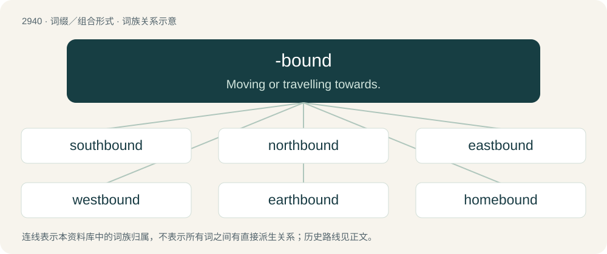

# 3048 · -bound — Moving or travelling towards.

[总目录](../00_总目录_按常用程度.md)

**类型**：词缀／组合形式　｜　**来源语言**：见词源记录

## 核心含义与来源

- 核心含义：Moving or travelling towards.
- 英文含义：Moving or travelling towards.
- 词形：-bound

**来源记录 1**（后缀／后置成分；Moving or travelling towards.）

From bound (“obliged to, certain to”).

## 词族图

## 单词速览（常用到不常用）

| 单词 | 音标 | 释义 |
|---|---|---|
| [southbound](#w-1) | /ˈsaʊθbaʊnd/ | a. 向南行的, 向南行驶的 |
| [northbound](#w-2) | 美 /ˈnɔɹθbaʊnd/ | a. 北行的 |
| [eastbound](#w-3) | 美 /ˈistbaʊnd/ | a. 往东的, 向东旅行的 |
| [westbound](#w-4) | /ˈwɛstbaʊnd/ | a. 向西行的, 向西驶的 |
| [earthbound](#w-5) | 美 /ˈɝθbaʊnd/ | a. 只在地球上的, 只在地面的, 只在陆地的, 世俗的, 平凡的, 缺乏想象力的 |
| [homebound](#w-6) | 美 /ˈhoʊmbaʊnd/ | a. 回家(乡)的, 回本国的 |
| [snowbound](#w-7) | 美 /ˈsnoʊˌbaʊnd/ | a. 被雪困住的, 被雪困在室内的, 被雪封住的 |

## 逐词详解

### 1. southbound

**词性**：形容词　｜　**音标**：/ˈsaʊθbaʊnd/

**中文释义**：a. 向南行的, 向南行驶的

**英文义项**：Which is (or will be) travelling south.

**构词拆分**：south + -bound

**词源与演化**：

From south + -bound.

**例句**：

> We took the southbound train to Barcelona.

该用例对应义项：Which is (or will be) travelling south.

### 2. northbound

**词性**：形容词　｜　**音标**：美 /ˈnɔɹθbaʊnd/

**中文释义**：a. 北行的

**英文义项**：Heading or moving in a northerly direction; or of infrastructure, intended for travelling northwards.

**构词拆分**：north + -bound

**词源与演化**：

From north + -bound.

**例句**：

> There are roadworks on the northbound carriageway.

该用例对应义项：Heading or moving in a northerly direction; or of infrastructure, intended for travelling northwards.

### 3. eastbound

**词性**：形容词　｜　**音标**：美 /ˈistbaʊnd/

**中文释义**：a. 往东的, 向东旅行的

**英文义项**：Moving or heading towards the east.

**构词拆分**：east + -bound

**词源与演化**：

From east + -bound.

**例句**：

> The eastbound train is late again!

该用例对应义项：Moving or heading towards the east.

### 4. westbound

**词性**：形容词　｜　**音标**：/ˈwɛstbaʊnd/

**中文释义**：a. 向西行的, 向西驶的

**英文义项**：Which is, or will be, moving towards the west.

**构词拆分**：west + -bound

**词源与演化**：

From west + -bound.

**例句**：

> Westbound traffic was blocked for miles.

该用例对应义项：Which is, or will be, moving towards the west.

### 5. earthbound

**词性**：形容词　｜　**音标**：美 /ˈɝθbaʊnd/

**中文释义**：a. 只在地球上的, 只在地面的, 只在陆地的, 世俗的, 平凡的, 缺乏想象力的

**英文义项**：Confined to the Earth; unable to leave Earth, either physically or spiritually. / Heading towards the planet Earth.

**构词拆分**：earth + -bound

**词源与演化**：

From earth + -bound.

### 6. homebound

**词性**：形容词　｜　**音标**：美 /ˈhoʊmbaʊnd/

**中文释义**：a. 回家(乡)的, 回本国的

**英文义项**：Being on one's way home: being homeward bound. / Confined to one's home, unable to leave it for some reason.

**构词拆分**：home + bound；home + -bound

**词源与演化**：

From home + bound or home + -bound.

**例句**：

> During the holiday season, the center's volunteers serve up meals-on-wheels, feeding homebound seniors and the homeless.

### 7. snowbound

**词性**：形容词　｜　**音标**：美 /ˈsnoʊˌbaʊnd/

**中文释义**：a. 被雪困住的, 被雪困在室内的, 被雪封住的

**英文义项**：Prevented from moving or traveling due to snow or snowy weather. / Of a location or other destination, inaccessible due to being covered in snow.

**构词拆分**：snow + -bound

**词源与演化**：

From snow + -bound.
