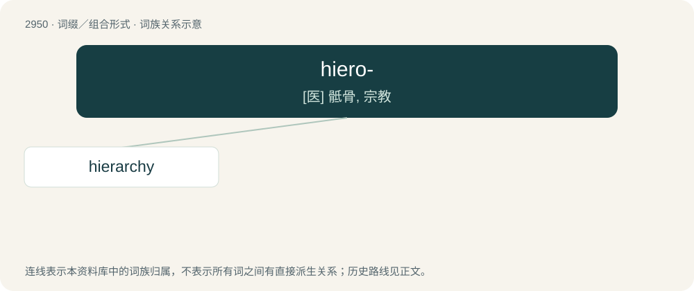

# 3057 · hiero- — \[医\] 骶骨, 宗教

[总目录](../00_总目录_按常用程度.md)

**类型**：词缀／组合形式　｜　**来源语言**：见词源记录

## 核心含义与来源

- 核心含义：\[医\] 骶骨, 宗教
- 英文含义：Holy, sacred.
- 词形：hiero-

**来源记录 1**（前缀／前置成分；Holy, sacred.）

From Ancient Greek ἱερο- (hiero-), from ἱερός (hierós, “sacred, holy”).

## 词族图

## 单词速览（常用到不常用）

| 单词 | 音标 | 释义 |
|---|---|---|
| [hierarchy](#w-1) | /ˈhaɪ.ə.ɹɑː(ɹ).ki/ | n. 等级制度, 僧侣统治, 等级体系；\[计\] 分级结构; 分层结构; 新闻组, 新闻组分层 |

## 逐词详解

### 1. hierarchy

**词性**：名词　｜　**音标**：/ˈhaɪ.ə.ɹɑː(ɹ).ki/

**中文释义**：n. 等级制度, 僧侣统治, 等级体系；\[计\] 分级结构; 分层结构; 新闻组, 新闻组分层

**英文义项**：A body of authoritative officials organized in nested ranks. / A social, religious, economic or political system or organization in which people or groups of people are ranked with some superior to others based on their status, authority or some other trait.

**构词拆分**：hiero- + -archy

**词源与演化**：

From Middle English ierarchie, jerarchie, from Old French ierarchie, jerarchie, from Late Latin ierarchia, from Latin hierarchia, from Ancient Greek ἱεραρχία (hierarkhía, “rule of a high priest”), from ἱεράρχης (hierárkhēs, “high priest”), from ἱερός (hierós, “holy”) + ἄρχω (árkhō, “to rule”), equivalent to hiero- + -archy. The H was re-added c. 1500 due to influence from Classical Latin.

**例句**：

> Put honesty first in her hierarchy of values.

该用例对应义项：a series of ordered groupings of people or things within a system
