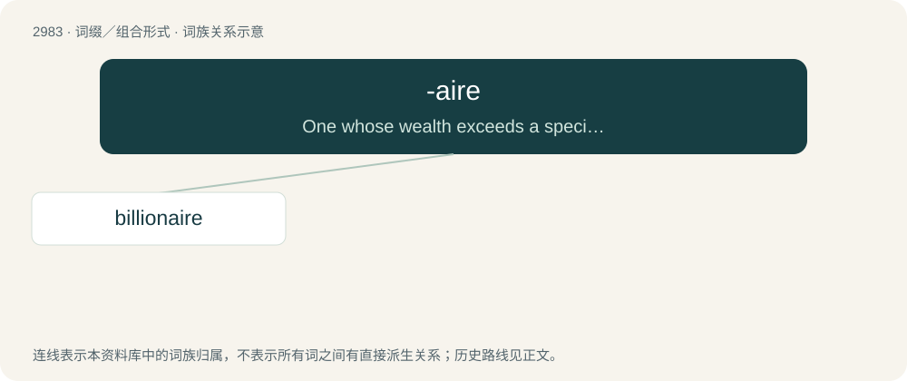

# 3084 · -aire — One whose wealth exceeds a specific number of units in the local currency.

[总目录](../00_总目录_按常用程度.md)

**类型**：词缀／组合形式　｜　**来源语言**：见词源记录

## 核心含义与来源

- 核心含义：One whose wealth exceeds a specific number of units in the local currency.
- 英文含义：One whose wealth exceeds a specific number of units in the local currency.
- 词形：-aire

**来源记录 1**（后缀／后置成分；One whose wealth exceeds a specific number of units in the local currency.）

Rebracketing of millionaire, which was, in turn, borrowed from French millionnaire.

## 词族图

## 单词速览（常用到不常用）

| 单词 | 音标 | 释义 |
|---|---|---|
| [billionaire](#w-1) | 英 /ˌbɪl.i.əˈnɛə(ɹ)/；美 /ˌbɪl.jəˈnɛɚ/ | n. 亿万富翁 |

## 逐词详解

### 1. billionaire

**词性**：名词　｜　**音标**：英 /ˌbɪl.i.əˈnɛə(ɹ)/；美 /ˌbɪl.jəˈnɛɚ/

**中文释义**：n. 亿万富翁

**英文义项**：Somebody whose wealth is at least one billion (10⁹) currency units (usually understood to exclude holders of hyperinflated currencies).

**构词拆分**：billion + -aire

**词源与演化**：

From billion + -aire.

**例句**：

> You too can easily become a millionaire... if you are a billionaire.
