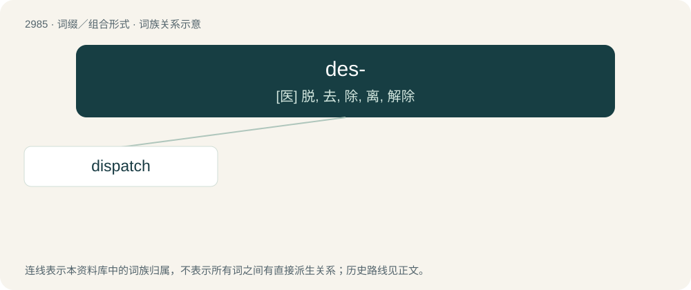

# 3085 · des- — \[医\] 脱, 去, 除, 离, 解除

[总目录](../00_总目录_按常用程度.md)

**类型**：词缀／组合形式　｜　**来源语言**：见词源记录

## 核心含义与来源

- 核心含义：\[医\] 脱, 去, 除, 离, 解除
- 英文含义：A removal of a group from a molecule.
- 词形：des-

**来源记录 1**（前缀／前置成分；A removal of a group from a molecule.）

From Middle English des-, dis-, from Old French des-, from Latin dis-.

## 词族图

## 单词速览（常用到不常用）

| 单词 | 音标 | 释义 |
|---|---|---|
| [dispatch](#w-1) | 英 /dɪˈspæt͡ʃ/；美 /dɪˈspæt͡ʃ/ | vt. 派遣；n. 派遣, 急件；\[计\] 调度 |

## 逐词详解

### 1. dispatch

**词性**：名词　｜　**音标**：英 /dɪˈspæt͡ʃ/；美 /dɪˈspæt͡ʃ/

**中文释义**：vt. 派遣；n. 派遣, 急件；\[计\] 调度

**英文义项**：A message sent quickly, as a shipment, a prompt settlement of a business, or an important official message sent by a diplomat, government official, military officer, etc. / The act of doing something quickly.

**词源与演化**：

Borrowed from Spanish despachar and/or Italian dispacciare. Further etymology is uncertain. For first element des-, see dis-. Second element probably from either Vulgar Latin \*pactāre (“to fasten"”), \*pactiare or Latin -pedicāre (“to entrap, shackle”), from pedica, from pēs. Ultimately related to impeach through shared Latin root. The first known use in writing (in the past tense, spelled as dispached) is by Bishop Cuthbert Tunstall in 1517. This would be unusually early for a borrowing from a Romance language other than French, but Tunstall had studied in Italy and was Commissioner to Spain, so this word may have been borrowed through diplomatic circles. The alternative spelling despatch was introduced in Samuel Johnson's dictionary, probably by accident. Compare typologically deliver (for the meaning to bring or transport) (&lt; Latin dē- + līberō).

**例句**：

> We must act with dispatch in this matter.

该用例对应义项：The act of doing something quickly.
