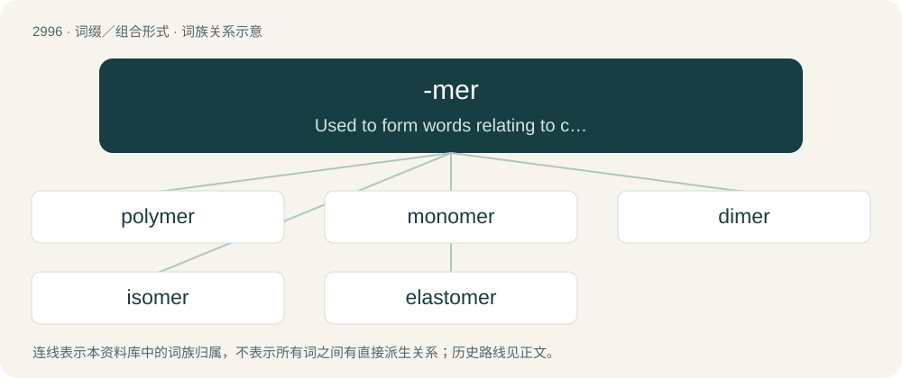

# 3101 · -mer — Used to form words relating to chemical structure, denoting parts of a molecule, for example, monomer (one part), dimer (two parts), polymer (many parts).

[总目录](../00_总目录_按常用程度.md)

**类型**：词缀／组合形式　｜　**来源语言**：见词源记录

## 核心含义与来源

- 核心含义：Used to form words relating to chemical structure, denoting parts of a molecule, for example, monomer (one part), dimer (two parts), polymer (many parts).
- 英文含义：Used to form words relating to chemical structure, denoting parts of a molecule, for example, monomer (one part), dimer (two parts), polymer (many parts).
- 词形：-mer

## 词族图

## 单词速览（常用到不常用）

| 单词 | 音标 | 释义 |
|---|---|---|
| [polymer](#w-1) | 英 /ˈpɒl.ɪ.mə/；美 /ˈpɑ.lɪ.mɚ/ | n. 聚合物, 聚合体；\[化\] 多聚体; 高分子; 大分子; 聚合物 |
| [monomer](#w-2) | 英 /ˈmɒnəmə/；美 /ˈmɑnəmɚ/ | n. 单体；\[化\] 单体 |
| [dimer](#w-3) | /ˈdaɪmə(ɹ)/ | n. 二聚物；\[化\] 二聚物; 二分子聚合物 |
| [isomer](#w-4) | 英 /ˈaɪ.sə.mə/；美 /ˈaɪ.sə.mɚ/ | n. 异构体；\[化\] 异构体 |
| [elastomer](#w-5) | /ɪˈlæstəmə(ɹ)/ | \[化\] 高弹体; 弹性体 |

## 逐词详解

### 1. polymer

**词性**：名词　｜　**音标**：英 /ˈpɒl.ɪ.mə/；美 /ˈpɑ.lɪ.mɚ/

**中文释义**：n. 聚合物, 聚合体；\[化\] 多聚体; 高分子; 大分子; 聚合物

**英文义项**：A long or larger molecule consisting of a chain or network of many repeating units, formed by chemically bonding together many identical or similar small molecules called monomers. A polymer is formed by polymerization, the joining of many monomer molecules. / A material consisting of such polymer molecules.

**构词拆分**：poly- + -mer

**词源与演化**：

From poly- + -mer, from Ancient Greek πολύς (polús, “many”) + μέρος (méros, “part”). Coined by Jöns Jacob Berzelius in 1833, though his definition was quite different from the modern one.

**例句**：

> The elasticity of this polymer isn't the best suited to our ends.

### 2. monomer

**词性**：名词　｜　**音标**：英 /ˈmɒnəmə/；美 /ˈmɑnəmɚ/

**中文释义**：n. 单体；\[化\] 单体

**英文义项**：A relatively small molecule which can be covalently bonded to other monomers to form a polymer or oligomer.

**构词拆分**：mono- + -mer

**词源与演化**：

From mono- + -mer.

### 3. dimer

**词性**：名词　｜　**音标**：/ˈdaɪmə(ɹ)/

**中文释义**：n. 二聚物；\[化\] 二聚物; 二分子聚合物

**英文义项**：A molecule consisting of two identical halves, formed by joining two identical molecules, sometimes with a single atom acting as a bridge.

**构词拆分**：di- + -mer

**词源与演化**：

From di- + -mer.

### 4. isomer

**词性**：名词　｜　**音标**：英 /ˈaɪ.sə.mə/；美 /ˈaɪ.sə.mɚ/

**中文释义**：n. 异构体；\[化\] 异构体

**英文义项**：Any of two or more compounds with the same molecular formula but with different structure. / Any of two or more atomic nuclei with the same mass number and atomic number but with different radioactive properties.

**构词拆分**：iso- + -mer

**词源与演化**：

From iso- + -mer.

### 5. elastomer

**词性**：名词　｜　**音标**：/ɪˈlæstəmə(ɹ)/

**中文释义**：\[化\] 高弹体; 弹性体

**英文义项**：Any polymer having the elastic properties of rubber.

**构词拆分**：elastic + -mer

**词源与演化**：

From elastic + -mer.
