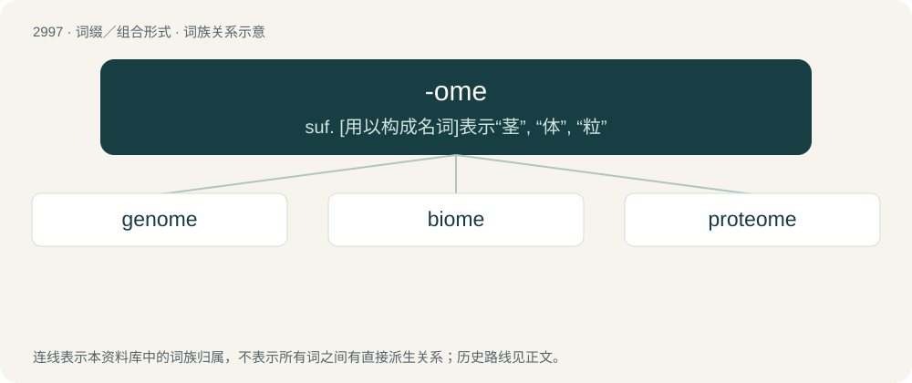

# 3102 · -ome — suf. \[用以构成名词\]表示“茎”, “体”, “粒”

[总目录](../00_总目录_按常用程度.md)

**类型**：词缀／组合形式　｜　**来源语言**：见词源记录

## 核心含义与来源

- 核心含义：suf. \[用以构成名词\]表示“茎”, “体”, “粒”
- 英文含义：A mass of something.
- 词形：-ome

**多个词源／构词路径**：同一拼写可能有不同来源；以下按词性和含义分别列出。

**来源记录 1**（后缀／后置成分；A mass of something.）

Alteration of -oma, from Ancient Greek -ωμα (-ōma). Only partially cognate to -some (“body”), from σῶμα (sôma, “body”), in that both share the case ending -μα (-ma), but the ω is unrelated.

**来源记录 2**（后缀／后置成分；The complete whole of a class of substances for a species or an individual.）

Back-formation from mitome, reinforced by chromosome. Early examples include biome (1916) and genome, from German Genom (1920). Some association with genetics due to occurrence in chromosome and genome.

## 词族图

## 单词速览（常用到不常用）

| 单词 | 音标 | 释义 |
|---|---|---|
| [genome](#w-1) | 英 /ˈd͡ʒiː.nəʊm/；美 /ˈd͡ʒiː.noʊm/ | \[化\] 基因组；\[医\] 染色体组 |
| [biome](#w-2) | /ˈbaɪ.oʊm/ | n. 生物群落区 |
| [proteome](#w-3) | 英 /ˈpɹəʊtɪəʊm/ | 蛋白质组 |

## 逐词详解

### 1. genome

**词性**：名词　｜　**音标**：英 /ˈd͡ʒiː.nəʊm/；美 /ˈd͡ʒiː.noʊm/

**中文释义**：\[化\] 基因组；\[医\] 染色体组

**英文义项**：The complete genetic information (either DNA or, in some viruses, RNA) of an organism.

**构词拆分**：By surface analysis, gen(e) + -ome

**词源与演化**：

From earlier genom, from German Genom, coined by German botanist Hans Winkler in 1920 as a blend of Gen (“gene”) + Chromosom (“chromosome”). By surface analysis, gen(e) + -ome, or a blend of gen(e) + (chromos)ome. Spelling altered to reflect the surface analysis.

**例句**：

> The human genome contains approximately three billion chemical base pairs.

该用例对应义项：the ordering of genes in a haploid set of chromosomes of a particular organism; the full DNA sequence of an organism

### 2. biome

**词性**：名词　｜　**音标**：/ˈbaɪ.oʊm/

**中文释义**：n. 生物群落区

**英文义项**：Any major regional biological community such as that of forest or desert. / All the genomes of such a community.

**构词拆分**：bio- + -ome

**词源与演化**：

From bio- + -ome.

**例句**：

> Alpine tundra is a biome or natural region at high elevation which does not contain trees.

### 3. proteome

**词性**：名词　｜　**音标**：英 /ˈpɹəʊtɪəʊm/

**中文释义**：蛋白质组

**英文义项**：The complete set of proteins encoded by a particular genome.

**构词拆分**：proteo- + -ome

**词源与演化**：

Blend of protein + genome or proteo- + -ome.
