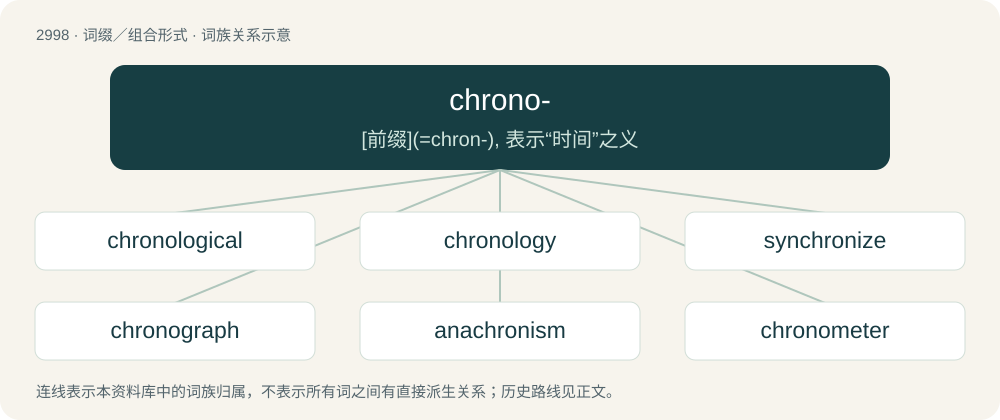

# 3103 · chrono- — \[前缀\](=chron-), 表示“时间”之义

[总目录](../00_总目录_按常用程度.md)

**类型**：词缀／组合形式　｜　**来源语言**：见词源记录

## 核心含义与来源

- 核心含义：\[前缀\](=chron-), 表示“时间”之义
- 英文含义：time
- 词形：chrono-

**来源记录 1**（前缀／前置成分；time）

Borrowed from Ancient Greek χρόνος (khrónos).

## 词族图

## 单词速览（常用到不常用）

| 单词 | 音标 | 释义 |
|---|---|---|
| [chronological](#w-1) | 英 /ˌkɹɒnəˈlɒd͡ʒɪkəl/；美 /ˌkɹɑnəˈlɑd͡ʒɪkəl/ | a. 年代学的, 按时间顺序的, 按照年月顺序的；\[计\] 编年的, 按年月日顺序的 |
| [chronology](#w-2) | 英 /kɹəˈnɒl.ə.d͡ʒi/；美 /kɹəˈnɑl.ə.d͡ʒi/ | n. 年代学, 资料按年月次序的排列, 按时间顺序编制的表格, 年表 |
| [synchronize](#w-3) | 英 /ˈsɪŋ.kɹəˌnaɪz/；美 /ˈsɪŋ.kɹəˌnaɪz/ | vt. 使同步, 使合拍；vi. 同时发生；\[计\] 同步 |
| [chronograph](#w-4) | 英 /ˈkɹɒ.nə.ɡɹɑːf/；美 /ˈkɹɑ.nəˌɡɹæf/ | n. 记时计, 秒表；\[医\] 微时计 |
| [anachronism](#w-5) | 英 /əˈnæ.kɹə.nɪ.z(ə)m/ | n. 时代错误, 不合潮流的人(物)；\[法\] 时代错误, 落伍的事物 |
| [chronometer](#w-6) | 英 /kɹəˈnɒm.ə.tə(ɹ)/；美 /krə(ʊ)ˈnɒmɪtər/ | n. 天文钟, 航海用的精密时计, 精密的时钟；\[化\] 精密记时计 |

## 逐词详解

### 1. chronological

**词性**：形容词　｜　**音标**：英 /ˌkɹɒnəˈlɒd͡ʒɪkəl/；美 /ˌkɹɑnəˈlɑd͡ʒɪkəl/

**中文释义**：a. 年代学的, 按时间顺序的, 按照年月顺序的；\[计\] 编年的, 按年月日顺序的

**英文义项**：Relating to time, or units of time. / In order of time from the earliest to the latest.

**构词拆分**：chrono- + -logical + chronology + -ical；chrono- + -logical；chronology + -ical

**词源与演化**：

From chrono- + -logical or chronology + -ical.

**例句**：

> He is 67 in chronological age, but has the mind and body of someone 55.

该用例对应义项：Relating to time, or units of time.

### 2. chronology

**词性**：名词　｜　**音标**：英 /kɹəˈnɒl.ə.d͡ʒi/；美 /kɹəˈnɑl.ə.d͡ʒi/

**中文释义**：n. 年代学, 资料按年月次序的排列, 按时间顺序编制的表格, 年表

**英文义项**：The science of determining the order in which events occurred. / An arrangement of events into chronological order; called a timeline when involving graphical elements.

**构词拆分**：chrono- + -logy；chrono- (“relating to time”) + -logy (“study of, account of”)

**词源与演化**：

From chrono- (“relating to time”) + -logy (“study of, account of”), after New Latin chronologia from Ancient Greek χρόνος (khrónos, “time”) + λόγος (lógos, “reason, explanation”). Literally "time reason" in Modern Greek.

**例句**：

> The film's chronology is not entirely obvious, but can be worked out by the clothes the characters are wearing in the scenes.

该用例对应义项：An arrangement of events into chronological order; called a timeline when involving graphical elements.

### 3. synchronize

**词性**：动词　｜　**音标**：英 /ˈsɪŋ.kɹəˌnaɪz/；美 /ˈsɪŋ.kɹəˌnaɪz/

**中文释义**：vt. 使同步, 使合拍；vi. 同时发生；\[计\] 同步

**英文义项**：To occur at the same time or with coordinated timing. / To cause (video and audio) to play in a coordinated way.

**构词拆分**：syn- + chrono- + -ize

**词源与演化**：

From Ancient Greek συγχρονίζω (sunkhronízō), equivalent to syn- + chrono- + -ize.

**例句**：

> Let's synchronize our efforts.

该用例对应义项：make synchronous and adjust in time or manner

### 4. chronograph

**词性**：名词　｜　**音标**：英 /ˈkɹɒ.nə.ɡɹɑːf/；美 /ˈkɹɑ.nəˌɡɹæf/

**中文释义**：n. 记时计, 秒表；\[医\] 微时计

**英文义项**：A chronogram. / A device which marks or records time or time intervals.

**构词拆分**：chrono- + -graph

**词源与演化**：

From Ancient Greek χρονογράφος (khronográphos, “chronicler”). Equivalent to chrono- + -graph.

### 5. anachronism

**词性**：名词　｜　**音标**：英 /əˈnæ.kɹə.nɪ.z(ə)m/

**中文释义**：n. 时代错误, 不合潮流的人(物)；\[法\] 时代错误, 落伍的事物

**英文义项**：A chronological mistake; the erroneous dating of an event, circumstance, or object. / A person or thing which seems to belong to a different time or period of time.

**构词拆分**：ana- + chrono- + -ism

**词源与演化**：

From New Latin anachronismus, from Ancient Greek ἀναχρονισμός (anakhronismós), from ἀναχρονίζομαι (anakhronízomai, “referring to the wrong time”), from ἀνά (aná, “up against”) + χρονίζω (khronízō, “spending time”), from χρόνος (khrónos, “time”). Analyzable as ana- + chrono- + -ism.

**例句**：

> A soldier is an anachronism of which we must get rid.

### 6. chronometer

**词性**：名词　｜　**音标**：英 /kɹəˈnɒm.ə.tə(ɹ)/；美 /krə(ʊ)ˈnɒmɪtər/

**中文释义**：n. 天文钟, 航海用的精密时计, 精密的时钟；\[化\] 精密记时计

**英文义项**：A device for measuring time, particularly a precision mechanism for measuring time of day.

**构词拆分**：chrono- + -meter

**词源与演化**：

From chrono- + -meter, possibly after the model of earlier French chronomètre (“metronome”), ultimately from Ancient Greek χρόνος (khrónos, “time”) + μέτρον (métron, “meter, measuring device”).

**例句**：

> A wristwatch costs $20; a chronometer costs $20,000.

该用例对应义项：A device for measuring time, particularly a precision mechanism for measuring time of day.
