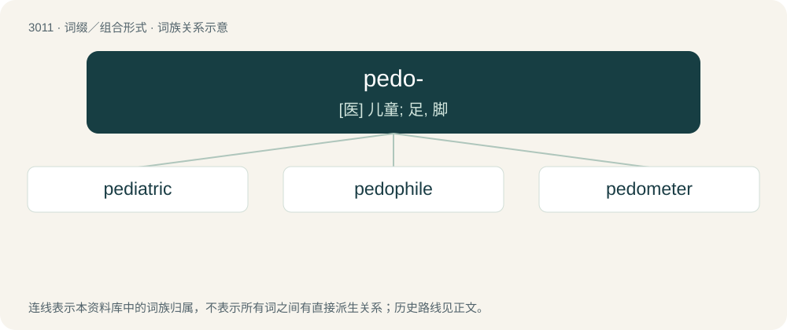

# 3116 · pedo- — \[医\] 儿童; 足, 脚

[总目录](../00_总目录_按常用程度.md)

**类型**：词缀／组合形式　｜　**来源语言**：见词源记录

## 核心含义与来源

- 核心含义：\[医\] 儿童; 足, 脚
- 英文含义：Relating to children.
- 词形：pedo-

**多个词源／构词路径**：同一拼写可能有不同来源；以下按词性和含义分别列出。

**来源记录 1**（前缀／前置成分；Relating to soil.）

Derived from Ancient Greek πέδον (pédon, “ground”).

**来源记录 2**（前缀／前置成分；Relating to feet.）

Derived from Latin pēs (“foot”).

## 词族图

## 单词速览（常用到不常用）

| 单词 | 音标 | 释义 |
|---|---|---|
| [pediatric](#w-1) | /ˌpiːdiːˈætrɪk/ | a. 小儿科的；\[医\] 儿科的 |
| [pedophile](#w-2) | 英 /ˈpiː.dəˌfaɪl/ | n. 恋童癖者 |
| [pedometer](#w-3) | 英 /pɪˈdɒmətə/；美 /pɪˈdɑmətɚ/ | n. 步数计, 步程计；\[医\] 婴儿测量器; 步数计 |

## 逐词详解

### 1. pediatric

**词性**：形容词　｜　**音标**：/ˌpiːdiːˈætrɪk/

**中文释义**：a. 小儿科的；\[医\] 儿科的

**英文义项**：Of or pertaining to pediatrics, the branch of medicine dealing with the care and treatment of children and adolescents.

**构词拆分**：pedo- (“child”) + -iatric

**词源与演化**：

From pedo- (“child”) + -iatric.

**例句**：

> The hospital has established a pediatric intensive care unit.

该用例对应义项：Of or pertaining to pediatrics, the branch of medicine dealing with the care and treatment of children and adolescents.

### 2. pedophile

**词性**：名词　｜　**音标**：英 /ˈpiː.dəˌfaɪl/

**中文释义**：n. 恋童癖者

**英文义项**：An adult or older adolescent who is sexually attracted to prepubescent children. / An adult who is sexually attracted to or engages in sexual acts with a child under the age of consent.

**构词拆分**：pedo- + -phile；pedo- (“child”) + -phile

**词源与演化**：

From pedo- (“child”) + -phile, after Ancient Greek παιδοφῐ́λης (paidophĭ́lēs) (from παῖς (paîs, “boy, child”) + φιλέω (philéō, “to love”)).

**例句**：

> Mennad strangled his cellmate because he was told he was a pedophile.

### 3. pedometer

**词性**：名词　｜　**音标**：英 /pɪˈdɒmətə/；美 /pɪˈdɑmətɚ/

**中文释义**：n. 步数计, 步程计；\[医\] 婴儿测量器; 步数计

**英文义项**：A device, often electronic, that measures the number of steps taken, and thus estimates the distance walked.

**构词拆分**：pedo- + -ometer

**词源与演化**：

According to the American Heritage Dictionary, from French pédomètre, from pedi-, combining form for Latin pēs (“foot”), plus -ometer, from Greek. In French now the word is podomètre, and similar in other Romance languages and in Greek (ποδόμετρο (podómetro)). By surface analysis, pedo- (“foot”) + -meter = pedo- + -ometer.

**例句**：

> He thought that buying a pedometer would spur him on to exercise.

该用例对应义项：A device, often electronic, that measures the number of steps taken, and thus estimates the distance walked.
