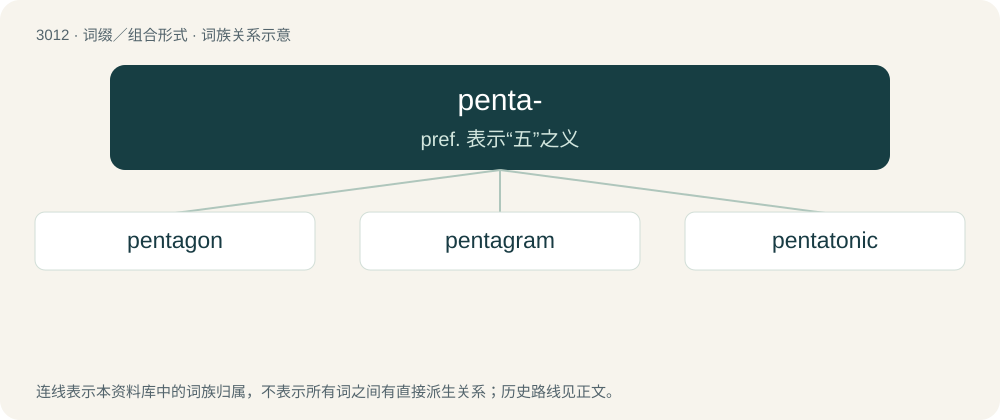

# 3117 · penta- — pref. 表示“五”之义

[总目录](../00_总目录_按常用程度.md)

**类型**：词缀／组合形式　｜　**来源语言**：见词源记录

## 核心含义与来源

- 核心含义：pref. 表示“五”之义
- 英文含义：Five.
- 词形：penta-

## 词族图

## 单词速览（常用到不常用）

| 单词 | 音标 | 释义 |
|---|---|---|
| [pentagon](#w-1) | 英 /ˈpɛn.tə.ɡən/；美 /ˈpɛn.təˌɡɑn/ | n. 五角形, 五边形；\[经\] 五角平台 |
| [pentagram](#w-2) | /ˈpɛn.təˌɡɹæm/ | n. 五角星形 |
| [pentatonic](#w-3) | /.pentəˈtɒnik/ | a. 五声(音阶)的 |

## 逐词详解

### 1. pentagon

**词性**：名词　｜　**音标**：英 /ˈpɛn.tə.ɡən/；美 /ˈpɛn.təˌɡɑn/

**中文释义**：n. 五角形, 五边形；\[经\] 五角平台

**英文义项**：A polygon with five sides and five angles. / A fort with five bastions.

**构词拆分**：penta- + -gon

**词源与演化**：

From Middle French pentagone, from Late Latin pentagōnum, from Ancient Greek πεντάγωνον (pentágōnon), noun use of the neuter of the adjective πεντάγωνος (pentágōnos, “five-angled”), from πέντε (pénte, “five”) + -γωνος (-gōnos, “angled”). Equivalent to penta- + -gon.

**例句**：

> I wear this tinfoil hat to keep the Pentagon from spying on me.

### 2. pentagram

**词性**：名词　｜　**音标**：/ˈpɛn.təˌɡɹæm/

**中文释义**：n. 五角星形

**英文义项**：The shape of a five-pointed star constructed of five intersecting lines meeting at the vertices, such that a central pentagon and five surrounding isosceles triangles are formed; often with magical connotations; a 5/2 (or 5/3) star polygon.

**构词拆分**：penta- + -gram

**词源与演化**：

From Ancient Greek πεντάγραμμον (pentágrammon), noun form of the adjectives πεντάγραμμος (pentágrammos) and πεντέγραμμος (pentégrammos, “five-lined, having five lines”). Equivalent to penta- + -gram.

**例句**：

> Ziri found a pentagram in the middle of the clearing.

### 3. pentatonic

**词性**：形容词　｜　**音标**：/.pentəˈtɒnik/

**中文释义**：a. 五声(音阶)的

**英文义项**：Based on five tones.

**构词拆分**：penta- + tonic

**词源与演化**：

From penta- + tonic.

**例句**：

> The middle movement is completely pentatonic, giving it an unusual sound.

该用例对应义项：Based on five tones.
