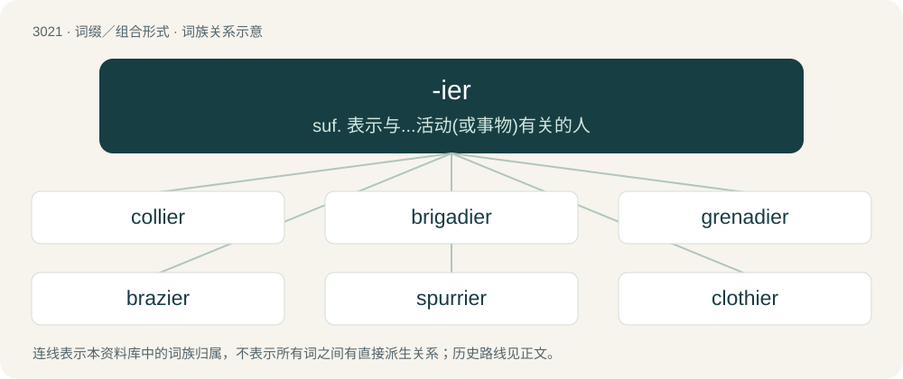

# 3123 · -ier — suf. 表示与...活动(或事物)有关的人

[总目录](../00_总目录_按常用程度.md)

**类型**：词缀／组合形式　｜　**来源语言**：见词源记录

## 核心含义与来源

- 核心含义：suf. 表示与...活动(或事物)有关的人
- 英文含义：spelling of the suffix sequence -y followed by -er, or of any word ending in -(e)y suffixed with -er.
- 词形：-ier

**多个词源／构词路径**：同一拼写可能有不同来源；以下按词性和含义分别列出。

**来源记录 1**（后缀／后置成分；spelling of the suffix sequence -y followed by -er, or of any word ending in -(e)y suffixed with -er.）

From -y + -er.

**来源记录 2**（后缀／后置成分；Forming nouns denoting occupations, particularly with words from French.）

From Middle English -ier, -iere from verbs ending in -ien + -ere, later extended to form other nouns (e.g. Middle English clothyer, glasiere, lovier, tiliere). Later reinforced by Middle French and modern French -ier, largely in words more recently borrowed from or influenced by French (e.g. cashier, financier, etc.). Doublet of -ar, -ary, -eer, and -yer.

## 词族图

## 单词速览（常用到不常用）

| 单词 | 音标 | 释义 |
|---|---|---|
| [collier](#w-1) | 英 /ˈkɒlɪə(ɹ)/；美 /ˈkɑliɚ/ | n. 煤矿工人, 运煤船, 运煤船员 |
| [brigadier](#w-2) | /bɹɪɡəˈdɪɚ/ | n. 陆军准将, 准将 |
| [grenadier](#w-3) | 英 /ɡɹɛnəˈdɪə/ | n. 手榴弹兵,\[军\]精锐部队的士兵 |
| [brazier](#w-4) | 英 /ˈbɹeɪ.ʒə(ɹ)/；美 /ˈbɹeɪ.ʒɚ/ | n. 火盆, 铜匠 |
| [spurrier](#w-5) | 英 /ˈspʌɹiə(ɹ)/；美 /ˈspɝɹiɚ/ | n. 马刺制造者 |
| [clothier](#w-6) | /ˈkloʊðiə(ɹ)/ | n. 布商, 衣商 |

## 逐词详解

### 1. collier

**词性**：名词　｜　**音标**：英 /ˈkɒlɪə(ɹ)/；美 /ˈkɑliɚ/

**中文释义**：n. 煤矿工人, 运煤船, 运煤船员

**英文义项**：A vessel carrying a bulk cargo of coal. / A sailor on such a vessel.

**构词拆分**：coal + -ier

**词源与演化**：

From Middle English colier, colyer, alteration of earlier coler, collere (“one who makes or sells charcoal”), from Old English \*colere (“collier”), equivalent to coal + -ier.

**例句**：

> The collier spent his days deep underground, mining coal in dangerous conditions.

### 2. brigadier

**词性**：名词　｜　**音标**：/bɹɪɡəˈdɪɚ/

**中文释义**：n. 陆军准将, 准将

**英文义项**：An army rank; an officer commanding a brigade. / A field officer of the highest grade, below general officers, NATO grade OF-7.

**构词拆分**：brigade + -ier

**词源与演化**：

Borrowed from French brigadier. Equivalent to brigade + -ier.

**例句**：

> Tom rose to the rank of brigadier before retiring from the army.

### 3. grenadier

**词性**：名词　｜　**音标**：英 /ɡɹɛnəˈdɪə/

**中文释义**：n. 手榴弹兵,\[军\]精锐部队的士兵

**英文义项**：A type of soldier, originally one who threw grenades, later a member of a company formed from the tallest men of the regiment; now specifically, a member of the Grenadier Guards of Canada and the United Kingdom. / Any of various African weaverbirds or waxbills, especially the common grenadier or the red bishop.

**构词拆分**：grenade + -ier

**词源与演化**：

From French grenadier, corresponding to grenade + -ier.

### 4. brazier

**词性**：名词　｜　**音标**：英 /ˈbɹeɪ.ʒə(ɹ)/；美 /ˈbɹeɪ.ʒɚ/

**中文释义**：n. 火盆, 铜匠

**英文义项**：A worker in brass; a brassworker.

**构词拆分**：By surface analysis, bras(s) + -ier

**词源与演化**：

From Middle English brasiere, from brasen (“to cover with brass”), from Old English brasian, bræsian (“to cover with brass”). By surface analysis, bras(s) + -ier.

**例句**：

> I lost this oblong Japanese brazier in an earthquake.

### 5. spurrier

**词性**：名词　｜　**音标**：英 /ˈspʌɹiə(ɹ)/；美 /ˈspɝɹiɚ/

**中文释义**：n. 马刺制造者

**英文义项**：A maker of spurs.

**构词拆分**：spur + -ier

**词源与演化**：

From Middle English sporiere; equivalent to spur + -ier.

### 6. clothier

**词性**：名词　｜　**音标**：/ˈkloʊðiə(ɹ)/

**中文释义**：n. 布商, 衣商

**英文义项**：A person who makes or sells cloth or clothing.

**构词拆分**：cloth + -ier

**词源与演化**：

From Middle English clothyer, an alteration of earlier clother, clothere (“a maker or seller of cloth”); equivalent to cloth + -ier.
