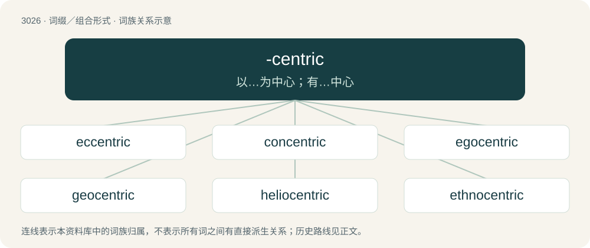

# 3127 · -centric — 以…为中心；有…中心

[总目录](../00_总目录_按常用程度.md)

**类型**：词缀／组合形式　｜　**来源语言**：见词源记录

## 核心含义与来源

- 核心含义：以…为中心；有…中心
- 英文含义：Having a specified number of centres.
- 词形：-centric

## 词族图

## 单词速览（常用到不常用）

| 单词 | 音标 | 释义 |
|---|---|---|
| [eccentric](#w-1) | /ɪkˈsɛntɹɪk/ | n. 怪人, 偏心圆；a. 古怪的, 反常的, 不同圆心的 |
| [concentric](#w-2) | /kənˈsɛn.tɹɪk/ | a. 同中心的, 同轴的；\[医\] 同心的, 共心的 |
| [egocentric](#w-3) | 英 /ˌiːɡəʊˈsɛntɹɪk/；美 /ˌiɡoʊˈsɛntɹɪk/ | a. 自我中心的, 利己主义的；n. 利己主义者 |
| [geocentric](#w-4) | 英 /ˌdʒiːəʊˈsɛntɹɪk/；美 /ˌd͡ʒioʊˈsɛntɹɪk/ | a. 以地球为中心的, 由地球中心所见成测量的 |
| [heliocentric](#w-5) | 英 /ˌhiːli.əʊˈsɛntɹɪk/；美 /ˌhiːlioʊˈsɛntɹɪk/ | a. 以太阳为中心的 |
| [ethnocentric](#w-6) | /,eθnəuˈsentrik/ | 种族\[民族\]中心主义的, 种族\[民族, 集团\]优越感的 |

## 逐词详解

### 1. eccentric

**词性**：形容词　｜　**音标**：/ɪkˈsɛntɹɪk/

**中文释义**：n. 怪人, 偏心圆；a. 古怪的, 反常的, 不同圆心的

**英文义项**：Not at or in the centre; away from the centre. / Not perfectly circular; elliptical.

**构词拆分**：ex- + -centric

**词源与演化**：

From Middle French excentrique, from Medieval Latin eccentricus, from Ancient Greek ἔκκεντρος (ékkentros, “not having the earth as the center of an orbit”), from ἐκ (ek, “out”) + κέντρον (kéntron, “point”). Equivalent to ex- + -centric.

**例句**：

> As of 2008, Margaret had the most eccentric orbit of any moon in the solar system, though Nereid's mean eccentricity is greater.

该用例对应义项：Not perfectly circular; elliptical.

### 2. concentric

**词性**：形容词　｜　**音标**：/kənˈsɛn.tɹɪk/

**中文释义**：a. 同中心的, 同轴的；\[医\] 同心的, 共心的

**英文义项**：Having a common center. / Of a motion, in the direction of contraction of a muscle. (e.g. the extension of the lower arm by means of the elbow joint while contracting the triceps and other elbow extensor muscles; closing of the jaw while flexing the masseter).

**构词拆分**：con- + -centric

**词源与演化**：

From Middle English concentrik, from Middle French concentrique, from Medieval Latin concentricus, from Latin con- (“with, together”) + centrum (“circle, center”). Equivalent to con- + -centric. By surface analysis, con- + centre + -ic.

**例句**：

> Can you draw two concentric circles using just your hands?

### 3. egocentric

**词性**：形容词　｜　**音标**：英 /ˌiːɡəʊˈsɛntɹɪk/；美 /ˌiɡoʊˈsɛntɹɪk/

**中文释义**：a. 自我中心的, 利己主义的；n. 利己主义者

**英文义项**：Selfish, self-centered, self-absorbed. / Egotistical.

**构词拆分**：ego + -centric

**词源与演化**：

From ego- + -centric.

**例句**：

> Our genetic material is being constantly invaded by small egocentric molecular parasites.

### 4. geocentric

**词性**：形容词　｜　**音标**：英 /ˌdʒiːəʊˈsɛntɹɪk/；美 /ˌd͡ʒioʊˈsɛntɹɪk/

**中文释义**：a. 以地球为中心的, 由地球中心所见成测量的

**英文义项**：Having the Earth at the center. / Of or relating to geocentrism, an obsolete cosmology which placed the Earth at the center of the universe.

**构词拆分**：geo- + -centric

**词源与演化**：

From geo- + -centric.

**用法示例／搭配（非完整句）**：

> a geocentric coordinate system

该用例对应义项：Having the Earth at the center.

### 5. heliocentric

**词性**：形容词　｜　**音标**：英 /ˌhiːli.əʊˈsɛntɹɪk/；美 /ˌhiːlioʊˈsɛntɹɪk/

**中文释义**：a. 以太阳为中心的

**英文义项**：Having the sun at the center/centre; usually in reference to a coordinate system or orbit. / Of or relating to heliocentrism.

**构词拆分**：helio- + -centric

**词源与演化**：

From helio- + -centric.

**用法示例／搭配（非完整句）**：

> a heliocentric coordinate system

该用例对应义项：Having the sun at the center/centre; usually in reference to a coordinate system or orbit.

### 6. ethnocentric

**词性**：形容词　｜　**音标**：/,eθnəuˈsentrik/

**中文释义**：种族\[民族\]中心主义的, 种族\[民族, 集团\]优越感的

**英文义项**：Of or pertaining to ethnocentrism.

**构词拆分**：ethno- + -centric

**词源与演化**：

From ethno- + -centric.

**例句**：

> The Abrahamic religions are deeply ethnocentric.
