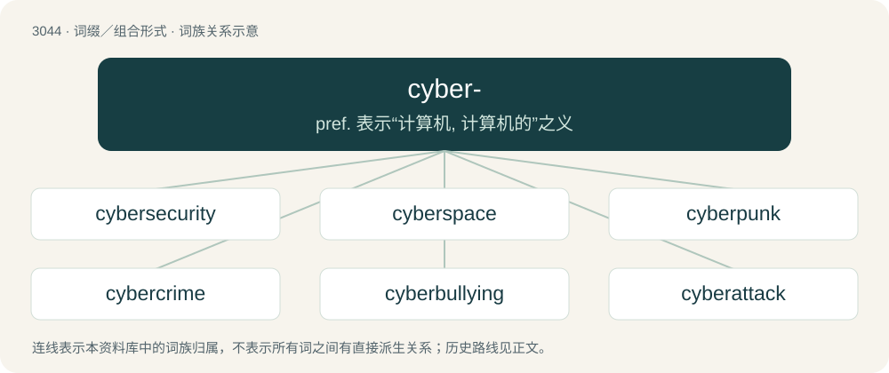

# 3144 · cyber- — pref. 表示“计算机, 计算机的”之义

[总目录](../00_总目录_按常用程度.md)

**类型**：词缀／组合形式　｜　**来源语言**：见词源记录

## 核心含义与来源

- 核心含义：pref. 表示“计算机, 计算机的”之义
- 英文含义：Relating to the Internet or cyberspace, or to computers more generally.
- 词形：cyber-

**来源记录 1**（前缀／前置成分；Relating to the Internet or cyberspace, or to computers more generally.）

From cybernetic.

## 词族图

## 单词速览（常用到不常用）

| 单词 | 音标 | 释义 |
|---|---|---|
| [cybersecurity](#w-1) | 英 /saɪbəsɪˈkjʊəɹɪtɪ/ | 【英文】Security against electronic attacks such as cyberwarfare or cyberterrorism. |
| [cyberspace](#w-2) | 英 /ˈsaɪ.bəˌspeɪs/；美 /ˈsaɪ.bəɹˌspeɪs/ | \[计\] 空间, 网控空间 |
| [cyberpunk](#w-3) | 英 /ˈsaɪ.bə.pʌŋk/；美 /ˈsaɪ.bɚˌpʌŋk/ | n. 计算机科幻小说； 网络黑客 |
| [cybercrime](#w-4) |  | n. 网络犯罪 |
| [cyberbullying](#w-5) |  | 网上欺凌 |
| [cyberattack](#w-6) | /ˈsaɪ.bə.ɹəˌtæk/ | 【英文】An attack or intrusion by means of a computer network such as the Internet, often for the purpose of spying. |
| [cybersex](#w-7) | 美 /ˈsaɪbɚsɛks/ | \[计\] 网控空间性行为 |
| [cyberwarfare](#w-8) |  | 【英文】Warfare taking place on the Internet, as by disrupting critical online services. |

## 逐词详解

### 1. cybersecurity

**词性**：名词　｜　**音标**：英 /saɪbəsɪˈkjʊəɹɪtɪ/

**英文义项**：Security against electronic attacks such as cyberwarfare or cyberterrorism.

**构词拆分**：cyber- + security

**词源与演化**：

From cyber- + security.

**例句**：

> Tom is one of the world's leading experts on cybersecurity.

### 2. cyberspace

**词性**：名词　｜　**音标**：英 /ˈsaɪ.bəˌspeɪs/；美 /ˈsaɪ.bəɹˌspeɪs/

**中文释义**：\[计\] 空间, 网控空间

**英文义项**：A world of information accessed through the Internet. / The Internet as a whole.

**构词拆分**：cyber- + space

**词源与演化**：

Blend of cybernetics + space, equivalent to cyber- + space, coined by American-Canadian speculative fiction writer William Gibson in his short story collection Burning Chrome (1982) and popularized in his novel Neuromancer (1984).

**例句**：

> Is the information superhighway in cyberspace, or does it merely take you there?

### 3. cyberpunk

**词性**：名词　｜　**音标**：英 /ˈsaɪ.bə.pʌŋk/；美 /ˈsaɪ.bɚˌpʌŋk/

**中文释义**：n. 计算机科幻小说； 网络黑客

**英文义项**：A subgenre of science fiction which focuses on computer or information technology and virtual reality juxtaposed with a degree of breakdown or radical change in the social order. / A cyberpunk character, a hacker punk, a high-tech low life.

**构词拆分**：cyber- + -punk

**词源与演化**：

From cyber- + -punk, coined by American writer and software developer Bruce Bethke as the title of a 1983 short story, and later popularized by Gardner Dozois.

**例句**：

> The film The Matrix redefined what a cyberpunk looked like.

该用例对应义项：A cyberpunk character, a hacker punk, a high-tech low life.

### 4. cybercrime

**词性**：名词

**中文释义**：n. 网络犯罪

**英文义项**：Crime committed using computer networks. / An individual crime of this kind.

**构词拆分**：cyber- + crime

**词源与演化**：

From cyber- + crime.

**例句**：

> I don't know if you realise this, but you're committing a cybercrime.

### 5. cyberbullying

**词性**：名词

**中文释义**：网上欺凌

**英文义项**：Acts in cyberspace intended to make life unpleasant for another person.

**构词拆分**：cyber- + bullying

**词源与演化**：

From cyber- + bullying.

**例句**：

> Sometimes I wonder when the first world championship in cyberbullying will take place.

### 6. cyberattack

**词性**：名词　｜　**音标**：/ˈsaɪ.bə.ɹəˌtæk/

**英文义项**：An attack or intrusion by means of a computer network such as the Internet, often for the purpose of spying.

**构词拆分**：cyber- + attack

**词源与演化**：

From cyber- + attack.

**例句**：

> The cyberattack affected hospitals, banks and companies around the world this year.

### 7. cybersex

**词性**：名词　｜　**音标**：美 /ˈsaɪbɚsɛks/

**中文释义**：\[计\] 网控空间性行为

**英文义项**：A virtual sexual encounter in which two or more persons connected remotely by means of a computer network send one another sexually explicit messages simulating a sexual experience.

**构词拆分**：cyber- + sex

**词源与演化**：

From cyber- + sex.

**例句**：

> I can have cybersex with you, for a price.

### 8. cyberwarfare

**词性**：名词

**英文义项**：Warfare taking place on the Internet, as by disrupting critical online services.

**构词拆分**：cyber- + warfare

**词源与演化**：

From cyber- + warfare.

**例句**：

> Contrary to the claims of politically opportunistic representatives, so-called "cyberwarfare" never causes anyone actual bodily harm.
