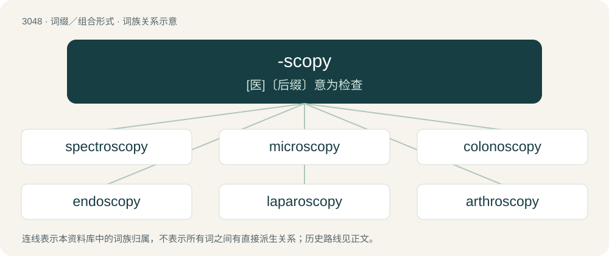

# 3147 · -scopy — \[医\]〔后缀〕意为检查

[总目录](../00_总目录_按常用程度.md)

**类型**：词缀／组合形式　｜　**来源语言**：见词源记录

## 核心含义与来源

- 核心含义：\[医\]〔后缀〕意为检查
- 英文含义：observation, viewing
- 词形：-scopy

**来源记录 1**（后缀／后置成分；observation, viewing）

From Ancient Greek σκοπέω (skopéō, “to see”).

## 词族图

## 单词速览（常用到不常用）

| 单词 | 音标 | 释义 |
|---|---|---|
| [spectroscopy](#w-1) | 英 /spɛkˈtɹɒs.kə.piː/；美 /spɛkˈtɹɑs.kə.pi/ | n. 光谱学；\[化\] 光谱学 |
| [microscopy](#w-2) | 英 /maɪˈkɹɒs.kə.pi/；美 /maɪˈkɹɑ.skə.pi/ | n. 显微镜使用, 用显微镜检查, 显微镜学；\[医\] 显微镜检查 |
| [colonoscopy](#w-3) | 英 /ˌkɒ.ləˈnɒ.skə.pi/；美 /kɑ.ləˈnɑ.skə.pi/ | n. 结肠镜检查；\[医\] 结肠镜检查 |
| [endoscopy](#w-4) | 美 /ɛnˈdɔ.skə.pi/ | \[医\] 内窥镜检查 |
| [laparoscopy](#w-5) | 英 /lapəˈɹɒskəpi/ | \[医\] 腹腔镜检查 |
| [arthroscopy](#w-6) | /ɑːˈθrɔskəpi/ | \[医\] 关节\[内窥\]镜检查 |

## 逐词详解

### 1. spectroscopy

**词性**：名词　｜　**音标**：英 /spɛkˈtɹɒs.kə.piː/；美 /spɛkˈtɹɑs.kə.pi/

**中文释义**：n. 光谱学；\[化\] 光谱学

**英文义项**：The scientific study of spectra. / The use of spectrometers in chemical analysis.

**构词拆分**：spectro- + -scopy

**词源与演化**：

From spectro- + -scopy.

**例句**：

> Professor Forrest F. Cleveland began publishing Molecular Spectroscopy entirely in Interlingua.

### 2. microscopy

**词性**：名词　｜　**音标**：英 /maɪˈkɹɒs.kə.pi/；美 /maɪˈkɹɑ.skə.pi/

**中文释义**：n. 显微镜使用, 用显微镜检查, 显微镜学；\[医\] 显微镜检查

**英文义项**：The study of microscopes, their design and manufacture. / The use of microscopes.

**构词拆分**：micro- + -scopy

**词源与演化**：

From micro- + -scopy.

### 3. colonoscopy

**词性**：名词　｜　**音标**：英 /ˌkɒ.ləˈnɒ.skə.pi/；美 /kɑ.ləˈnɑ.skə.pi/

**中文释义**：n. 结肠镜检查；\[医\] 结肠镜检查

**英文义项**：The examination of the colon using a colonoscope.

**构词拆分**：colono- + -scopy

**词源与演化**：

From colono- + -scopy.

**例句**：

> I had a colonoscopy and upper abdominal endoscopy.

### 4. endoscopy

**词性**：名词　｜　**音标**：美 /ɛnˈdɔ.skə.pi/

**中文释义**：\[医\] 内窥镜检查

**英文义项**：The examination of a bodily orifice, canal or organ using an endoscope.

**构词拆分**：endo- + -scopy

**词源与演化**：

From endo- + -scopy.

**例句**：

> If you're worried, go for an endoscopy to have it checked out.

### 5. laparoscopy

**词性**：名词　｜　**音标**：英 /lapəˈɹɒskəpi/

**中文释义**：\[医\] 腹腔镜检查

**英文义项**：Examination of the loins or abdomen, now specifically examination or surgery on the peritoneal cavity using a laparoscope.

**构词拆分**：laparo- (“flank”) + -scopy

**词源与演化**：

From laparo- (“flank”) + -scopy, after German Laparoskopie.

### 6. arthroscopy

**词性**：名词　｜　**音标**：/ɑːˈθrɔskəpi/

**中文释义**：\[医\] 关节\[内窥\]镜检查

**英文义项**：the examination of the interior of a joint (such as the knee) using an arthroscope

**构词拆分**：arthro- + -scopy

**词源与演化**：

From arthro- + -scopy.
