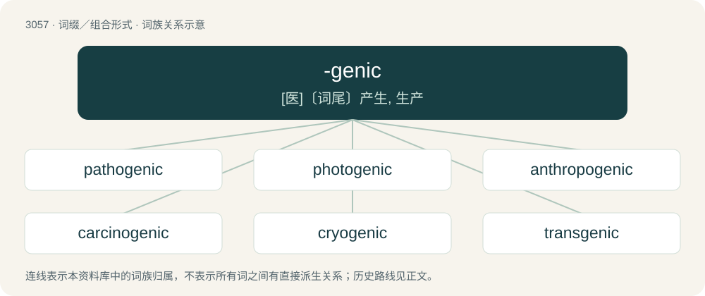

# 3153 · -genic — \[医\]〔词尾〕产生, 生产

[总目录](../00_总目录_按常用程度.md)

**类型**：词缀／组合形式　｜　**来源语言**：见词源记录

## 核心含义与来源

- 核心含义：\[医\]〔词尾〕产生, 生产
- 英文含义：Forms adjectives relating to things producing or generating something.
- 词形：-genic

**来源记录 1**（后缀／后置成分；Forms adjectives relating to things producing or generating something.）

Borrowed either from French -gène or directly from its etymological source, Ancient Greek -γενής (-genḗs, “offspring; kind”), with -ic. Compare -gen.

## 词族图

## 单词速览（常用到不常用）

| 单词 | 音标 | 释义 |
|---|---|---|
| [pathogenic](#w-1) | 美 /pæθəˈd͡ʒɛnɪk/ | a. 致病的, 成为病原的, 病原的；\[医\] 致病的, 病原的 |
| [photogenic](#w-2) | 英 /ˌfəʊ.təʊˈd͡ʒɛn.ɪk/；美 /ˌfoʊ.toʊˈd͡ʒɛn.ɪk/ | a. 发光的, 由于光而产生的, 适宜于拍照的, 拍照效果好的, 特别上镜的, 上照的；\[医\] 光所致的, 光原性的, 发光的 |
| [anthropogenic](#w-3) | /ˌæn θrə pəˈdʒɛn ɪk/ | \[医\] 人类发生的, 人类起源的 |
| [carcinogenic](#w-4) | /ˌkɑː(ɹ)sɪnəˈd͡ʒɛnɪk/ | a. 致癌作用, 癌发生；\[医\] 致癌的 |
| [cryogenic](#w-5) | 美 /ˌkɹaɪoʊˈd͡ʒɛnɪk/ | a. 低温学的；\[医\] 降温的, 产低温的 |
| [transgenic](#w-6) | 英 /tɹɑːnzˈdʒɛnɪk/ | 基因改造的, 基因被改变的(gene-altered) |
| [ketogenic](#w-7) | /ˌkiːtəʊˈd͡ʒɛnɪk/ | a. 生酮的；\[医\] 生酮的 |
| [oncogenic](#w-8) | /ˌɒŋkoʊˈd͡ʒɛnɪk/ | a. \[医\]瘤原性的,致瘤的 |
| [mutagenic](#w-9) | /.mjuːtəˈdʒenik/ | a. 诱变的；\[医\] 诱变的 |
| [eugenic](#w-10) | /juˈd͡ʒɛn.ɪk/ | a. 优生学的, 优种的；\[医\] 优生学 |
| [biogenic](#w-11) | /,baiəuˈdʒenik/ | a. 生物所产生的, 生物的生命活动所必需的 |
| [psychogenic](#w-12) | /ˌsaɪkɒˈd͡ʒɛnɪk/ | \[医\] 精神性的, 心理性的 |
| [neurogenic](#w-13) | /njuərəuˈdʒenik/ | a. 神经原的, 神经性的；\[医\] 发生神经的; 神经原\[性\]的 |

## 逐词详解

### 1. pathogenic

**词性**：形容词　｜　**音标**：美 /pæθəˈd͡ʒɛnɪk/

**中文释义**：a. 致病的, 成为病原的, 病原的；\[医\] 致病的, 病原的

**英文义项**：Able to cause (harmful) disease. / Consisting of harsh, percussive, nonverbal sounds.

**构词拆分**：patho- + -genic

**词源与演化**：

From patho- + -genic.

**例句**：

> While the environment is teeming with bacteria and fungi, most are not pathogenic.

该用例对应义项：Able to cause (harmful) disease.

### 2. photogenic

**词性**：形容词　｜　**音标**：英 /ˌfəʊ.təʊˈd͡ʒɛn.ɪk/；美 /ˌfoʊ.toʊˈd͡ʒɛn.ɪk/

**中文释义**：a. 发光的, 由于光而产生的, 适宜于拍照的, 拍照效果好的, 特别上镜的, 上照的；\[医\] 光所致的, 光原性的, 发光的

**英文义项**：Generated or caused by light. / Producing or emitting light; luminescent.

**构词拆分**：photo- + -genic

**词源与演化**：

From photo- + -genic.

**例句**：

> The company hired the spokesperson for his photogenic face.

该用例对应义项：Looking good when photographed.

### 3. anthropogenic

**词性**：形容词　｜　**音标**：/ˌæn θrə pəˈdʒɛn ɪk/

**中文释义**：\[医\] 人类发生的, 人类起源的

**英文义项**：Pertaining to the origin of man (anthropogeny). / Having its origin in the influence of human activity on nature.

**构词拆分**：anthropo- + -genic

**词源与演化**：

From anthropo- + -genic. First use appears c. 1883.

**例句**：

> Wastewater is any water that has been adversely affected in quality by anthropogenic influence.

该用例对应义项：Having its origin in the influence of human activity on nature.

### 4. carcinogenic

**词性**：形容词　｜　**音标**：/ˌkɑː(ɹ)sɪnəˈd͡ʒɛnɪk/

**中文释义**：a. 致癌作用, 癌发生；\[医\] 致癌的

**英文义项**：Causing or tending to cause cancer.

**构词拆分**：carcino- + -genic

**词源与演化**：

From carcino- + -genic.

**例句**：

> The carcinogenic action of certain chemicals.

该用例对应义项：causing or tending to cause cancer

### 5. cryogenic

**词性**：形容词　｜　**音标**：美 /ˌkɹaɪoʊˈd͡ʒɛnɪk/

**中文释义**：a. 低温学的；\[医\] 降温的, 产低温的

**英文义项**：Of, relating to, or performed at low temperatures.

**构词拆分**：cryo- + -genic

**词源与演化**：

From cryo- + -genic.

**例句**：

> I want to be put into cryogenic sleep.

### 6. transgenic

**词性**：形容词　｜　**音标**：英 /tɹɑːnzˈdʒɛnɪk/

**中文释义**：基因改造的, 基因被改变的(gene-altered)

**英文义项**：Of, or pertaining to an organism whose genome has been changed by the addition of a gene from another species; (of an organism) whose genome has been changed by such addition, genetically modified.

**构词拆分**：trans- + -genic

**词源与演化**：

From trans- + -genic.

**例句**：

> The transgenic rabbit in BBC’s Sherlock glowed in the dark.

### 7. ketogenic

**词性**：形容词　｜　**音标**：/ˌkiːtəʊˈd͡ʒɛnɪk/

**中文释义**：a. 生酮的；\[医\] 生酮的

**英文义项**：Relating to ketogenesis.

**构词拆分**：keto- + -genic

**词源与演化**：

From keto- + -genic.

**例句**：

> The ketogenic diet appears to be a very effective treatment for epilepsy.

### 8. oncogenic

**词性**：形容词　｜　**音标**：/ˌɒŋkoʊˈd͡ʒɛnɪk/

**中文释义**：a. \[医\]瘤原性的,致瘤的

**英文义项**：Causing the formation of tumors. / Arising from or caused by a tumor: tumor-induced.

**构词拆分**：onco- (“tumor”) + -genic (“producing”)

**词源与演化**：

From onco- (“tumor”) + -genic (“producing”).

**用法示例／搭配（非完整句）**：

> oncogenic osteomalacia

该用例对应义项：Arising from or caused by a tumor: tumor-induced.

### 9. mutagenic

**词性**：形容词　｜　**音标**：/.mjuːtəˈdʒenik/

**中文释义**：a. 诱变的；\[医\] 诱变的

**英文义项**：Capable of causing mutation. / Relating to mutagenesis.

**构词拆分**：muta- + -genic

**词源与演化**：

From muta- + -genic.

**例句**：

> Don't smell it. It might be mutagenic.

### 10. eugenic

**词性**：形容词　｜　**音标**：/juˈd͡ʒɛn.ɪk/

**中文释义**：a. 优生学的, 优种的；\[医\] 优生学

**英文义项**：Of or relating to eugenics. / Relating or adapting to production of strong or effective offspring.

**构词拆分**：eu- + -genic

**词源与演化**：

From eu- + -genic.

### 11. biogenic

**词性**：形容词　｜　**音标**：/,baiəuˈdʒenik/

**中文释义**：a. 生物所产生的, 生物的生命活动所必需的

**英文义项**：produced by living organisms, or by a biological process / essential for the maintenance of life

**构词拆分**：bio- + -genic

**词源与演化**：

From bio- + -genic.

**例句**：

> Fermentation is a biogenic process.

该用例对应义项：produced by living organisms or biological processes

### 12. psychogenic

**词性**：形容词　｜　**音标**：/ˌsaɪkɒˈd͡ʒɛnɪk/

**中文释义**：\[医\] 精神性的, 心理性的

**英文义项**：Originating from or caused by state of mind; having a psychological rather than a physiological cause.

**构词拆分**：psycho- + -genic

**词源与演化**：

From psycho- + -genic.

**例句**：

> Both nocebo and placebo effects are presumably psychogenic.

### 13. neurogenic

**词性**：形容词　｜　**音标**：/njuərəuˈdʒenik/

**中文释义**：a. 神经原的, 神经性的；\[医\] 发生神经的; 神经原\[性\]的

**英文义项**：Originating in, or caused by, the nervous system

**构词拆分**：neuro- + -genic

**词源与演化**：

From neuro- + -genic.
