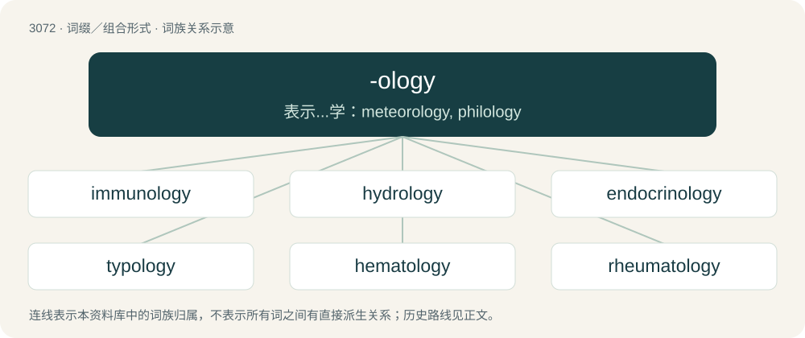

# 3171 · -ology — 表示...学：meteorology, philology

[总目录](../00_总目录_按常用程度.md)

**类型**：词缀／组合形式　｜　**来源语言**：见词源记录

## 核心含义与来源

- 核心含义：表示...学：meteorology, philology
- 英文含义：added to an ordinary English word to create a name for a (possibly non-existent) field of study.
- 词形：-ology

**来源记录 1**（后缀／后置成分；added to an ordinary English word to create a name for a (possibly non-existent) field of study.）

From -o- (interconsonantal vowel) + -logy.

## 词族图

## 单词速览（常用到不常用）

| 单词 | 音标 | 释义 |
|---|---|---|
| [immunology](#w-1) | 英 /ˌɪm.jʊˈnɒl.ə.dʒi/；美 /ˌɪm.jəˈnɑː.lə.dʒi/ | n. 免疫学；\[化\] 免疫学 |
| [hydrology](#w-2) | /haiˈdrɒlədʒi/ | n. 水文学；\[医\] 水文学 |
| [endocrinology](#w-3) | 英 /ˌɛn.də.kɹɪˈnɒ.lə.d͡ʒi/；美 /ˌɛn.də.kɹɪˈnɑ.lə.d͡ʒi/ | n. 内分泌学 |
| [typology](#w-4) | /taɪˈpɒl.ə.d͡ʒi/ | n. 象征论, 象征主义, 类型学；\[医\] 类型学; 血型学 |
| [hematology](#w-5) | /ˌhiməˈtɒləd͡ʒi/ | n. 血液学；\[医\] 血液学 |
| [rheumatology](#w-6) | /.ruːməˈtɒlədʒi/ | n. 风湿病学；\[医\] 风湿病学 |
| [climatology](#w-7) | 英 /klaɪ.mɪˈtɒ.lə.d͡ʒi/；美 /klaɪ.mɪˈtɑ.lə.d͡ʒi/ | n. 气候学；\[医\] 气候学, 风土学 |
| [kinesiology](#w-8) | /kəˌni.ziˈɔ.lə.d͡ʒɪ/ | n. 运动机能学；\[医\] 运动学 |
| [parasitology](#w-9) | /.pærəsaiˈtɒlədʒi/ | n. 寄生物学, 寄生虫学；\[医\] 寄生物学, 寄生虫学 |
| [symbology](#w-10) | /simˈbɒlədʒi/ | n. 符号学, 符号使用 |
| [reflexology](#w-11) | /,riːflekˈsɔlədʒi/ | \[医\] 反射学 |
| [haematology](#w-12) | 英 /ˌhiːməˈtɒlədʒi/；美 /ˌhiməˈtɑləd͡ʒi/ | n. (=hematology)血液学, 血液病学 |
| [lithology](#w-13) | /liˈθɒlədʒi/ | n. 岩性学, 结石学；\[化\] 岩石学; 岩性; 岩性学 |
| [enzymology](#w-14) | /,enzaiˈmɔlədʒi/ | n. 酶学；\[化\] 酶学 |
| [phenology](#w-15) | /ˌfɛnˈɒlədʒi/ | n. 物候学, 物候关系；\[医\] 物候学 |

## 逐词详解

### 1. immunology

**词性**：名词　｜　**音标**：英 /ˌɪm.jʊˈnɒl.ə.dʒi/；美 /ˌɪm.jəˈnɑː.lə.dʒi/

**中文释义**：n. 免疫学；\[化\] 免疫学

**英文义项**：The branch of medicine that concerns the body's immune system.

**构词拆分**：immune + -ology

**词源与演化**：

From immune + -ology.

### 2. hydrology

**词性**：名词　｜　**音标**：/haiˈdrɒlədʒi/

**中文释义**：n. 水文学；\[医\] 水文学

**英文义项**：The science of the properties, distribution, and effects of water on a planet's surface, in the soil and underlying rocks, and in the atmosphere. / The properties, distribution, and flows of water in a specific locale; the hydrological characteristics of a particular place or region.

**构词拆分**：hydro- + -ology

**词源与演化**：

From hydro- + -ology.

**例句**：

> When trees die, the ecology and hydrology of a forest change, which in turn promotes insect infestation and fire.

### 3. endocrinology

**词性**：名词　｜　**音标**：英 /ˌɛn.də.kɹɪˈnɒ.lə.d͡ʒi/；美 /ˌɛn.də.kɹɪˈnɑ.lə.d͡ʒi/

**中文释义**：n. 内分泌学

**英文义项**：The study of the endocrine glands of the human body, the hormones produced by them, and their related disorders.

**构词拆分**：endocrine + -ology

**词源与演化**：

From French endocrinologie, or endocrine + -ology.

**例句**：

> Endocrinology is on the third floor.

### 4. typology

**词性**：名词　｜　**音标**：/taɪˈpɒl.ə.d͡ʒi/

**中文释义**：n. 象征论, 象征主义, 类型学；\[医\] 类型学; 血型学

**英文义项**：The study of symbolic representation, especially of the origin and meaning of Scripture types. / The systematic classification of the types of something according to their common characteristics.

**构词拆分**：type + -ology

**词源与演化**：

From type + -ology.

### 5. hematology

**词性**：名词　｜　**音标**：/ˌhiməˈtɒləd͡ʒi/

**中文释义**：n. 血液学；\[医\] 血液学

**英文义项**：The scientific study of blood and blood-producing organs. / The medical specialty dealing with the health and diseases of blood and blood-producing organs.

**构词拆分**：hemato- + -logy；hemat- + -ology

**词源与演化**：

From international scientific vocabulary, reflecting New Latin combining forms: hemato- + -logy = hemat- + -ology; morphologically parallel with haematology.

### 6. rheumatology

**词性**：名词　｜　**音标**：/.ruːməˈtɒlədʒi/

**中文释义**：n. 风湿病学；\[医\] 风湿病学

**英文义项**：The branch of medicine specializing in arthritis and other ailments of the joints.

**词源与演化**：

From Ancient Greek ῥεῦμα (rheûma) (whence also English rheum) + -ology.

### 7. climatology

**词性**：名词　｜　**音标**：英 /klaɪ.mɪˈtɒ.lə.d͡ʒi/；美 /klaɪ.mɪˈtɑ.lə.d͡ʒi/

**中文释义**：n. 气候学；\[医\] 气候学, 风土学

**英文义项**：The science that deals with climates, and investigates their phenomena and causes.

**构词拆分**：climate + -ology

**词源与演化**：

From climate + -ology.

**例句**：

> Meteorologists are people who know a tremendous amount about geophysics, thermodynamics and climatology, and almost nothing about tomorrow's weather.

### 8. kinesiology

**词性**：名词　｜　**音标**：/kəˌni.ziˈɔ.lə.d͡ʒɪ/

**中文释义**：n. 运动机能学；\[医\] 运动学

**英文义项**：The study of body movement. / The application of such principles to the diagnosis and treatment of muscular imbalance.

**构词拆分**：kinesi- + -ology

**词源与演化**：

From kinesi- + -ology.

**例句**：

> Kinesiology is the study of movement.

### 9. parasitology

**词性**：名词　｜　**音标**：/.pærəsaiˈtɒlədʒi/

**中文释义**：n. 寄生物学, 寄生虫学；\[医\] 寄生物学, 寄生虫学

**英文义项**：The study of parasites.

**构词拆分**：parasite + -ology

**词源与演化**：

From parasite + -ology.

### 10. symbology

**词性**：名词　｜　**音标**：/simˈbɒlədʒi/

**中文释义**：n. 符号学, 符号使用

**英文义项**：The study or use of symbols. / An encoding scheme, particularly for barcodes.

**构词拆分**：symbol + -ology

**词源与演化**：

From symbol + -ology, with haplology of -olol- to -ol-.

**例句**：

> I have a very interesting book about symbology.

### 11. reflexology

**词性**：名词　｜　**音标**：/,riːflekˈsɔlədʒi/

**中文释义**：\[医\] 反射学

**英文义项**：The study and interpretation of behavior in terms of simple and complex reflexes. / A form of complementary medicine involving the stimulation of points on the feet, hands, or ears, in the belief that it will have a beneficial effect on some other parts of the body or to improve general health.

**构词拆分**：reflex + -ology

**词源与演化**：

From reflex + -ology, derived from Russian.

**例句**：

> The spa offers a reflexology foot bath.

### 12. haematology

**词性**：名词　｜　**音标**：英 /ˌhiːməˈtɒlədʒi/；美 /ˌhiməˈtɑləd͡ʒi/

**中文释义**：n. (=hematology)血液学, 血液病学

**英文义项**：The scientific study of blood and blood-producing organs.

**构词拆分**：haemat- + -ology；hæmat- + -ology；haemato- + -logy

**词源与演化**：

From haemat- + -ology or hæmat- + -ology or haemato- + -logy.

### 13. lithology

**词性**：名词　｜　**音标**：/liˈθɒlədʒi/

**中文释义**：n. 岩性学, 结石学；\[化\] 岩石学; 岩性; 岩性学

**英文义项**：The study of rocks, with particular emphasis on their description and classification. / The general composition of a rock or rock sequence.

**构词拆分**：litho- + -ology

**词源与演化**：

From litho- + -ology.

### 14. enzymology

**词性**：名词　｜　**音标**：/,enzaiˈmɔlədʒi/

**中文释义**：n. 酶学；\[化\] 酶学

**英文义项**：The branch of science that studies enzymes.

**构词拆分**：enzyme + -ology

**词源与演化**：

From enzyme + -ology.

### 15. phenology

**词性**：名词　｜　**音标**：/ˌfɛnˈɒlədʒi/

**中文释义**：n. 物候学, 物候关系；\[医\] 物候学

**英文义项**：The study of the effect of climate on periodic biological phenomena.

**构词拆分**：pheno- + -ology

**词源与演化**：

From pheno- + -ology.
