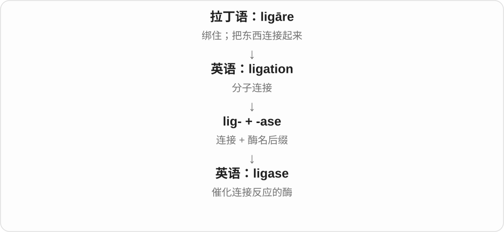

# 3174 · -ase — 科学命名中的酶词尾，前半提示底物、反应等

[逐词精讲目录](../00_逐词精讲目录.md) · [总目录](../00_总目录_按常用程度.md)

## 核心词根与来源

-ase 能帮你认出大量酶名，不能单靠前半字面推出所有机制。先学常见底物和动作，再看少量代表名称，不必把所有专业酶名一口气背下。

**-ASE：先认出这是酶，再看它处理什么**

lactase、amylase 先看底物；kinase、phosphatase 对照反应；polymerase、nuclease 对照链的合成和切开。

- **按底物及常见作用理解**：lactase · amylase · protease · nuclease
- **磷酸基团与氧化等反应**：kinase · phosphatase · oxidase · dehydrogenase · catalase
- **合成、连接与其他代表酶名**：polymerase · ligase · synthetase · transferase · telomerase · luciferase

## 词形与演化规律

diastase 等旧酶名末尾推广为 -ase；接不同科学词干；常读 /eɪs/，不少词也读 /eɪz/，不是统一读 /eɪz/ 的硬规则。

## 单词速览（按词族由简到繁）

同一基础词的相关扩展放在一起，先读基础形式，再读扩展；各组之间优先读常用的。具体词源关系见各词讲解。

| 单词 | 音标 | 核心意思 |
|---|---|---|
| [kinase](#w-1) | /ˈkaɪneɪs/，也读 /ˈkaɪneɪz/ | 激酶 |
| [polymerase](#w-2) | 英 /pəˈlɪməreɪz/；美 /pəˈlɪməreɪs/ | 聚合酶 |
| [dehydrogenase](#w-3) | 英 /diːˌhaɪˈdrɒdʒəneɪz/；美 /ˌdiːhaɪˈdrɑːdʒəneɪs/ | 脱氢酶 |
| [protease](#w-4) | 英 /ˈprəʊtieɪz/；美 /ˈproʊtieɪz/ | 蛋白酶 |
| [oxidase](#w-5) | 英 /ˈɒksɪdeɪs/；美 /ˈɑːksɪdeɪs/，末音也可 /z/ | 氧化酶 |
| [phosphatase](#w-6) | 英 /ˈfɒsfəteɪs/；美 /ˈfɑːsfəteɪs/，末音也可 /z/ | 磷酸酶 |
| [amylase](#w-7) | 美 /ˈæməˌleɪs/，亦 /ˈæməˌleɪz/ | 淀粉酶 |
| [transferase](#w-10) | 美 /ˈtrænsfərˌeɪs/，也读 /ˈtrænsfərˌeɪz/ | 转移酶 |
| [synthetase](#w-11) | /ˈsɪnθəteɪs/，亦 /ˈsɪnθəteɪz/ | 合成酶〔常指连接酶类〕 |
| [catalase](#w-13) | /ˈkætəleɪs/，也读 /ˈkætəleɪz/ | 过氧化氢酶 |
| [telomerase](#w-14) | 美 /təˈlɑːməreɪs/ | 端粒酶 |
| [lactase](#w-15) | /ˈlækteɪs/ | 乳糖酶 |
| [ligase](#w-18) | 英 /ˈlɪɡeɪz/；美 /ˈlaɪɡeɪz/ | 连接酶 |
| [luciferase](#w-19) | 英 /ˈluːsɪfəˌreɪs/、/ˈluːsɪfəˌreɪz/；美 /luːˈsɪfəˌreɪs/、/luːˈsɪfəˌreɪz/ | 荧光素酶 |
| [nuclease](#w-20) | 英 /ˈnjuːklieɪs/；美 /ˈnuːklieɪs/，末音也可 /z/ | 核酸酶 |

## 逐词讲解

### 1. kinase — 激酶

**音标**：/ˈkaɪneɪs/，也读 /ˈkaɪneɪz/

**先抓住这个画面**

可以先想成“给目标接上磷酸基团的酶”。名字虽有运动材料，实际不是让肌肉动的酶，而是常参与细胞信号等过程的磷酸基团转移。

**怎么拆**

kin- 接希腊运动材料，与 kinetic 同源构词，再接酶名尾 -ase → kinase。现代机制要按生化定义理解，不能从 move 一字猜全。

**怎么变成今天的意思**

**法语 diastase 等早期酶名的末尾 → 科学词尾 -ase**  
逐渐成为酶名构词材料

↓

**底物、反应等名称材料 + -ase**  
前面提示与什么物质、什么反应有关；细节看整词

↓

**kin- 运动材料 + -ase → kinase**  
催化从供体向目标转移磷酸基团的酶

protein kinase 蛋白激酶；kinase activity 激酶活性。名称可与作用目标进一步组合。

**常见搭配与例句**

protein kinase；kinase activity。

> The diagram shows a kinase adding a phosphate group to a protein.

图示展示激酶向蛋白质加上磷酸基团。

> The paper compares the activity of two kinases.

论文比较了两种激酶的活性。

**别混淆**

kinase 与 phosphatase 经常在加上、去掉磷酸基团的过程中相对，但不能简单说二者是同一个酶方向倒转。

### 2. polymerase — 聚合酶

**音标**：英 /pəˈlɪməreɪz/；美 /pəˈlɪməreɪs/

**先抓住这个画面**

像分子装配工，帮助把小构件接到正在形成的长链上。

**怎么拆**

polymer + -ase；-ase 是酶名常用后缀。现代生物学里最常见的是 DNA polymerase 与 RNA polymerase；后缀不表示“一个更大的聚合物”。

**怎么变成今天的意思**

**希腊语 meros**  
一部分、一份

↓

**希腊语 poly- + meros → polymeres**  
有许多部分的

↓

**近代化学术语 polymeric、polymer**  
名词有德语借入或由形容词逆构的分析；现代义与早期化学用法有别

↓

**现代 polymer + -ase → polymerase**  
以催化聚合的作用命名一类酶

DNA 聚合酶参与合成 DNA，RNA 聚合酶参与合成 RNA。词尾 -ase 点出它是促成反应的酶；polymer 则是它参与构建的那类长链产物的概念。

**常见搭配与例句**

DNA polymerase；RNA polymerase；polymerase activity；polymerase chain reaction。

> DNA polymerase helps build a new DNA strand from smaller units.

DNA 聚合酶帮助用较小的构件合成一条新的 DNA 链。

> The textbook compares the roles of DNA polymerase and RNA polymerase.

课本比较了 DNA 聚合酶与 RNA 聚合酶的作用。

**别混淆**

polymer 是聚合物，polymerase 是酶。PCR 名称中的 polymerase 说用到的酶，reaction 才说反应过程。

### 3. dehydrogenase — 脱氢酶

**音标**：英 /diːˌhaɪˈdrɒdʒəneɪz/；美 /ˌdiːhaɪˈdrɑːdʒəneɪs/

**先抓住这个画面**

像负责转交“氢和电子”的搬运工，帮助一种物质被氧化、另一种物质被还原。

**怎么拆**

de- 去掉 + hydrogen 氢 + -ase 酶。

**怎么变成今天的意思**

**希腊 gígnesthai / génos / génesis**  
产生、出生；出身和种类；形成过程

↓

**希腊 hýdōr“水” + 产生词素 → 法语 hydrogène**  
18世纪化学命名：能与氧反应生成水的元素

↓

**英语 hydrogen**  
氢

↓

**现代科学词 dehydrogenase**  
催化脱氢和相关转移反应的酶类

它是酶，不是氢气，也不是单纯把水吸走。不同脱氢酶作用于不同底物；名称常在前面加底物，例如 alcohol dehydrogenase。

**常见搭配与例句**

alcohol dehydrogenase；dehydrogenase activity。

> The researchers measured dehydrogenase activity in the cells.

研究人员测量了细胞中的脱氢酶活性。

> Alcohol dehydrogenase participates in alcohol metabolism.

醇脱氢酶参与酒精代谢。

**别混淆**

dehydration 是脱水；dehydrogenase 催化的是氢及相关电子转移，别混成同一个 dehyd-。

### 4. protease — 蛋白酶

**音标**：英 /ˈprəʊtieɪz/；美 /ˈproʊtieɪz/

**先抓住这个画面**

把蛋白质长链切成较短片段的酶，像处理特定材料的剪刀。

**怎么拆**

截取 protein 的 prote-，加酶类名称后缀 -ase。这里的 prote- 已专指蛋白质，不能再次按“第一”硬译。

**怎么变成今天的意思**

**古希腊 prôtos → prōto-／prot-**  
第一、最初、主要的

↓

**古希腊 prōteîos → 法语科学名称 protéine**  
第一等的、首要的 → 被认为对生命重要的物质

↓

**英语 protein**  
后来成为蛋白质这一类物质的名称

↓

**科学构词 prote(in) + -ase → protease**  
作用于蛋白质的酶

消化过程会用到蛋白酶；某些洗涤剂也用它处理蛋白质类污渍。不同蛋白酶对底物和作用条件有要求，不是所有污渍都能剪开。

**常见搭配与例句**

a protease enzyme；protease activity；a detergent containing protease。

> The detergent contains a protease that helps break down protein stains.

这种洗涤剂含有帮助分解蛋白质污渍的蛋白酶。

> The researchers measured protease activity in the sample.

研究人员测量了样本中的蛋白酶活性。

**别混淆**

protein 是被处理的蛋白质；protease 是能催化其分解的酶。多数酶本身也是蛋白质，这并不矛盾。

### 5. oxidase — 氧化酶

**音标**：英 /ˈɒksɪdeɪs/；美 /ˈɑːksɪdeɪs/，末音也可 /z/

**先抓住这个画面**

看到 oxid- 先想到氧化反应，看到 -ase 知道这是酶。合起来是催化氧化反应的一类酶，常涉及直接以氧作反应参与者。

**怎么拆**

oxide 等氧化材料的词干 + -ase → oxidase，现代科学命名，不是所有氧元素相关物质的统称。

**怎么变成今天的意思**

**法语 diastase 等早期酶名的末尾 → 科学词尾 -ase**  
逐渐成为酶名构词材料

↓

**底物、反应等名称材料 + -ase**  
前面提示与什么物质、什么反应有关；细节看整词

↓

**oxid- 氧化材料 + -ase → oxidase**  
催化氧化反应的酶

oxidase activity 氧化酶活性；polyphenol oxidase 多酚氧化酶；名称前部还可限定反应物。

**常见搭配与例句**

oxidase activity；an oxidase enzyme。

> The paper describes an oxidase involved in the reaction.

论文描述了一种参与该反应的氧化酶。

> The chart compares oxidase activity in the two samples.

图表比较了两个样品的氧化酶活性。

**别混淆**

oxide 是氧化物，oxidase 是酶；oxidation 是反应过程，三者并非可互换的拼写变体。

### 6. phosphatase — 磷酸酶

**音标**：英 /ˈfɒsfəteɪs/；美 /ˈfɑːsfəteɪs/，末音也可 /z/

**先抓住这个画面**

在很多基础生化场景中，激酶加上磷酸基团，phosphatase 把相应基团水解除去。把它记成处理磷酸酯的酶，比只记三个中文字更有画面。

**怎么拆**

phosphate 磷酸盐、磷酸基团相关材料 + -ase，构形成 phosphatase；不是 phosphorus 原词完整加尾。

**怎么变成今天的意思**

**法语 diastase 等早期酶名的末尾 → 科学词尾 -ase**  
逐渐成为酶名构词材料

↓

**底物、反应等名称材料 + -ase**  
前面提示与什么物质、什么反应有关；细节看整词

↓

**phosphate 的词干 + -ase → phosphatase**  
处理磷酸酯、催化相关水解的酶

protein phosphatase 蛋白磷酸酶；alkaline phosphatase 碱性磷酸酶；phosphatase activity 磷酸酶活性。

**常见搭配与例句**

protein phosphatase；phosphatase activity。

> The illustration shows a phosphatase removing a phosphate group.

插图展示磷酸酶去除一个磷酸基团。

> The report discusses protein phosphatase activity.

报告讨论蛋白磷酸酶的活性。

**别混淆**

phosphate 是化合物或基团材料，phosphatase 是酶类名称；多出来的 -ase 改变了它是什么东西。

### 7. amylase — 淀粉酶

**音标**：美 /ˈæməˌleɪs/，亦 /ˈæməˌleɪz/

**先抓住这个画面**

帮助把淀粉长链拆成较小片段的酶。

**怎么拆**

amyl-〔淀粉〕＋ -ase〔酶〕。amyl- 经拉丁 amylum 接希腊 ámylon；现代词尾 -ase 用来命名酶，别把它和糖类常见的 -ose 混淆。

**怎么变成今天的意思**

**希腊 a-〔不〕＋ mýlē〔磨〕→ ámylon**  
原指不用磨碾取得的淀粉；名称保留旧制取特点

↓

**拉丁 amylum → 近代科学 amyl-／amylo-**  
淀粉及相关构词成分

↓

**近代 amyl- ＋ -ase → amylase**  
以所作用的淀粉来给酶命名

把淀粉想成很长的珠链，amylase 像剪开某些连接的工具。唾液和胰液中的淀粉酶参与消化；它是处理淀粉的蛋白质工具，本身不是淀粉。

**常见搭配与例句**

salivary amylase；pancreatic amylase；amylase activity。

> Salivary amylase begins breaking down starch in the mouth.

唾液淀粉酶开始在口腔中分解淀粉。

> The experiment measured amylase activity at different temperatures.

实验测量了不同温度下的淀粉酶活性。

**别混淆**

amylase 是酶；amylose 是淀粉中的一种多糖。末尾一字母不同，分别是“工具”和“材料”。

### 8. transferase — 转移酶

**音标**：美 /ˈtrænsfərˌeɪs/，也读 /ˈtrænsfərˌeɪz/

**先抓住这个画面**

像分子世界里的搬运助手，把一个化学基团从一个分子转到另一个分子上。

**怎么拆**

transfer + -ase，-ase 是酶名常用后缀。

**怎么变成今天的意思**

**拉丁语：ferre；第一人称 ferō**  
带、承载；承受；生出

↓

**拉丁语：trans- + ferre → transferre**  
带到另一边；转移

↓

**英语：transfer**  
转移、转让；调动、换乘

↓

**英语：transfer + -ase → transferase**  
催化基团转移的酶

这里转移的是甲基、磷酸基等化学基团；酶催化反应，不是把整颗细胞搬走。名称常在前面指出转移什么，如 methyltransferase。

**常见搭配与例句**

a transferase enzyme；transferase activity；a methyl transferase。

> This transferase moves a methyl group to another molecule.

这种转移酶把一个甲基转到另一分子上。

> The experiment compared transferase activity in the two samples.

实验比较了两个样本中的转移酶活性。

**别混淆**

transporter 常帮助物质跨膜运输；transferase 是催化化学基团转移的一类酶。

### 9. synthetase — 合成酶〔常指连接酶类〕

**音标**：/ˈsɪnθəteɪs/，亦 /ˈsɪnθəteɪz/

**先抓住这个画面**

让两个分子连接起来，常借助 ATP 等提供的能量来完成这一步。

**怎么拆**

synthetic 的 synthet- 词干 + 酶名词尾 -ase；不能写成 synthesis 完整词干直接拼接而忽略 t。

**怎么变成今天的意思**

**古希腊语 tithenai，词典形 tithemi**  
放、安置、设定

↓

**希腊语 syntithenai → synthetikos**  
放在一起 → 与组合有关的

↓

**近代拉丁语 syntheticus／法语 synthétique → 英语 synthetic**  
综合的；后来有合成材料、人工的义

↓

**英语 synthet(ic) + -ase → synthetase**  
合成的 + 酶 → 催化连接合成的酶

许多常用酶名仍含 synthetase，例如 aminoacyl-tRNA synthetase。IUBMB 建议此名限于 ligase 类；synthase 的范围更广，不能用“synthase 一律不用 ATP”来机械区分。

**常见搭配与例句**

aminoacyl-tRNA synthetase；synthetase activity。

> The assay measured synthetase activity in the sample.

测定检测了样本中的合成酶活性。

> The lecture explains how an aminoacyl-tRNA synthetase recognizes its substrates.

讲座解释了氨酰 tRNA 合成酶如何识别其底物。

**别混淆**

synthetase 指酶；synthesizer 指合成装置。生化名称的具体反应，应查酶分类和反应式。

### 10. catalase — 过氧化氢酶

**音标**：/ˈkætəleɪs/，也读 /ˈkætəleɪz/

**先抓住这个画面**

把过氧化氢分解成水和氧的那类酶叫 catalase。名字来自催化材料，但今天它不是所有催化酶的总称。

**怎么拆**

catalysis 催化的缩短词干 + -ase → catalase。科学命名后来固定指催化过氧化氢分解的酶。

**怎么变成今天的意思**

**法语 diastase 等早期酶名的末尾 → 科学词尾 -ase**  
逐渐成为酶名构词材料

↓

**底物、反应等名称材料 + -ase**  
前面提示与什么物质、什么反应有关；细节看整词

↓

**catalysis 的缩短材料 + -ase → catalase**  
固定为过氧化氢分解酶的名称

catalase activity 过氧化氢酶活性；the action of catalase 过氧化氢酶的作用。

**常见搭配与例句**

catalase activity；the action of catalase。

> The lesson explains how catalase breaks down hydrogen peroxide.

这节课解释过氧化氢酶如何分解过氧化氢。

> The diagram labels catalase above the reaction arrow.

图中在反应箭头上方标出了过氧化氢酶。

**别混淆**

catalyst 泛指催化剂，catalase 是一种特定酶名；不是所有酶都叫 catalase，也不只存在于肝脏。

### 11. telomerase — 端粒酶

**音标**：美 /təˈlɑːməreɪs/

**先抓住这个画面**

帮助给染色体末端续上重复序列的酶系统。

**怎么拆**

英语 telomere + -ase；替换结尾 e，加上表示酶的 -ase。读音重心与 telomere 不同，不能把词基原读音机械原样拼接。

**怎么变成今天的意思**

**希腊语 meros**  
一部分、一份

↓

**现代科学构词 telo- + -mere → telomere**  
末端的部分；命名染色体端部结构

↓

**英语 telomere + -ase → telomerase**  
以端粒命名参与其延长的酶

端粒酶利用自身携带的 RNA 模板，在染色体末端补加端粒 DNA 重复序列。可以把它想成维护末端帽套的工具，但它不是帽套本身，也不意味着所有细胞都同样活跃地使用它。

**常见搭配与例句**

telomerase activity；the telomerase enzyme；active telomerase；telomerase research。

> Telomerase adds repeated DNA sequences to the ends of chromosomes.

端粒酶把重复的 DNA 序列补加到染色体末端。

> The study compared telomerase activity in two groups of cells.

这项研究比较了两组细胞中的端粒酶活性。

**别混淆**

telomere 是端部结构，telomerase 是能帮助维护该结构的酶；它属于一种逆转录酶，因此“用 RNA 作模板合成 DNA”是这里的关键方向。

### 12. lactase — 乳糖酶

**音标**：/ˈlækteɪs/

**先抓住这个画面**

把乳糖想成两个小糖连在一起，乳糖酶就是帮助拆开这个连接的工具。

**怎么拆**

lact- 乳 + 表示酶的后缀 -ase，命名关联它作用的乳糖 lactose。不要把 -ase 和表示糖的 -ose 混淆。

**怎么变成今天的意思**

**拉丁 lac，属格 lactis**  
乳、奶

↓

**lact- + -ase**  
与乳糖分解有关的酶名

↓

**英语 lactase**  
把乳糖分解为葡萄糖与半乳糖的酶

乳糖是被分解的糖，乳糖酶是帮助分解它的酶。人体小肠乳糖酶不足时，可能无法充分消化摄入的乳糖。这解释了词的关系，不表示只要看见 lactase 就是某一种固定药品。

**常见搭配与例句**

the enzyme lactase；lactase activity；lactase deficiency。

> Lactase helps break lactose into two simpler sugars.

乳糖酶帮助把乳糖分解成两种更简单的糖。

> The diagram labels lactose as the substrate and lactase as the enzyme.

图中把乳糖标为底物，把乳糖酶标为酶。

**别混淆**

lactose 是糖，lactase 是酶；lactic acid 是乳酸。三者都带 lact-，却是不同东西。

### 13. ligase — 连接酶

**音标**：英 /ˈlɪɡeɪz/；美 /ˈlaɪɡeɪz/

**先抓住这个画面**

ligase 是催化两个分子连接的一类酶。学习时抓住“帮助连接发生的酶”即可，不能把它直接当作被连接的那个分子。

**怎么拆**

以 ligation 的 lig- 相关词干加酶名后缀 -ase 形成。-ase 在许多生化酶名中出现，如 lactase、amylase。

**怎么变成今天的意思**

这是现代科学命名利用古典词根造词的例子，不是古罗马人已经有了现代连接酶概念。旧词根提供“绑”的画面，新后缀和专业定义确定现代对象。

**常见搭配与例句**

DNA ligase（DNA 连接酶）；ligase activity（连接酶活性）；add ligase to a reaction（向反应体系加入连接酶）。

> DNA ligase helps join adjacent DNA fragments.

DNA 连接酶帮助连接相邻的 DNA 片段。

> The experiment measured ligase activity at different temperatures.

实验测量了不同温度下的连接酶活性。

**别混淆**

-ase 提示这是一种酶；ligand 没有这个后缀，指参与结合的一方。只背中文“连接”会丢掉两者的角色差别。

### 14. luciferase — 荧光素酶

**音标**：英 /ˈluːsɪfəˌreɪs/、/ˈluːsɪfəˌreɪz/；美 /luːˈsɪfəˌreɪs/、/luːˈsɪfəˌreɪz/

**先抓住这个画面**

发光原料在旁边，这种酶帮反应顺利发生，让化学变化变成可检测的光。

**怎么拆**

借自法语 luciférase，以拉丁 lūcifer“带光的”加酶后缀 -ase 命名。它与 luciférine 是法语科学命名中的配套词，不应画成英语 luciferin 必然先造出 luciferase。

**怎么变成今天的意思**

**拉丁语：ferre；第一人称 ferō**  
带、承载；承受；生出

↓

**拉丁语：lūc-〔光〕 + -fer → lūcifer**  
带来光的；晨星

↓

**法语：luciférase**  
以“带来光”及酶后缀命名

↓

**英语：luciferase**  
催化荧光素氧化发光反应的酶

实验里常利用 luciferase 产生的光信号报告某种生物活动。不同发光系统所需的底物和辅助条件并不完全一样，词名本身不指定一种配方。

**常见搭配与例句**

a luciferase assay；luciferase activity；a luciferase reporter。

> The assay measured luciferase activity in the sample.

检测测量了样本中的荧光素酶活性。

> The cells produced a light signal when the appropriate luciferase substrate was added.

加入适合的荧光素酶底物后，这些细胞产生了光信号。

**别混淆**

luciferase 是酶；luciferin 是相应底物，二者在反应中扮演不同角色。

### 15. nuclease — 核酸酶

**音标**：英 /ˈnjuːklieɪs/；美 /ˈnuːklieɪs/，末音也可 /z/

**先抓住这个画面**

DNA、RNA 像由小单元连起的长链，nuclease 能催化切开链中相应的连接。重点是核酸，不是把整个细胞核切开。

**怎么拆**

nucle- 核酸相关材料 + -ase → nuclease，科学词汇；核的旧命名进入核酸，再进入酶名。

**怎么变成今天的意思**

**法语 diastase 等早期酶名的末尾 → 科学词尾 -ase**  
逐渐成为酶名构词材料

↓

**底物、反应等名称材料 + -ase**  
前面提示与什么物质、什么反应有关；细节看整词

↓

**nucle- 核酸材料 + -ase → nuclease**  
催化核酸链相应连接水解的酶

nuclease activity 核酸酶活性；a DNA nuclease 作用于 DNA 的核酸酶。不同酶作用对象、位置可不同。

**常见搭配与例句**

nuclease activity；a nuclease enzyme。

> The illustration shows a nuclease cutting a nucleic acid chain.

插图展示核酸酶切开核酸链。

> The article compares several types of nuclease.

文章比较了几类核酸酶。

**别混淆**

nuclease 不等于所有处理细胞核的酶；polymerase 常说催化链合成，nuclease 看链连接的切开。

## 这一组要分清什么

不是所有酶都以 -ase 结尾，如 pepsin；也不能把拼写碰巧相似的 phase 当酶名。catalase 是特定酶，不是催化剂总称。

## 串起来练习

The chart compares a kinase, a phosphatase and a nuclease by their functions.

图表按功能比较激酶、磷酸酶和核酸酶。
