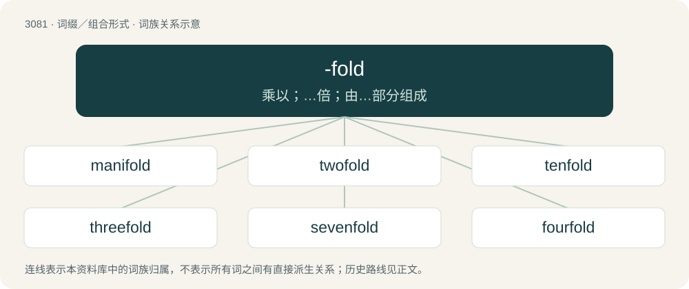

# 3180 · -fold — 乘以；…倍；由…部分组成

[总目录](../00_总目录_按常用程度.md)

**类型**：词缀／组合形式　｜　**来源语言**：见词源记录

## 核心含义与来源

- 核心含义：乘以；…倍；由…部分组成
- 英文含义：Used to make adjectives meaning "times".
- 词形：-fold

**来源记录 1**（后缀／后置成分；Used to make adjectives meaning "times".）

From Middle English -fold, -fald, -fauld, from Old English -feald (“-fold”), from Proto-West Germanic \*-falþ, from Proto-Germanic \*-falþaz (“-fold”), from Proto-Indo-European \*-poltos (“-fold”), from \*pel- (“to fold”). Cognate with Dutch -voud, Swedish -faldig (“-fold”), Latin -plus, -plex, Ancient Greek -παλτος (-paltos), -πλος (-plos), -πλόος (-plóos). More at fold.

## 词族图

## 单词速览（常用到不常用）

| 单词 | 音标 | 释义 |
|---|---|---|
| [manifold](#w-1) | 英 /ˈmænɪˌfəʊld/；美 /ˈmænɪˌfoʊld/ | n. 复印本, 多种；a. 多种的, 有许多部分的, 多方面的；vt. 复写, 使多样化, 增多 |
| [twofold](#w-2) | 英 /ˈtuːfəʊld/；美 /ˈtufoʊld/ | a. 两倍的, 两重的；adv. 两倍地, 两重地 |
| [tenfold](#w-3) | 美 /ˈtɛnfoʊld/ | a. 十倍的, 十重的；adv. 十倍地, 十重地 |
| [threefold](#w-4) | /ˈθriːfəuld/ | a. 三倍的, 三重的；adv. 三倍地, 三重地 |
| [sevenfold](#w-5) | /ˈsɛvənfoʊld/ | a. 七倍, 七重；adv. 七倍, 七重 |
| [fourfold](#w-6) | 英 /ˈfɔːfəʊld/；美 /ˈfɔɹ.foʊld/ | a. 四重的, 四倍的, 四垒的；adv. 四倍, 四重 |
| [fivefold](#w-7) | /ˈfaivfəuld/ | a. 五重的, 五倍的；adv. 五重地, 五倍地 |
| [eightfold](#w-8) | /ˈeitfəuld/ | a. 八倍的, 八层的；adv. 八倍地, 八层地 |
| [sixfold](#w-9) | /ˈsiksfəuld/ | a. 六倍的, 六重的 |

## 逐词详解

### 1. manifold

**词性**：形容词　｜　**音标**：英 /ˈmænɪˌfəʊld/；美 /ˈmænɪˌfoʊld/

**中文释义**：n. 复印本, 多种；a. 多种的, 有许多部分的, 多方面的；vt. 复写, 使多样化, 增多

**英文义项**：Various in kind, quality, or manifestation; diverse. / Many in number; numerous.

**构词拆分**：many + -fold

**词源与演化**：

From Middle English manifold, from Old English maniġfeald (“manifold, various, varied, complicated, numerous, abundant, plural”), from Proto-Germanic \*managafalþaz, equivalent to many + -fold. Cognate with Middle High German manecvalt (“manifold”), Icelandic margfaldr (“multiple”). Compare also German mannigfaltig (“various”), Dutch menigvoudig (“various”), Danish mangefold (“multiple”), Swedish mångfald (“diversity”).

**例句**：

> The manifold meanings of the English word set are infamous among lexicographers.

该用例对应义项：Various in kind, quality, or manifestation; diverse.

### 2. twofold

**词性**：形容词　｜　**音标**：英 /ˈtuːfəʊld/；美 /ˈtufoʊld/

**中文释义**：a. 两倍的, 两重的；adv. 两倍地, 两重地

**英文义项**：Double; duplicate; multiplied by two. / Having two parts, especially two different parts.

**构词拆分**：two + -fold

**词源与演化**：

From Middle English twofold, from Old English twēofeald. Equivalent to two + -fold; cognate to Icelandic tvöfalt and Dutch tweevoudig.

**例句**：

> The wheat produced a twofold harvest.

该用例对应义项：Double; duplicate; multiplied by two.

### 3. tenfold

**词性**：形容词　｜　**音标**：美 /ˈtɛnfoʊld/

**中文释义**：a. 十倍的, 十重的；adv. 十倍地, 十重地

**英文义项**：Ten times as much or as many. / Containing ten parts.

**构词拆分**：ten + -fold

**词源与演化**：

From Middle English tenfold, tenfolde, from Old English tīenfeald, equivalent to ten + -fold.

**例句**：

> The morals of children are tenfold worse than formerly.

### 4. threefold

**词性**：形容词　｜　**音标**：/ˈθriːfəuld/

**中文释义**：a. 三倍的, 三重的；adv. 三倍地, 三重地

**英文义项**：Three times as great. / Triple.

**构词拆分**：three + -fold

**词源与演化**：

From Middle English threfold, from Old English þrīfeald. Equivalent to three + -fold.

**例句**：

> Modern Algeria has embarked on a process of Arabization, Islamization and socialism and this threefold policy has been a failure.

### 5. sevenfold

**词性**：形容词　｜　**音标**：/ˈsɛvənfoʊld/

**中文释义**：a. 七倍, 七重；adv. 七倍, 七重

**英文义项**：Seven times as much; multiplied by seven. / Having seven parts; composed of seven items.

**构词拆分**：seven + -fold

**词源与演化**：

Inherited from Middle English sevenfold, sevenefold, from Old English seofonfeald. Equivalent to seven + -fold.

**例句**：

> Sevenfold vengeance shall be taken for Cain: but for Lamech seventy times sevenfold.

### 6. fourfold

**词性**：形容词　｜　**音标**：英 /ˈfɔːfəʊld/；美 /ˈfɔɹ.foʊld/

**中文释义**：a. 四重的, 四倍的, 四垒的；adv. 四倍, 四重

**英文义项**：Four times as great; quadruple. / Comprised of four individual members.

**构词拆分**：four + -fold

**词源与演化**：

From Middle English fourfold, fourefold, from Old English fēowerfeald. Equivalent to four + -fold. Cognate with Dutch viervoud, Gothic 𐍆𐌹𐌳𐌿𐍂𐍆𐌰𐌻𐌸𐍃 (fidurfalþs).

**例句**：

> A fourfold increase in the dosage.

该用例对应义项：four times as great or many

### 7. fivefold

**词性**：形容词　｜　**音标**：/ˈfaivfəuld/

**中文释义**：a. 五重的, 五倍的；adv. 五重地, 五倍地

**英文义项**：Five times as much or as many. / In a group or series of five; consisting of five together as one; quintuple.

**构词拆分**：five + -fold

**词源与演化**：

From Middle English fiffold, from Old English fīffeald. Equivalent to five + -fold.

**例句**：

> Corn yields in the U.S. have increased fivefold over the past seventy years, thanks to advances in agricultural technology.

### 8. eightfold

**词性**：形容词　｜　**音标**：/ˈeitfəuld/

**中文释义**：a. 八倍的, 八层的；adv. 八倍地, 八层地

**英文义项**：Eight times as much; multiplied by eight. / Containing eight parts.

**构词拆分**：eight + -fold

**词源与演化**：

From Middle English \[Term?\], from Old English eahtafeald. Equivalent to eight + -fold.

### 9. sixfold

**词性**：形容词　｜　**音标**：/ˈsiksfəuld/

**中文释义**：a. 六倍的, 六重的

**英文义项**：Having six times as much or as many. / Having six component parts.

**构词拆分**：six + -fold

**词源与演化**：

From Middle English sexfold, from Old English sixfeald. Equivalent to six + -fold.

**例句**：

> The method is sixfold, and I will tell you what the six steps you must take are.

该用例对应义项：Having six component parts.
