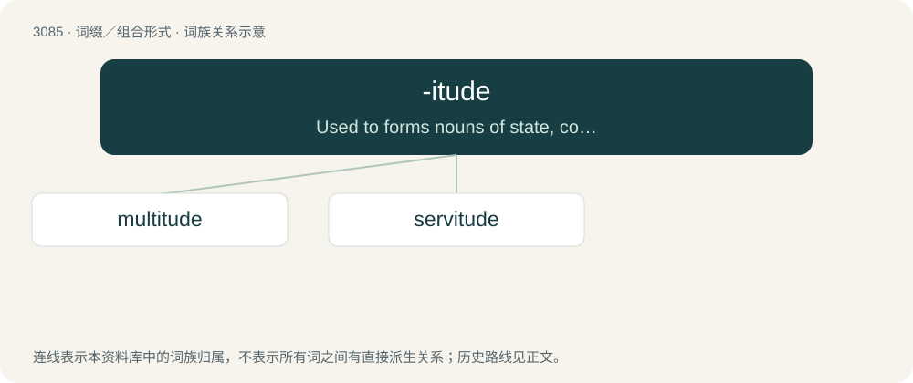

# 3184 · -itude — Used to forms nouns of state, condition or quality.

[总目录](../00_总目录_按常用程度.md)

**类型**：词缀／组合形式　｜　**来源语言**：见词源记录

## 核心含义与来源

- 核心含义：Used to forms nouns of state, condition or quality.
- 英文含义：Used to forms nouns of state, condition or quality.
- 词形：-itude

**来源记录 1**（后缀／后置成分；Used to forms nouns of state, condition or quality.）

Borrowed from Middle French -itude, from Latin -(i)tūdō. By surface analysis, -i- + -tude.

## 词族图

## 单词速览（常用到不常用）

| 单词 | 音标 | 释义 |
|---|---|---|
| [multitude](#w-1) | 英 /ˈmʌltɪtjuːd/；美 /ˈmʌltəˌt(j)ud/ | n. 多数, 群众 |
| [servitude](#w-2) | 英 /ˈsɜːvɪtʃuːd/；美 /ˈsərvəˌt(j)ud/ | n. 奴隶状态, 惩役, 地役权；\[法\] 苦役, 劳役, 奴役 |

## 逐词详解

### 1. multitude

**词性**：名词　｜　**音标**：英 /ˈmʌltɪtjuːd/；美 /ˈmʌltəˌt(j)ud/

**中文释义**：n. 多数, 群众

**英文义项**：A great amount or number, often of people; abundance, myriad, profusion. / The mass of ordinary people; the masses, the populace.

**构词拆分**：multi- + -itude

**词源与演化**：

From Middle English multitude, multitud, multytude (“(great) amount or number of people or things; multitudinous”), borrowed from Old French multitude (“crowd of people; diversity, wide range”), or directly from its etymon Latin multitūdō (“great amount or number of people or things”), from multus (“many; much”) + -tūdō (suffix forming abstract nouns indicating a state or condition). The English word is analysable as multi- + -itude.

**例句**：

> A multitude of TV antennas.

该用例对应义项：a large indefinite number

### 2. servitude

**词性**：名词　｜　**音标**：英 /ˈsɜːvɪtʃuːd/；美 /ˈsərvəˌt(j)ud/

**中文释义**：n. 奴隶状态, 惩役, 地役权；\[法\] 苦役, 劳役, 奴役

**英文义项**：The state of being a slave; slavery; being forced to work for others or do their bidding without one's consent or against one's will, either in perpetuity or for a period of time over which one has little or no control. / A qualified beneficial interest severed or fragmented from the ownership of an inferior property and attached to a superior property or to some person other than the owner; the most common form is an easement.

**构词拆分**：serve + -itude

**词源与演化**：

From Middle French servitude, from Latin servitūdō, from Latin servus (“slave”). Equivalent to serve + -itude.

**例句**：

> Every liberation bears within itself the danger of a new kind of servitude.
