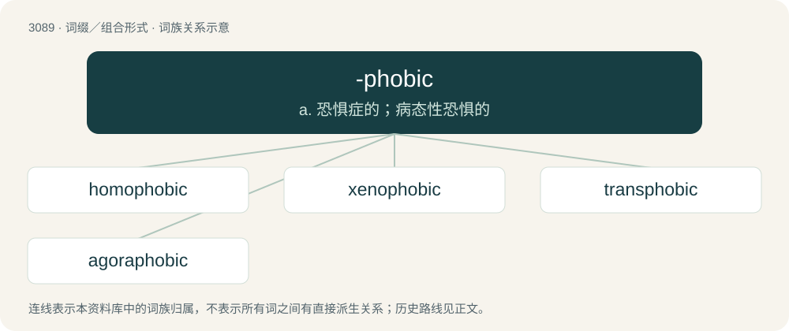

# 3186 · -phobic — a. 恐惧症的；病态性恐惧的

[总目录](../00_总目录_按常用程度.md)

**类型**：词缀／组合形式　｜　**来源语言**：见词源记录

## 核心含义与来源

- 核心含义：a. 恐惧症的；病态性恐惧的
- 英文含义：Used to form adjectives indicating a fear of a specific thing.
- 词形：-phobic

**来源记录 1**（后缀／后置成分；Used to form adjectives indicating a fear of a specific thing.）

From -phobia (from Late Latin -phobia, from Koine Greek -φοβία (-phobía), from φόβος (phóbos, “fear”)) + -ic.

## 词族图

## 单词速览（常用到不常用）

| 单词 | 音标 | 释义 |
|---|---|---|
| [homophobic](#w-1) | 英 /ˈhəʊ.məˌfəʊ.bɪk/；美 /ˈhoʊ.məˌfoʊ.bɪk/ | a. 害怕同性恋的 |
| [xenophobic](#w-2) | 英 /ˌzɛn.əˈfəʊ.bɪk/；美 /ˌzi.nəˈfoʊ.bɪk/ | a. 畏惧和憎恨外国人的；\[法\] 仇外的, 恐惧外国人的 |
| [transphobic](#w-3) |  | 跨性别恐惧症 |
| [agoraphobic](#w-4) | 英 /ˌæɡ.ə.ɹəˈfəʊ.bɪk/；美 /ˌæɡ.ɚ.əˈfoʊ.bɪk/ | a. 广场恐怖的, 旷野恐怖的, 恐旷症的, 陌生环境恐怖的 |

## 逐词详解

### 1. homophobic

**词性**：形容词　｜　**音标**：英 /ˈhəʊ.məˌfəʊ.bɪk/；美 /ˈhoʊ.məˌfoʊ.bɪk/

**中文释义**：a. 害怕同性恋的

**英文义项**：Exhibiting homophobia; characteristic of homophobes. / Inconvenient, annoying, irritating.

**构词拆分**：homo- + -phobic

**词源与演化**：

From homo- (“homosexual”) + -phobic.

**例句**：

> My bus left right as I got to the station. It's so homophobic of the driver to not wait for me!

该用例对应义项：Inconvenient, annoying, irritating.

### 2. xenophobic

**词性**：形容词　｜　**音标**：英 /ˌzɛn.əˈfəʊ.bɪk/；美 /ˌzi.nəˈfoʊ.bɪk/

**中文释义**：a. 畏惧和憎恨外国人的；\[法\] 仇外的, 恐惧外国人的

**英文义项**：Exhibiting or characterised by xenophobia, a fear or hatred of strangers, foreigners, or extraterrestial life.

**构词拆分**：xeno- + -phobic

**词源与演化**：

From xeno- + -phobic, from Ancient Greek ξένος (xénos, “foreign, strange”) + φόβος (phóbos, “fear”).

**例句**：

> Apropos of nothing, Tom went on an unhinged xenophobic rant.

### 3. transphobic

**词性**：形容词

**中文释义**：跨性别恐惧症

**英文义项**：Exhibiting transphobia.

**构词拆分**：trans- + -phobic

**词源与演化**：

From trans- + -phobic.

**例句**：

> Trans pornography enjoys the most popularity in the most transphobic U.S. states.

### 4. agoraphobic

**词性**：名词　｜　**音标**：英 /ˌæɡ.ə.ɹəˈfəʊ.bɪk/；美 /ˌæɡ.ɚ.əˈfoʊ.bɪk/

**中文释义**：a. 广场恐怖的, 旷野恐怖的, 恐旷症的, 陌生环境恐怖的

**英文义项**：One who suffers from agoraphobia.

**构词拆分**：agora- + -phobic

**词源与演化**：

From agora- + -phobic, see agoraphobia.
