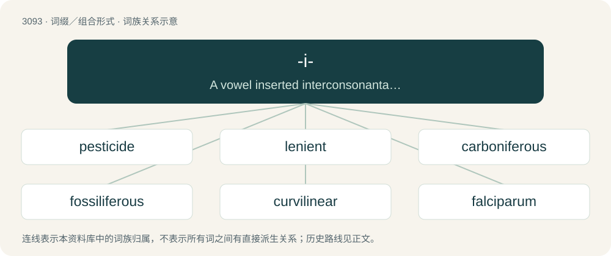

# 3189 · -i- — A vowel inserted interconsonantally between morphemes of Latinate origin in order to ease pronunciation (an anaptyxis, a linking vowel).

[总目录](../00_总目录_按常用程度.md)

**类型**：词缀／组合形式　｜　**来源语言**：见词源记录

## 核心含义与来源

- 核心含义：A vowel inserted interconsonantally between morphemes of Latinate origin in order to ease pronunciation (an anaptyxis, a linking vowel).
- 英文含义：A vowel inserted interconsonantally between morphemes of Latinate origin in order to ease pronunciation (an anaptyxis, a linking vowel).
- 词形：-i-

**多个词源／构词路径**：同一拼写可能有不同来源；以下按词性和含义分别列出。

**来源记录 1**（interfix；A vowel inserted interconsonantally between morphemes of Latinate origin in order to ease pronunciation (an anaptyxis, a linking vowel).）

Borrowed from Latin -i-.

**来源记录 2**（interfix；A monoclonal antibody derived from a non-human primate source.）

The initial vowel of primate.

**来源记录 3**（后缀／后置成分；A spelling variant of a word-final -y vowel when followed by a suffix that does not begin with an i, for example -ied, -ier, -iest.）

A word-internal spelling variant of a word-final y.

## 词族图

## 单词速览（常用到不常用）

| 单词 | 音标 | 释义 |
|---|---|---|
| [pesticide](#w-1) | 英 /ˈpɛstɪsaɪd/；美 /ˈpɛstɪˌsaɪd/ | n. 杀虫剂；\[化\] 农药 |
| [lenient](#w-2) | /ˈliːni.ənt/ | a. 宽大的, 温和的, 慈悲为怀的；\[法\] 宽大的, 仁慈的 |
| [carboniferous](#w-3) | 英 /ˌkɑːbəˈnɪfəɹəs/ | 【英文】Containing or producing carbon. |
| [fossiliferous](#w-4) | /.fɒsiˈlifərəs/ | a. 含有化石的 |
| [curvilinear](#w-5) | /.kəːviˈliniə/ | a. 曲线的, 由曲线组成的 |
| [falciparum](#w-6) | /falˈsɪ.pə.ɹəm/ | 【英文】The parasitic protozoan Plasmodium falciparum that causes falciparum malaria |
| [coolio](#w-7) | 美 /ˈkulioʊ/ | \[人名\]库里奥 |
| [tumorigenesis](#w-8) | /,tuːməriˈdʒenisis/ | 肿瘤发生 |
| [cannabidiol](#w-9) | 英 /kan.əb.ɪˈdʌɪ.ɒl/；美 /kæn.əb.ɪˈdaɪ.ɔl/ | \[化\] 大麻二酚；\[医\] 大麻二酚 |

## 逐词详解

### 1. pesticide

**词性**：名词　｜　**音标**：英 /ˈpɛstɪsaɪd/；美 /ˈpɛstɪˌsaɪd/

**中文释义**：n. 杀虫剂；\[化\] 农药

**英文义项**：Anything, especially a synthetic substance but also any substance (e.g. sulfur), or virus, bacterium, or other organism, which kills or suppresses the activities of pests.

**构词拆分**：pest + -i- + -cide

**词源与演化**：

From pest + -i- + -cide.

**例句**：

> The pesticide degraded the health of the microbiome within the soil.

### 2. lenient

**词性**：形容词　｜　**音标**：/ˈliːni.ənt/

**中文释义**：a. 宽大的, 温和的, 慈悲为怀的；\[法\] 宽大的, 仁慈的

**英文义项**：Lax; not strict; tolerant of dissent or deviation.

**构词拆分**：-i- + -ent

**词源与演化**：

From Middle French lénient, from Latin lēniēns (whence -i- + -ent), present participle of lēnīre (“to soften, soothe”), from lēnis (“soft”).

**例句**：

> The standard is fairly lenient, so use your discretion.

该用例对应义项：Lax; not strict; tolerant of dissent or deviation.

### 3. carboniferous

**词性**：形容词　｜　**音标**：英 /ˌkɑːbəˈnɪfəɹəs/

**英文义项**：Containing or producing carbon.

**构词拆分**：carbon + -i- + -ferous

**词源与演化**：

From carbon + -i- + -ferous.

### 4. fossiliferous

**词性**：形容词　｜　**音标**：/.fɒsiˈlifərəs/

**中文释义**：a. 含有化石的

**英文义项**：Containing fossils.

**构词拆分**：fossil + -i- + -ferous

**词源与演化**：

From fossil + -i- + -ferous.

### 5. curvilinear

**词性**：形容词　｜　**音标**：/.kəːviˈliniə/

**中文释义**：a. 曲线的, 由曲线组成的

**英文义项**：Having bends; curved; curvilineal. / Formed by curved lines.

**构词拆分**：curve + -i- + linear

**词源与演化**：

From curve + -i- + linear, compare curve, linear.

**用法示例／搭配（非完整句）**：

> the curvilinear motion of a thrown stone

该用例对应义项：Having bends; curved; curvilineal.

### 6. falciparum

**词性**：名词　｜　**音标**：/falˈsɪ.pə.ɹəm/

**英文义项**：The parasitic protozoan Plasmodium falciparum that causes falciparum malaria

**词源与演化**：

From Latin falc- (“sickle, scythe”) + -i- + Latin -parum (“-parous”), from Latin parere (“bring forth, bear”).

### 7. coolio

**词性**：形容词　｜　**音标**：美 /ˈkulioʊ/

**中文释义**：\[人名\]库里奥

**英文义项**：Cool; awesome; all right.

**构词拆分**：cool + -i- + -o

**词源与演化**：

From cool + -i- + -o.

### 8. tumorigenesis

**词性**：名词　｜　**音标**：/,tuːməriˈdʒenisis/

**中文释义**：肿瘤发生

**英文义项**：Production of a new tumor or tumors. / The process involved in the production of a new tumor or tumors.

**构词拆分**：tumor + -i- + -genesis

**词源与演化**：

From tumor + -i- + -genesis.

### 9. cannabidiol

**词性**：名词　｜　**音标**：英 /kan.əb.ɪˈdʌɪ.ɒl/；美 /kæn.əb.ɪˈdaɪ.ɔl/

**中文释义**：\[化\] 大麻二酚；\[医\] 大麻二酚

**英文义项**：A nonintoxicating cannabinoid found in the hemp plant Cannabis sativa.

**构词拆分**：cannabis + -i- + di- + -ol

**词源与演化**：

From cannab(is) + -i- + di- + -ol.
