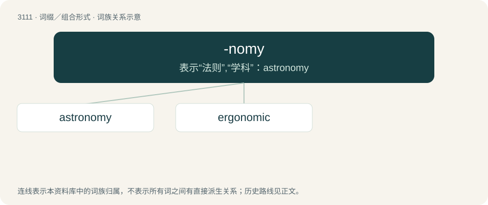

# 3207 · -nomy — 表示“法则”,“学科”：astronomy

[总目录](../00_总目录_按常用程度.md)

**类型**：词缀／组合形式　｜　**来源语言**：见词源记录

## 核心含义与来源

- 核心含义：表示“法则”,“学科”：astronomy
- 英文含义：a system of rules, laws, or knowledge about a body of a particular field; distribution, arrangement, management
- 词形：-nomy

**来源记录 1**（后缀／后置成分；a system of rules, laws, or knowledge about a body of a particular field; distribution, arrangement, management）

Borrowed from French -nomie, and a learned borrowing from Latin -nomia, from Ancient Greek νόμος (nómos, “law, custom”).

## 词族图

## 单词速览（常用到不常用）

| 单词 | 音标 | 释义 |
|---|---|---|
| [astronomy](#w-1) | 英 /əˈstɹɒn.ə.mi/；美 /əˈstɹɑ.nə.mi/ | n. 天文学 |
| [ergonomic](#w-2) | /,\\\\ː^əjˈnɔmik/ | a. 人类环境改造学的 |

## 逐词详解

### 1. astronomy

**词性**：名词　｜　**音标**：英 /əˈstɹɒn.ə.mi/；美 /əˈstɹɑ.nə.mi/

**中文释义**：n. 天文学

**英文义项**：The study of the physical universe beyond the Earth's atmosphere, including the process of mapping locations and properties of the matter and radiation in the universe. / Astrology.

**构词拆分**：astro- + -nomy

**词源与演化**：

From Middle English astronomie, astronemy, from Old French astronomie, equivalent to astro- + -nomy. Displaced native Old English tungolcræft.

**例句**：

> Tom does not know what the difference is between astronomy and astrology.

### 2. ergonomic

**词性**：形容词　｜　**音标**：/,\\\\ː^əjˈnɔmik/

**中文释义**：a. 人类环境改造学的

**英文义项**：Of or relating to the science of ergonomics. / Designed for comfort or to minimize fatigue.

**构词拆分**：ergo- + -nomy + -ic

**词源与演化**：

Dated 1950 C.E.; ergo- + -nomy + -ic, from Ancient Greek: ἔργον (érgon, “work”) and νόμος (nómos, “distribution”).

**例句**：

> The instrument panel has a very ergonomic layout.
