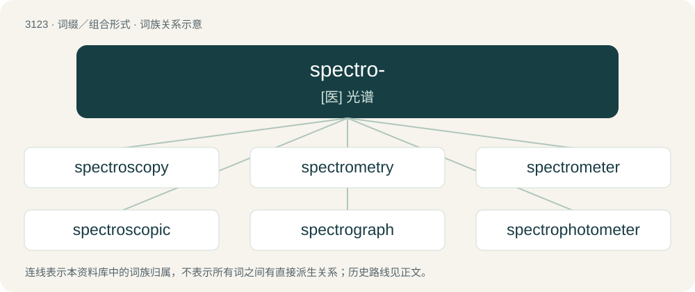

# 3223 · spectro- — \[医\] 光谱

[总目录](../00_总目录_按常用程度.md)

**类型**：词缀／组合形式　｜　**来源语言**：见词源记录

## 核心含义与来源

- 核心含义：\[医\] 光谱
- 英文含义：optical spectra.
- 词形：spectro-

**来源记录 1**（前缀／前置成分；optical spectra.）

From spectrum.

## 词族图

## 单词速览（常用到不常用）

| 单词 | 音标 | 释义 |
|---|---|---|
| [spectroscopy](#w-1) | 英 /spɛkˈtɹɒs.kə.piː/；美 /spɛkˈtɹɑs.kə.pi/ | n. 光谱学；\[化\] 光谱学 |
| [spectrometry](#w-2) | /spekˈtrɔmitri/ | \[医\] 分光术, 光谱测定法 |
| [spectrometer](#w-3) | 英 /spɛkˈtɹɒm.ɪ.tə/；美 /spɛkˈtɹɑm.ɪ.təɹ/ | n. 分光计, 谱仪；\[化\] 分光计; 分光仪 |
| [spectroscopic](#w-4) | /.spektrəˈskɒpik/ | a. 分光镜的, 光谱学的；\[医\] 分光镜检查的; 分光镜的 |
| [spectrograph](#w-5) | 美 /ˈspɛktɹəˌɡɹæf/ | n. 光谱仪, 摄谱仪；\[化\] 光谱仪; 摄谱仪 |
| [spectrophotometer](#w-6) | /,spektrəufəˈtɔmitə/ | n. 分光光度计；\[化\] 分光光度计 |

## 逐词详解

### 1. spectroscopy

**词性**：名词　｜　**音标**：英 /spɛkˈtɹɒs.kə.piː/；美 /spɛkˈtɹɑs.kə.pi/

**中文释义**：n. 光谱学；\[化\] 光谱学

**英文义项**：The scientific study of spectra. / The use of spectrometers in chemical analysis.

**构词拆分**：spectro- + -scopy

**词源与演化**：

From spectro- + -scopy.

**例句**：

> Professor Forrest F. Cleveland began publishing Molecular Spectroscopy entirely in Interlingua.

### 2. spectrometry

**词性**：名词　｜　**音标**：/spekˈtrɔmitri/

**中文释义**：\[医\] 分光术, 光谱测定法

**英文义项**：The measurement of the wavelength of electromagnetic radiation, especially any of several techniques used to analyze the structure of molecules; the measurement of spectra of things other than radiation, such as the masses of molecules and their breakdown products

**构词拆分**：spectro- + -metry

**词源与演化**：

From spectro- + -metry.

### 3. spectrometer

**词性**：名词　｜　**音标**：英 /spɛkˈtɹɒm.ɪ.tə/；美 /spɛkˈtɹɑm.ɪ.təɹ/

**中文释义**：n. 分光计, 谱仪；\[化\] 分光计; 分光仪

**英文义项**：An optical instrument for measuring the absorption of light by chemical substances; typically it will plot a graph of absorption versus wavelength or frequency, and the patterns produced are used to identify the substances present, and their internal structure.

**构词拆分**：spectro- + -meter

**词源与演化**：

From spectro- + -meter.

**例句**：

> A spectrometer uses light to identify the chemical composition of matter.

### 4. spectroscopic

**词性**：形容词　｜　**音标**：/.spektrəˈskɒpik/

**中文释义**：a. 分光镜的, 光谱学的；\[医\] 分光镜检查的; 分光镜的

**英文义项**：Of or relating to spectroscopy or to a spectroscope.

**构词拆分**：spectro- + -scopic

**词源与演化**：

From spectro- + -scopic, or borrowed from French spectroscopique.

### 5. spectrograph

**词性**：名词　｜　**音标**：美 /ˈspɛktɹəˌɡɹæf/

**中文释义**：n. 光谱仪, 摄谱仪；\[化\] 光谱仪; 摄谱仪

**英文义项**：A machine for recording spectra, producing spectrograms.

**构词拆分**：spectro- + -graph

**词源与演化**：

From spectro- + -graph.

### 6. spectrophotometer

**词性**：名词　｜　**音标**：/,spektrəufəˈtɔmitə/

**中文释义**：n. 分光光度计；\[化\] 分光光度计

**英文义项**：An instrument used to measure the intensity of electromagnetic radiation at different wavelengths.

**构词拆分**：spectro- + photometer

**词源与演化**：

From spectro- + photometer.
