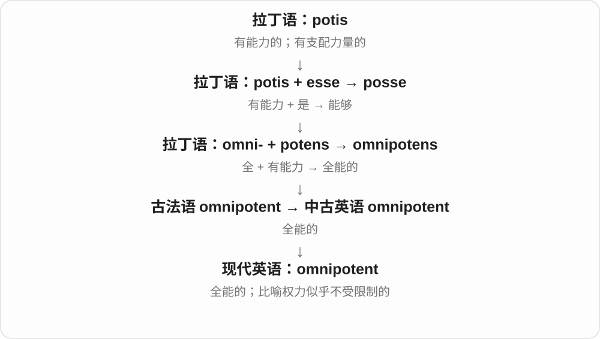
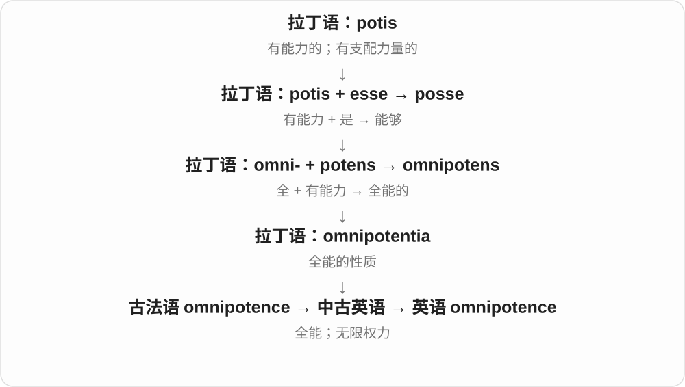

# 3226 · omni- — 全部；每一个；所有

[逐词精讲目录](../00_逐词精讲目录.md) · [总目录](../00_总目录_按常用程度.md)

## 核心词根与来源

omni- 给后面成分一个全范围：present 在场，scient 知道，potent 有能力，vorous 吃。它有古代、近代借词，也有现代英语组合，不能把每个词都说成在英语里现场拼成。omnibus 的 -bus 原来属于拉丁语法形式。

**把范围推到全部：哪里都在、什么都知道、各种东西都吃，或把各个渠道接在一起。**

拉丁 omnis 全部 → omni-；中世纪拉丁 omnipraesens/omnipraesentia → omnipresent/omnipresence；英语再造 omnidirectional、omnichannel。拉丁 omnibus 为所有人 → 法语公共马车名称 → omnibus。

- **处处在场**：omnipresent, omnipresence
- **全知与全能**：omniscient, omniscience, omnipotent, omnipotence
- **食物范围**：omnivore, omnivorous
- **各方向、各渠道与合集**：omnidirectional, omnichannel, omnibus

## 词形与演化规律

omni- 接不同成分时重音随整词变化；omniscient 的中间读音不能照字母一个个拼。omnichannel 是现代商业词，重点在连接渠道，并不是强制覆盖所有可能的渠道。

## 单词速览（常用到不常用）

| 单词 | 音标 | 核心意思 |
|---|---|---|
| [omnibus](#w-1) | 英 /ˈɒmnɪbəs/；美 /ˈɑːmnɪbəs/ | 作品合集；汇总的；旧称公共马车、公共汽车 |
| [omnipotent](#w-2) | 英 /ɒmˈnɪpətənt/；美 /ɑːmˈnɪpətənt/ | 全能的；仿佛无所不能的 |
| [omnipresent](#w-3) | 英 /ˌɒmnɪˈprezənt/；美 /ˌɑːmnɪˈprezənt/ | 无处不在的 |
| [omniscient](#w-4) | 英 /ɒmˈnɪsiənt/，亦 /ɒmˈnɪʃənt/；美 /ɑːmˈnɪʃənt/ | 无所不知的；全知的 |
| [omnipotence](#w-5) | 英 /ɒmˈnɪpətəns/；美 /ɑːmˈnɪpətəns/ | 全能；无限的力量或权力 |
| [omniscience](#w-6) | 英 /ɒmˈnɪsiəns/；美 /ɑːmˈnɪʃəns/ | 全知；无所不知 |
| [omnivorous](#w-7) | 英 /ɒmˈnɪvərəs/；美 /ɑːmˈnɪvərəs/ | 杂食的；兴趣广泛、涉猎很杂的 |
| [omnidirectional](#w-8) | 英 /ˌɒmnɪdəˈrekʃənəl/；美 /ˌɑːmnɪdəˈrekʃənəl/；也可读 /daɪ/ | 全向的；可朝各方向的 |
| [omnivore](#w-9) | 英 /ˈɒmnɪvɔː(r)/；美 /ˈɑːmnɪvɔːr/ | 杂食动物；饮食不只限于植物的人 |
| [omnipresence](#w-10) | 英 /ˌɒmnɪˈprezəns/；美 /ˌɑːmnɪˈprezəns/ | 无处不在；遍在 |
| [omnichannel](#w-11) | 构词参考读法：英 /ˌɒmnɪˈtʃænəl/；美 /ˌɑːmniˈtʃænəl/ | 全渠道的 |

## 逐词讲解

### 1. omnibus — 作品合集；汇总的；旧称公共马车、公共汽车

**音标**：英 /ˈɒmnɪbəs/；美 /ˈɑːmnɪbəs/

**先抓住这个画面**

把许多内容装在一起：可以是几本小说合成一册，也可以是一份包了很多项目的提案。

**怎么拆**

经法语 voiture omnibus 大家都能乘的车，借拉丁 omnibus 为所有人，是 omnis 的复数与格。后来扩展为把多项东西放在一起；bus 正是 omnibus 的截短。

**怎么变成今天的意思**

**拉丁 omnis 全部、每一个**  
其组合形式 omni- 在英语中表达所有方向、渠道、能力等

↓

**拉丁 omnibus 为所有人 → 法语 voiture omnibus → 英语 omnibus**  
公共交通工具的旧名称

↓

**英语扩展为汇集多项的形容词、合集名词**  
从人人可用转到内容包罗多项

an omnibus edition 是合集版，an omnibus bill 是涵盖多项事务的综合法案。今天直接说交通通常用 bus，omnibus 的交通义显得老派。

**常见搭配与例句**

an omnibus edition；an omnibus collection；an omnibus bill。

> The volume is an omnibus of her first three novels.

这一卷合集收录了她的前三部小说。

> The committee discussed an omnibus proposal covering several departments.

委员会讨论了一份涵盖多个部门的综合提案。

**别混淆**

anthology 通常是选集，omnibus 常把若干部完整作品或多集节目收在一起。词尾 -bus 原来属于拉丁语法词尾，不是早就有 bus 再加 omni-。

### 2. omnipotent — 全能的；仿佛无所不能的

**音标**：英 /ɒmˈnɪpətənt/；美 /ɑːmˈnɪpətənt/

**先抓住这个画面**

omnipotent 把能力的范围推到“任何事都能做到”，不是只在一个项目上厉害。

**怎么拆**

来自古法语及拉丁 omnipotens：omni- 全部 + potens 有能力的；英语保留了这个整体词。

**怎么变成今天的意思**

宗教中可描述神的全能；评论中也可夸张地形容权力极大的人。用于人时往往带“他以为自己什么都能管”的意味。

**常见搭配与例句**

an omnipotent deity；seem omnipotent；an omnipotent ruler。

> The myth describes an omnipotent deity.

这个神话描绘了一位全能的神。

> No manager is omnipotent, however impressive the job title.

不管职位名称多显赫，没有哪个经理是无所不能的。

**别混淆**

omnipotent 是什么都能做；omniscient 是什么都知道；omnipresent 是无处不在。

### 3. omnipresent — 无处不在的

**音标**：英 /ˌɒmnɪˈprezənt/；美 /ˌɑːmnɪˈprezənt/

**先抓住这个画面**

走到哪里都碰得到，仿佛到处都有它。

**怎么拆**

接中世纪拉丁 omnipraesens，由 omnis 全部与 praesens 在场组成。现代可看成 omni- + present，但这里 present 是在场，不是礼物。

**怎么变成今天的意思**

**拉丁 omnis 全部、每一个**  
其组合形式 omni- 在英语中表达所有方向、渠道、能力等

↓

**拉丁 praesens 在场 + omni- → 中世纪拉丁 omnipraesens**  
处处都在的

↓

**英语 omnipresent**  
宗教语境可说遍在；日常常夸张地说到处都是

omnipresent advertising 是广告无处不在，不必理解为宇宙每一点都真的有广告。形容气氛、技术或某个品牌时，常是一种强烈的概括。

**常见搭配与例句**

omnipresent advertising；an omnipresent threat；seem omnipresent。

> Advertising seemed omnipresent in the city centre.

市中心似乎到处都是广告。

> The threat of closure was omnipresent during the negotiations.

谈判期间，停业的威胁始终笼罩着大家。

**别混淆**

ubiquitous 也常说到处都有；omnipresent 的处处在场感更强。omnipotent 是无所不能，不能把存在范围和能力混为一谈。

### 4. omniscient — 无所不知的；全知的

**音标**：英 /ɒmˈnɪsiənt/，亦 /ɒmˈnɪʃənt/；美 /ɑːmˈnɪʃənt/

**先抓住这个画面**

别人只知道自己看到的事，这个观察者却连每个人心里在想什么都知道。

**怎么拆**

来自中世纪拉丁语 omnisciens，由 omnis“所有”与 sciens“知道的”组合；不是 omni- + science 的简单拼写变化。

**怎么变成今天的意思**

**拉丁语 scire**  
知道、认识

↓

**中世纪拉丁语 omnis + sciens → omnisciens → 英语 omniscient**  
所有 + 知道 → 无所不知的

an omniscient narrator 是全知叙述者，叙述能进入多个人物的内心。日常说某人 acts omniscient，常是在批评他装得什么都懂。

**常见搭配与例句**

an omniscient narrator；an omniscient deity；appear omniscient。

> The novel uses an omniscient narrator who knows every character’s thoughts.

小说采用全知叙述者，能知道每个人物的想法。

> No manager is omniscient, so the team needs to share information.

没有哪个经理无所不知，因此团队需要共享信息。

**别混淆**

omniscient 是全知；omnipotent 是全能。知道一切不等于能做到一切。

### 5. omnipotence — 全能；无限的力量或权力

**音标**：英 /ɒmˈnɪpətəns/；美 /ɑːmˈnɪpətəns/

**先抓住这个画面**

omnipotence 把“没有任何能力边界”作为一个性质来讨论。

**怎么拆**

经古法语 omnipotence 来自拉丁 omnipotentia；对应 omnipotent，但不是必须等英语形容词出现后才加后缀。

**怎么变成今天的意思**

神学里可讨论 divine omnipotence；政治或心理评论里可谈某人对自己权力的无限想象。通常是不可数名词。

**常见搭配与例句**

divine omnipotence；a belief in omnipotence；an illusion of omnipotence。

> The seminar examined different ideas of divine omnipotence.

研讨课讨论了对神之全能的不同理解。

> Success gave him an illusion of omnipotence.

成功让他产生了无所不能的错觉。

**别混淆**

potency 是某种作用的强度；omnipotence 把范围扩展到没有能力限制，语义强得多。

### 6. omniscience — 全知；无所不知

**音标**：英 /ɒmˈnɪsiəns/；美 /ɑːmˈnɪʃəns/

**先抓住这个画面**

把“所有事情都知道”当作一种能力或状态来讨论。

**怎么拆**

借自中世纪拉丁语 omniscientia，omni-“全部” + scientia“知识”；名词有自己的拉丁语借入路线。

**怎么变成今天的意思**

**拉丁语 scire**  
知道、认识

↓

**拉丁语 omnis + scientia → 中世纪拉丁语 omniscientia → 英语 omniscience**  
所有知识 → 全知

常见于神学、文学叙述和哲学讨论。日常中的 an illusion of omniscience 是误以为掌握一切信息的错觉，不能把大量数据自动等同于全知。

**常见搭配与例句**

divine omniscience；narrative omniscience；an illusion of omniscience。

> The essay contrasts divine omniscience with human uncertainty.

文章对比了神的全知与人的不确定性。

> The dashboard created an illusion of omniscience.

这个仪表盘让人产生了掌握全部信息的错觉。

**别混淆**

omniscient 是形容词；omniscience 是名词。expertise 只是某领域的专长，并非全知。

### 7. omnivorous — 杂食的；兴趣广泛、涉猎很杂的

**音标**：英 /ɒmˈnɪvərəs/；美 /ɑːmˈnɪvərəs/

**先抓住这个画面**

菜单不只限于一种来源：植物也吃，动物性食物也吃；比喻时是各种题材都愿意接触。

**怎么拆**

拉丁 omnis 全部 + -vorus 吃的 → omnivorus，再进入英语成为 omnivorous。现代可以拆成 omni- + -vorous；并不是由较晚的英语 omnivore 才造出的形容词。

**怎么变成今天的意思**

**拉丁 vorare**  
吞下、吞食

↓

**拉丁 omnis + vorus → omnivorus**  
各种都吃的、吞食一切的

↓

**英语 omnivorous**  
杂食的；广泛吸收各类内容的

生物学中说杂食，通常指同时以植物性和动物性食物为食，不是能把石头、金属也吃掉。an omnivorous reader 则像阅读菜单很宽：小说、历史、科学都愿意读。重点在范围广，不必强调吃得或读得特别快。

**常见搭配与例句**

omnivorous animals；an omnivorous diet；an omnivorous reader。

> Pigs are omnivorous and eat a wide range of foods.

猪是杂食动物，食物范围很广。

> She is an omnivorous reader, equally happy with poetry and science books.

她读书涉猎很广，诗歌和科学书都读得津津有味。

**别混淆**

omnivorous 讲吃什么种类，voracious 讲需求有多大。carnivorous 偏肉食，herbivorous 偏植物食，是另一种食性分类。

### 8. omnidirectional — 全向的；可朝各方向的

**音标**：英 /ˌɒmnɪdəˈrekʃənəl/；美 /ˌɑːmnɪdəˈrekʃənəl/；也可读 /daɪ/

**先抓住这个画面**

不是只盯住正前方，而是朝周围各方向接收、发出或移动。

**怎么拆**

英语 omni- 全 + directional 方向的，是近代英语组合。directional 本身接 direction；不能因有古典成分就说整个词来自古代拉丁语。

**怎么变成今天的意思**

**拉丁 omnis 全部、每一个**  
其组合形式 omni- 在英语中表达所有方向、渠道、能力等

↓

**英语 omni- + directional → omnidirectional**  
面向各方向，常用于声音、天线、移动设备

an omnidirectional microphone 能从四周拾音。工程中所谓全向，要看所讨论的平面和频率等条件，不一定表示整个三维空间里每个方向性能都完全一样。

**常见搭配与例句**

an omnidirectional microphone；an omnidirectional antenna；omnidirectional movement。

> We used an omnidirectional microphone for the group discussion.

小组讨论时，我们用了全向麦克风。

> The robot’s wheels allow omnidirectional movement.

机器人的轮子让它可以向各个方向移动。

**别混淆**

directional microphone 特别朝某些方向拾音；omnidirectional 更面向周围。isotropic 是更严格的方向均匀概念，不宜直接等同全向设备。

### 9. omnivore — 杂食动物；饮食不只限于植物的人

**音标**：英 /ˈɒmnɪvɔː(r)/；美 /ˈɑːmnɪvɔːr/

**先抓住这个画面**

omnivorous 描述食性，an omnivore 则把具有这种食性的人或动物指出来。

**怎么拆**

最终来自拉丁 omnivorus。英语名词与 omnivorous 及 carnivore 等名词模式有关，法语 omnivore 也可能是直接来源；不把这几种解释硬排成唯一的借入顺序。

**怎么变成今天的意思**

**拉丁 vorare**  
吞下、吞食

↓

**拉丁 omnis + vorus → omnivorus**  
各种都吃的、吞食一切的

↓

**法语 omnivore / 英语同类名词模式**  
把这种食性用作动物或人的名称

↓

**英语 omnivore**  
杂食者、杂食动物

在生态文章里，它是食物链中的一种食性角色；在餐饮语境里，也可说一个人既吃植物性食物也吃肉。它只描述饮食类型，不代表每一种食物都爱吃，更不等于一个人没有个人口味。

**常见搭配与例句**

an omnivore；omnivores and herbivores；a menu for omnivores。

> Raccoons are omnivores that eat both plant and animal foods.

浣熊是杂食动物，既吃植物性食物，也吃动物性食物。

> The restaurant offers options for vegans and omnivores alike.

这家餐馆为纯素食者和荤素都吃的客人都提供了选择。

**别混淆**

omnivore 是名词，omnivorous 是形容词。说 a raccoon is an omnivore，或 a raccoon is omnivorous；后一句不加 an。

### 10. omnipresence — 无处不在；遍在

**音标**：英 /ˌɒmnɪˈprezəns/；美 /ˌɑːmnɪˈprezəns/

**先抓住这个画面**

把到处都能感到它这一状态当成一个整体来谈。

**怎么拆**

接中世纪拉丁 omnipraesentia，来自 omnipraesens。现代可以联想 omni- + presence，但名词有自己的拉丁借入路线。

**怎么变成今天的意思**

**拉丁 omnis 全部、每一个**  
其组合形式 omni- 在英语中表达所有方向、渠道、能力等

↓

**拉丁 praesens 在场 + omni- → 中世纪拉丁 omnipraesens**  
处处都在的

↓

**中世纪拉丁 omnipraesentia → 英语 omnipresence**  
处处在场这一性质或状态

the omnipresence of smartphones 说智能手机已经渗入许多生活场景。通常不可数，不把它当成许多个 presence 去数。

**常见搭配与例句**

the omnipresence of technology；divine omnipresence；a sense of omnipresence。

> The essay explores the omnipresence of screens in modern life.

文章讨论了屏幕在现代生活中无处不在的现象。

> The brand’s omnipresence made it hard to ignore.

这个品牌到处出现，让人很难忽视它。

**别混淆**

presence 可以只是某人在一个地方出现，omnipresence 强调几乎处处都在。visibility 是容易看见，两者相关，却不等同。

### 11. omnichannel — 全渠道的

**音标**：构词参考读法：英 /ˌɒmnɪˈtʃænəl/；美 /ˌɑːmniˈtʃænəl/

**先抓住这个画面**

顾客换到网站、手机或门店后，事情还能接着办，不必每换一个地方就重新开始。

**怎么拆**

英语 omni- 全 + channel 渠道，是现代商业组合词。名称虽说全，实际重点是企业所用渠道之间能够连接，而不是必须覆盖世界上所有渠道。

**怎么变成今天的意思**

**拉丁 omnis 全部、每一个**  
其组合形式 omni- 在英语中表达所有方向、渠道、能力等

↓

**英语 omni- + channel → omnichannel**  
把线上、线下等渠道连接起来的商业方式

omnichannel service 可以让客服接着查看你在门店或网站的记录。它强调过程衔接，不只是在很多地方都开一个账号。

**常见搭配与例句**

omnichannel retail；an omnichannel strategy；omnichannel customer service。

> The retailer adopted an omnichannel strategy linking its website and stores.

零售商采用了连接网站与门店的全渠道策略。

> Omnichannel support lets customers continue a conversation on a different device.

全渠道客服让顾客换一台设备后仍能接着原来的沟通。

**别混淆**

multichannel 只说明有多种渠道，它们可能彼此独立；omnichannel 通常进一步强调渠道间的信息和体验衔接。

## 这一组要分清什么

omnipresent 是处处在，omnipotent 是无所不能。omnichannel 强调渠道协同，不只多开几个独立渠道。bus 是 omnibus 的截短，不反过来解释。

## 串起来练习

分别解释 omnipresent、omniscient、omnipotent 的全体现在哪；用线上购物再到门店取货理解 omnichannel；说明 omnibus 为什么既能是合集又曾指公共马车。
