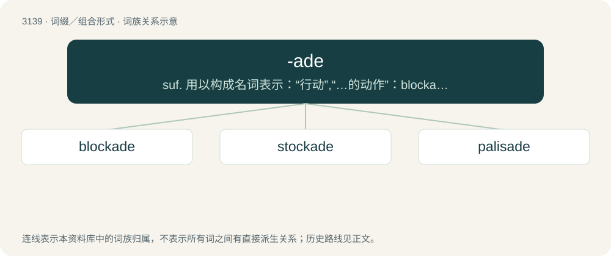

# 3239 · -ade — suf. 用以构成名词表示：“行动”,“…的动作”：blockade; “行动者”：renegade; “行动者的集体”：cavalcade; “行动的产物”：arcade; “参与”,“参加”：brigade

[总目录](../00_总目录_按常用程度.md)

**类型**：词缀／组合形式　｜　**来源语言**：见词源记录

## 核心含义与来源

- 核心含义：suf. 用以构成名词表示：“行动”,“…的动作”：blockade; “行动者”：renegade; “行动者的集体”：cavalcade; “行动的产物”：arcade; “参与”,“参加”：brigade
- 英文含义：Used to form nouns denoting action, or a person performing said action.
- 词形：-ade

**来源记录 1**（后缀／后置成分；Used to form nouns denoting action, or a person performing said action.）

Borrowed from Spanish -ado, from Latin -āta, feminine form of -ātus, suffix used to create adjectives and nouns.

## 词族图

## 单词速览（常用到不常用）

| 单词 | 音标 | 释义 |
|---|---|---|
| [blockade](#w-1) | 英 /blɒˈkeɪd/；美 /blɑˈkeɪd/ | n. 阻塞；vt. 封锁 |
| [stockade](#w-2) | 英 /ˌstɒˈkeɪd/；美 /ˌstɑˈkeɪd/ | n. 栅栏, 围起的地方；vt. 用栅栏围住 |
| [palisade](#w-3) | /ˈpæl.ɪˌseɪ̯d/ | n. 木栅；vt. 用栅栏围护 |

## 逐词详解

### 1. blockade

**词性**：名词　｜　**音标**：英 /blɒˈkeɪd/；美 /blɑˈkeɪd/

**中文释义**：n. 阻塞；vt. 封锁

**英文义项**：The physical blocking or surrounding of a place, especially a port, in order to prevent commerce and traffic in or out. / Any form of formal isolation or inhibition of something, especially with the force of law or arms.

**构词拆分**：block + -ade

**词源与演化**：

From block + -ade, probably after Dutch blocquade (now blokkade) or German Blockade.

**用法示例／搭配（非完整句）**：

> beta-blockade

该用例对应义项：Inhibition of the activity (function) of chemical messengers or their receptors, such as (often) receptor antagonism.

### 2. stockade

**词性**：名词　｜　**音标**：英 /ˌstɒˈkeɪd/；美 /ˌstɑˈkeɪd/

**中文释义**：n. 栅栏, 围起的地方；vt. 用栅栏围住

**英文义项**：An enclosure protected by a wall of wooden posts. / A military prison.

**构词拆分**：stock + -ade

**词源与演化**：

From French estocade, equivalent to stock + -ade.

**例句**：

> The thief was thrown into the stockade to await trial.

### 3. palisade

**词性**：名词　｜　**音标**：/ˈpæl.ɪˌseɪ̯d/

**中文释义**：n. 木栅；vt. 用栅栏围护

**英文义项**：A long, strong stake, one end of which is set firmly in the ground, and the other sharpened. / A wall of wooden stakes, used as a defensive barrier.

**词源与演化**：

Borrowed from Middle French palissade, from Old French, from Old Occitan palissada, from palissa (“stake”), probably from pal (“stake”), or possibly from Gallo-Romance \*pālīcea, from Latin pālus (“stake”) + -ade.

**例句**：

> They lived near the ocean, at the top of a steep palisade.
