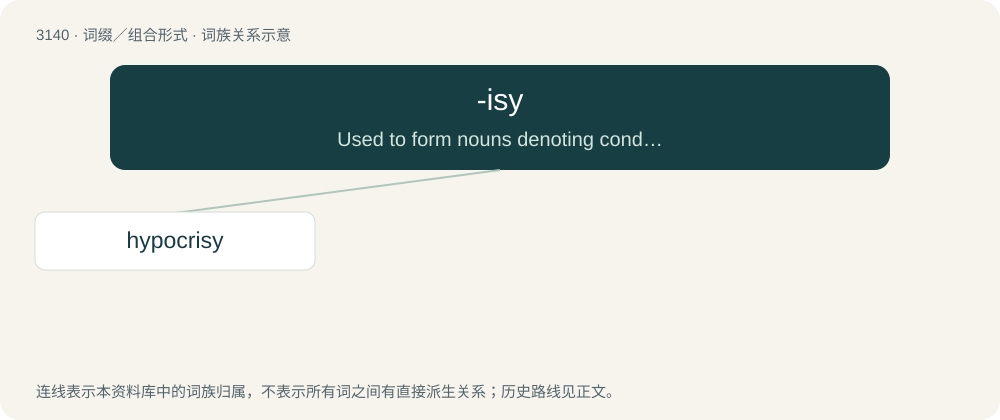

# 3240 · -isy — Used to form nouns denoting condition, action, or process.

[总目录](../00_总目录_按常用程度.md)

**类型**：词缀／组合形式　｜　**来源语言**：见词源记录

## 核心含义与来源

- 核心含义：Used to form nouns denoting condition, action, or process.
- 英文含义：Used to form nouns denoting condition, action, or process.
- 词形：-isy

**来源记录 1**（后缀／后置成分；Used to form nouns denoting condition, action, or process.）

Ultimately from Ancient Greek -σις (-sis).

## 词族图

## 单词速览（常用到不常用）

| 单词 | 音标 | 释义 |
|---|---|---|
| [hypocrisy](#w-1) | 英 /hɪˈpɒkɹəsi/；美 /hɪˈpɑkɹəsi/ | n. 伪善；\[法\] 伪善, 虚伪 |

## 逐词详解

### 1. hypocrisy

**词性**：名词　｜　**音标**：英 /hɪˈpɒkɹəsi/；美 /hɪˈpɑkɹəsi/

**中文释义**：n. 伪善；\[法\] 伪善, 虚伪

**英文义项**：The contrivance of a false appearance of virtue or goodness, while concealing real character or inclinations, especially with respect to religious and moral beliefs; hence in general sense, dissimulation, pretence, sham. / The claim or pretense of having beliefs, standards, qualities, behaviours, virtues, motivations, etc. which one does not really have.

**构词拆分**：hypo- + Ancient Greek κρί(σις) (krí(sis)) + -isy

**词源与演化**：

From hypo- + Ancient Greek κρί(σις) (krí(sis)) + -isy. From Middle English ipocrisie, from Old French ypocrisie, from Late Latin hypocrisis, from Ancient Greek ὑπόκρισις (hupókrisis, “answer, stage acting, pretense”), from ὑποκρίνομαι (hupokrínomai, “I answer (a fellow actor on stage), play a part, dissemble, feign”), from ὑπό (hupó, “under, equivalent of the modern "hypo-" prefix”) + the middle voice of κρίνω (krínō, “I separate, judge, decide”) + -isy. Displaced native Old English līċettung.

**例句**：

> He condemned the hypocrisy of politicians who broke their own laws.

该用例对应义项：The contrivance of a false appearance of virtue or goodness, while concealing real character or inclinations, especially with respect to religious and moral beliefs; hence in general sense, dissimulation, pretence, sham.
