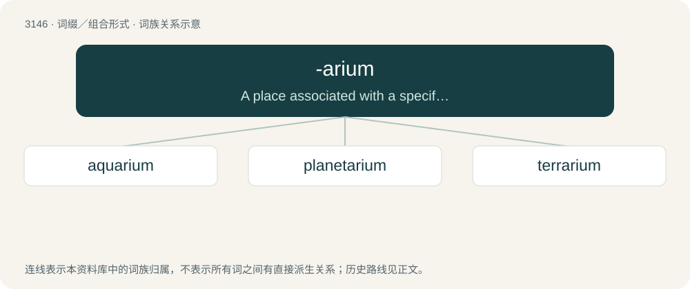

# 3248 · -arium — A place associated with a specified thing.

[总目录](../00_总目录_按常用程度.md)

**类型**：词缀／组合形式　｜　**来源语言**：见词源记录

## 核心含义与来源

- 核心含义：A place associated with a specified thing.
- 英文含义：A place associated with a specified thing.
- 词形：-arium

**来源记录 1**（后缀／后置成分；A place associated with a specified thing.）

Learned borrowing from Latin -ārium. Doublet of -ary.

## 词族图

## 单词速览（常用到不常用）

| 单词 | 音标 | 释义 |
|---|---|---|
| [aquarium](#w-1) | 美 /əˈkwɛɹ.i.jəm/ | n. 水族馆, 养鱼池, 水草缸；\[医\] 培养缸 |
| [planetarium](#w-2) | 英 /plænɪˈtɛəɹɪəm/；/plænɪˈtɛɚiəm/ | n. 行星仪, 天文馆, 天象图 |
| [terrarium](#w-3) | 英 /təˈɹɛəɹ.ɪ.əm/；美 /təˈɹɛɹ.i.əm/ | n. 陆栖小动物饲养箱, 小植物裁培盒 |

## 逐词详解

### 1. aquarium

**词性**：名词　｜　**音标**：美 /əˈkwɛɹ.i.jəm/

**中文释义**：n. 水族馆, 养鱼池, 水草缸；\[医\] 培养缸

**英文义项**：A tank, often made of glass, for keeping live fish or other aquatic animals. / A public place where live fish and other aquatic animals are exhibited.

**词源与演化**：

Borrowed from Latin aquārium, neuter of aquārius (“of or pertaining to water”), from aqua + -arium. Doublet of ewer; see also Aquarius. Also claimed to be coined by English naturalist Philip Henry Gosse, as a blend of aquatic + vivarium.

**例句**：

> The Vancouver aquarium will no longer keep whales and dolphins in captivity.

### 2. planetarium

**词性**：名词　｜　**音标**：英 /plænɪˈtɛəɹɪəm/；/plænɪˈtɛɚiəm/

**中文释义**：n. 行星仪, 天文馆, 天象图

**英文义项**：A display museum in which images of stars and other astronomical phenomena are projected onto a domed ceiling. / An orrery.

**构词拆分**：planet + -arium

**词源与演化**：

Borrowed from New Latin planētārium. Equivalent to planet + -arium.

**例句**：

> He went to the planetarium to see the stars and the planets.

### 3. terrarium

**词性**：名词　｜　**音标**：英 /təˈɹɛəɹ.ɪ.əm/；美 /təˈɹɛɹ.i.əm/

**中文释义**：n. 陆栖小动物饲养箱, 小植物裁培盒

**英文义项**：An enclosure wherein small animals are displayed, usually with some plants, in a naturalistic setting. / A partially enclosed glass container for displaying plants, especially plants that need high humidity.

**词源与演化**：

From Latin terra (“earth”) + -arium, by analogy with aquarium.

**例句**：

> I have a tarantula in a small terrarium, and I feed it cockroaches.
