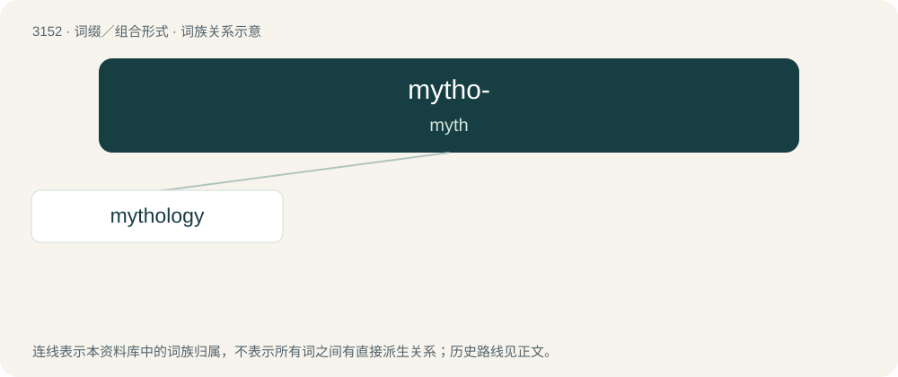

# 3256 · mytho- — myth

[总目录](../00_总目录_按常用程度.md)

**类型**：词缀／组合形式　｜　**来源语言**：见词源记录

## 核心含义与来源

- 核心含义：myth
- 英文含义：myth
- 词形：mytho-

**来源记录 1**（前缀／前置成分；myth）

From Ancient Greek μῦθος (mûthos).

## 词族图

## 单词速览（常用到不常用）

| 单词 | 音标 | 释义 |
|---|---|---|
| [mythology](#w-1) | 英 /mɪˈθɒl.ə.d͡ʒi/；美 /mɪˈθɑ.lə.d͡ʒi/ | n. 神话 |

## 逐词详解

### 1. mythology

**词性**：名词　｜　**音标**：英 /mɪˈθɒl.ə.d͡ʒi/；美 /mɪˈθɑ.lə.d͡ʒi/

**中文释义**：n. 神话

**英文义项**：The collection of myths of a people, concerning the origin of the people, history, deities, ancestors and heroes. / A similar body of myths concerning an event, person or institution.

**构词拆分**：mytho- + -logy

**词源与演化**：

First attested as Middle English in 1412. From Middle French mythologie, from Latin mȳthologia, from Ancient Greek μυθολογία (muthología, “legend”) μυθολογέω (muthologéō, “to tell tales”), from μυθολόγος (muthológos, “legend”), from μῦθος (mûthos, “story”) + λέγω (légō, “to say”). By surface analysis, myth + -ology or mytho- + -logy.

**例句**：

> The story of a great flood is very common in world mythology.
