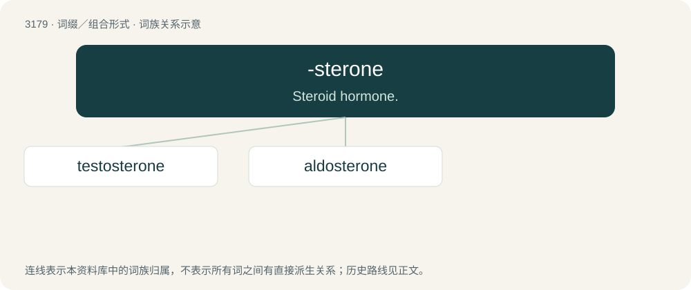

# 3279 · -sterone — Steroid hormone.

[总目录](../00_总目录_按常用程度.md)

**类型**：词缀／组合形式　｜　**来源语言**：见词源记录

## 核心含义与来源

- 核心含义：Steroid hormone.
- 英文含义：Steroid hormone.
- 词形：-sterone

**来源记录 1**（后缀／后置成分；Steroid hormone.）

From sterol + -one.

## 词族图

## 单词速览（常用到不常用）

| 单词 | 音标 | 释义 |
|---|---|---|
| [testosterone](#w-1) | 英 /tɛˈstɒ.stə.ɹəʊn/；美 /tɛˈstɑ.stəˌɹoʊn/ | n. 睾丸激素；\[化\] 睾酮 |
| [aldosterone](#w-2) | 英 /ælˈdɒstəɹəʊn/；美 /ælˈdɑstəˌɹoʊn/ | n. 醛固酮；\[化\] 醛甾酮 |

## 逐词详解

### 1. testosterone

**词性**：名词　｜　**音标**：英 /tɛˈstɒ.stə.ɹəʊn/；美 /tɛˈstɑ.stəˌɹoʊn/

**中文释义**：n. 睾丸激素；\[化\] 睾酮

**英文义项**：A steroid hormone that stimulates development of male secondary sexual characteristics, produced mainly in the testes, but also in the ovaries and adrenal cortex. / Manly behavior, often of an aggressive or foolishly reckless nature.

**构词拆分**：testis + -o- + -sterone

**词源与演化**：

From test(is) + -o- + -sterone (“steroid hormone”).

**例句**：

> Mother encouraged James to rely more on intelligence and less on testosterone to deal with the neighbor's son.

该用例对应义项：Manly behavior, often of an aggressive or foolishly reckless nature.

### 2. aldosterone

**词性**：名词　｜　**音标**：英 /ælˈdɒstəɹəʊn/；美 /ælˈdɑstəˌɹoʊn/

**中文释义**：n. 醛固酮；\[化\] 醛甾酮

**英文义项**：A mineralocorticoid hormone, secreted by the adrenal cortex, that regulates the balance of sodium and potassium in the body.

**构词拆分**：aldo- (“related to aldehydes”) + -sterone

**词源与演化**：

From aldo- (“related to aldehydes”) + -sterone, modelled on German Aldosteron; coined in the 1950s.
