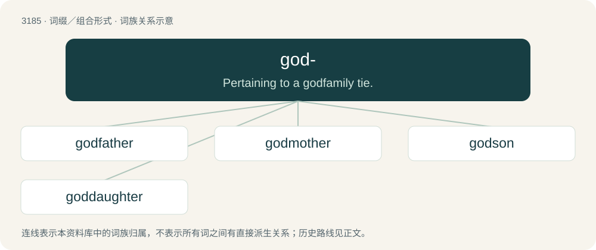

# 3282 · god- — Pertaining to a godfamily tie.

[总目录](../00_总目录_按常用程度.md)

**类型**：词缀／组合形式　｜　**来源语言**：见词源记录

## 核心含义与来源

- 核心含义：Pertaining to a godfamily tie.
- 英文含义：Pertaining to a godfamily tie.
- 词形：god-

**来源记录 1**（前缀／前置成分；Pertaining to a godfamily tie.）

From god.

## 词族图

## 单词速览（常用到不常用）

| 单词 | 音标 | 释义 |
|---|---|---|
| [godfather](#w-1) | 英 /ˈɡɒdfɑːðə/；美 /ˈɡɑdfɑðɚ/ | n. 教父；vt. 当教父 |
| [godmother](#w-2) | 英 /ˈɡɒdmʌðə/ | n. 教母, 女监护人 |
| [godson](#w-3) | 英 /ˈɡɒdˌsʌn/；美 /ˈɡɑdˌsʌn/ | n. 教子 |
| [goddaughter](#w-4) | 英 /ˈɡɒdˌdɔːtə(ɹ)/；美 /ˈɡɑdˌdɔ.tɚ/ | n. 教女 |

## 逐词详解

### 1. godfather

**词性**：名词　｜　**音标**：英 /ˈɡɒdfɑːðə/；美 /ˈɡɑdfɑðɚ/

**中文释义**：n. 教父；vt. 当教父

**英文义项**：A man present at the christening of a baby who promises to help raise the child in a Christian manner; a male godparent who sponsors the baptism of a child. / Someone who plays a key role in fostering the development of something.

**构词拆分**：god- + father

**词源与演化**：

From Middle English godfader, from Old English godfæder (“godfather”), equivalent to god- + father. Cognate with Old Saxon godfadar (“godfather”), Middle Dutch godvader (“godfather”), Danish gudfader, gudfar (“godfather”), Swedish gudfader, gudfar (“godfather”), Icelandic guðfaðir (“godfather”).

**例句**：

> Thank you for sending me the link to purchase "The Godfather" movie.

### 2. godmother

**词性**：名词　｜　**音标**：英 /ˈɡɒdmʌðə/

**中文释义**：n. 教母, 女监护人

**英文义项**：A woman present at the christening of a baby who promises to help raise the child in a Christian manner; a female godparent who sponsors the baptism of a child.

**构词拆分**：god- + mother

**词源与演化**：

From Middle English godmoder, from Old English godmōdor (“godmother”), equivalent to god- + mother. Cognate with Old High German gotmuoter (“godmother”), Old Norse guðmóðir (“godmother”), Icelandic guðmóður (“godmother”), Swedish gudmoder (“godmother”), Danish gudmor (“godmother”).

**例句**：

> I don't know if my son's godmother and godfather are still alive.

### 3. godson

**词性**：名词　｜　**音标**：英 /ˈɡɒdˌsʌn/；美 /ˈɡɑdˌsʌn/

**中文释义**：n. 教子

**英文义项**：A male child whose baptism is sponsored by a godparent.

**构词拆分**：god- + son

**词源与演化**：

From Middle English godsone, gossone, from Old English godsunu (“godson”), equivalent to god- + son. Cognate with Danish gudsøn (“godson”), Swedish gudson (“godson”), Icelandic guðsonur (“godson”).

**例句**：

> Whenever she travels, she buys a gift for her godson.

### 4. goddaughter

**词性**：名词　｜　**音标**：英 /ˈɡɒdˌdɔːtə(ɹ)/；美 /ˈɡɑdˌdɔ.tɚ/

**中文释义**：n. 教女

**英文义项**：A female child whose baptism is sponsored by a godparent.

**构词拆分**：god- + daughter

**词源与演化**：

From Middle English goddoghter, goddoȝter, from Old English goddohtor (“goddaughter”), equivalent to god- + daughter. Cognate with Danish guddatter (“goddaughter”), Swedish guddotter (“goddaughter”), Icelandic guðdóttir (“goddaughter”).
