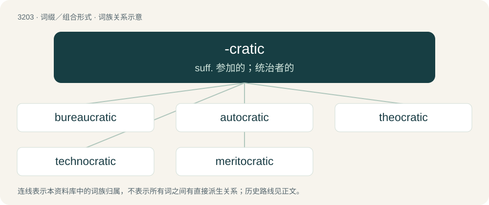

# 3303 · -cratic — suff. 参加的；统治者的

[总目录](../00_总目录_按常用程度.md)

**类型**：词缀／组合形式　｜　**来源语言**：见词源记录

## 核心含义与来源

- 核心含义：suff. 参加的；统治者的
- 英文含义：used to form adjectives, of or befitting -cracy
- 词形：-cratic

**来源记录 1**（后缀／后置成分；used to form adjectives, of or befitting -cracy）

From Middle French -cratique, and its source, Latin -craticus, from Ancient Greek -κρατικός (-kratikós), from -κρατία (-kratía, “-cracy”), from κράτος (krátos, “strength, might, rule, authority”). Equivalent to -crat + -ic or -cracy + -ic.

## 词族图

## 单词速览（常用到不常用）

| 单词 | 音标 | 释义 |
|---|---|---|
| [bureaucratic](#w-1) | 英 /ˌbjʊəɹəˈkɹætɪk/；美 /ˌbjʊɹəˈkɹætɪk/ | a. 官僚的；\[经\] 机僚化的 |
| [autocratic](#w-2) | 英 /ˌɔːtəˈkɹætɪk/；美 /ˌɑtoʊˈkɹætɪk/ | a. 独裁的, 专制的 |
| [theocratic](#w-3) | /.θiːəˈkrætik/ | a. 神权政治的 |
| [technocratic](#w-4) | 英 /tɛk.nəˈkɹæt.ɪk/ | a. 由技术专家官员组成的；受技术官僚影响的 |
| [meritocratic](#w-5) | /ˌmerɪtəˈkrætɪk/ | a. 精英管理的；贤能统治的 |

## 逐词详解

### 1. bureaucratic

**词性**：形容词　｜　**音标**：英 /ˌbjʊəɹəˈkɹætɪk/；美 /ˌbjʊɹəˈkɹætɪk/

**中文释义**：a. 官僚的；\[经\] 机僚化的

**英文义项**：Of or pertaining to bureaucracy or the actions of bureaucrats.

**构词拆分**：bureaucrat + -ic；bureau + -cratic

**词源与演化**：

Borrowed from French bureaucratique, from bureaucrate (“bureaucrat”) or bureaucratie (“bureaucracy”) + -ique (“-ic”), equivalent to bureaucrat + -ic or bureau + -cratic.

**例句**：

> His bureaucratic behavior annoyed his colleagues.

该用例对应义项：of or relating to or resembling a bureaucrat or bureaucracy

### 2. autocratic

**词性**：形容词　｜　**音标**：英 /ˌɔːtəˈkɹætɪk/；美 /ˌɑtoʊˈkɹætɪk/

**中文释义**：a. 独裁的, 专制的

**英文义项**：Of or pertaining to autocracy or to an autocrat; absolute; holding independent and arbitrary powers of government. / Of or pertaining to the manner of an autocrat.

**构词拆分**：autocrat + -ic；auto- + -cratic

**词源与演化**：

From autocrat + -ic, equivalent to auto- + -cratic.

**例句**：

> Despite his lack of actual authority, his autocratic demeanour annoyed many of his colleagues.

该用例对应义项：Of or pertaining to the manner of an autocrat.

### 3. theocratic

**词性**：形容词　｜　**音标**：/.θiːəˈkrætik/

**中文释义**：a. 神权政治的

**英文义项**：Pertaining to theocracy. / Conforming to God-rule, by Christian behavior.

**构词拆分**：theocrat + -ic；theo- + -cratic

**词源与演化**：

From theocrat + -ic or theo- + -cratic.

**例句**：

> The U.S. Supreme Court is a tyranny of the extreme theocratic fascist minority.

### 4. technocratic

**词性**：形容词　｜　**音标**：英 /tɛk.nəˈkɹæt.ɪk/

**中文释义**：a. 由技术专家官员组成的；受技术官僚影响的

**英文义项**：Of, or relating to a technocrat or technocracy.

**构词拆分**：techno- + -cratic

**词源与演化**：

From techno- + -cratic.

**例句**：

> Does Algeria need to create a technocratic government?

### 5. meritocratic

**词性**：形容词　｜　**音标**：/ˌmerɪtəˈkrætɪk/

**中文释义**：a. 精英管理的；贤能统治的

**英文义项**：Pertaining to a meritocracy.

**构词拆分**：merit + -o- + -cratic；meritocrat + -ic

**词源与演化**：

From merit + -o- + -cratic or meritocrat + -ic.
