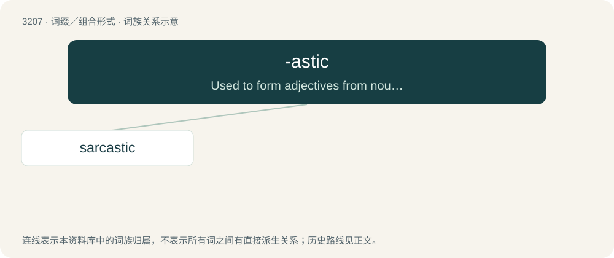

# 3306 · -astic — Used to form adjectives from nouns, often with the meaning meaning "of, or relating to".

[总目录](../00_总目录_按常用程度.md)

**类型**：词缀／组合形式　｜　**来源语言**：见词源记录

## 核心含义与来源

- 核心含义：Used to form adjectives from nouns, often with the meaning meaning "of, or relating to".
- 英文含义：Used to form adjectives from nouns, often with the meaning meaning "of, or relating to".
- 词形：-astic

**来源记录 1**（后缀／后置成分；Used to form adjectives from nouns, often with the meaning meaning "of, or relating to".）

Equivalent to -ast + -ic

## 词族图

## 单词速览（常用到不常用）

| 单词 | 音标 | 释义 |
|---|---|---|
| [sarcastic](#w-1) | 英 /sɑːˈkæs.tɪk/；美 /sɑɹˈkæs.tɪk/ | a. 讽刺的, 讥讽的 |

## 逐词详解

### 1. sarcastic

**词性**：形容词　｜　**音标**：英 /sɑːˈkæs.tɪk/；美 /sɑɹˈkæs.tɪk/

**中文释义**：a. 讽刺的, 讥讽的

**英文义项**：Containing sarcasm. / Having the personality trait of expressing sarcasm.

**构词拆分**：sarcasm + -astic

**词源与演化**：

Either from sarcasm + -astic or from French sarcastique, from French sarcasme, from Late Latin sarcasmus, ultimately from Ancient Greek σαρκασμός (sarkasmós, “sarcasm”), itself from Ancient Greek σάρξ (sárx, literally “meat, flesh”).

**用法示例／搭配（非完整句）**：

> the teacher's sarcastic tone

该用例对应义项：Containing sarcasm.
