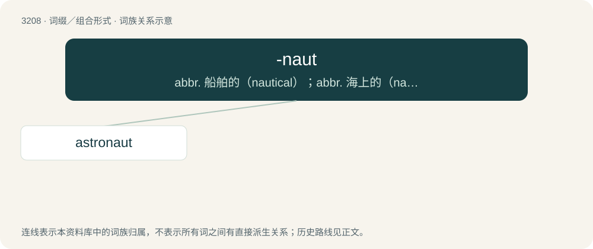

# 3307 · -naut — abbr. 船舶的（nautical）；abbr. 海上的（nautical）

[总目录](../00_总目录_按常用程度.md)

**类型**：词缀／组合形式　｜　**来源语言**：见词源记录

## 核心含义与来源

- 核心含义：abbr. 船舶的（nautical）；abbr. 海上的（nautical）
- 英文含义：Forms nouns meaning voyager or traveller
- 词形：-naut

**来源记录 1**（后缀／后置成分；Forms nouns meaning voyager or traveller）

From Ancient Greek ναύτης (naútēs, “sailor”).

## 词族图

## 单词速览（常用到不常用）

| 单词 | 音标 | 释义 |
|---|---|---|
| [astronaut](#w-1) | 英 /ˈæstɹəˌnɔːt/；美 /ˈæstɹəˌnɔt/ | n. 太空旅行者, 宇航员；\[法\] 美国太空人 |

## 逐词详解

### 1. astronaut

**词性**：名词　｜　**音标**：英 /ˈæstɹəˌnɔːt/；美 /ˈæstɹəˌnɔt/

**中文释义**：n. 太空旅行者, 宇航员；\[法\] 美国太空人

**英文义项**：A member of the crew of a spaceship or other spacecraft that travels beyond Earth's atmosphere, or someone trained to serve that purpose. / An American space traveler, when contrasted against equivalent terms from other countries such as cosmonaut, taikonaut, spationaut, and vyomanaut.

**构词拆分**：astro- + -naut

**词源与演化**：

From astro- + -naut. Coined from Ancient Greek ἄστρον (ástron, “star”) and ναύτης (naútēs, “sailor”).

**例句**：

> Tom doesn't want to give up his dream of becoming an astronaut.
