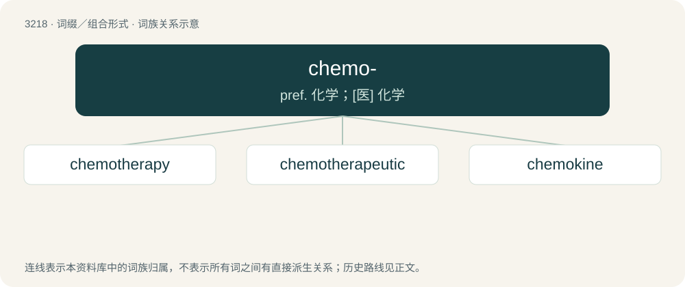

# 3316 · chemo- — pref. 化学；\[医\] 化学

[总目录](../00_总目录_按常用程度.md)

**类型**：词缀／组合形式　｜　**来源语言**：见词源记录

## 核心含义与来源

- 核心含义：pref. 化学；\[医\] 化学
- 英文含义：Relating to or using chemicals or chemistry.
- 词形：chemo-

**来源记录 1**（前缀／前置成分；Relating to or using chemicals or chemistry.）

Back-formation from compounds built on New Latin chēmicus (“pertaining to alchemy or chemistry”) and chēmia (“chemistry”), ultimately of Ancient Greek origin.

## 词族图

## 单词速览（常用到不常用）

| 单词 | 音标 | 释义 |
|---|---|---|
| [chemotherapy](#w-1) | /ˌkiːməʊˈθɛɹəpi/ | n. 化学疗法；\[化\] 化学疗法 |
| [chemotherapeutic](#w-2) | /ˈkeməj,θerəˈpjuːtik/ | a. 化学疗法, 化学治疗 |
| [chemokine](#w-3) | /kiːməʊˌkaɪn/ | 趋化因子 |

## 逐词详解

### 1. chemotherapy

**词性**：名词　｜　**音标**：/ˌkiːməʊˈθɛɹəpi/

**中文释义**：n. 化学疗法；\[化\] 化学疗法

**英文义项**：Any chemical treatment intended to be therapeutic with respect to a disease state. / chemical treatment to kill or halt the replication and/or spread of cancerous cells in a patient.

**构词拆分**：chemo- + therapy

**词源与演化**：

From chemo- + therapy.

**例句**：

> She has been prescribed medical cannabis to alleviate the side effects of chemotherapy.

### 2. chemotherapeutic

**词性**：形容词　｜　**音标**：/ˈkeməj,θerəˈpjuːtik/

**中文释义**：a. 化学疗法, 化学治疗

**英文义项**：Of or having to do with chemotherapy.

**构词拆分**：chemo- + therapeutic

**词源与演化**：

From chemo- + therapeutic.

### 3. chemokine

**词性**：名词　｜　**音标**：/kiːməʊˌkaɪn/

**中文释义**：趋化因子

**英文义项**：Any of various chemotactic cytokines, produced during inflammation, that organize the leukocytes.

**构词拆分**：chemo- + -kine

**词源与演化**：

From chemo- + -kine.
