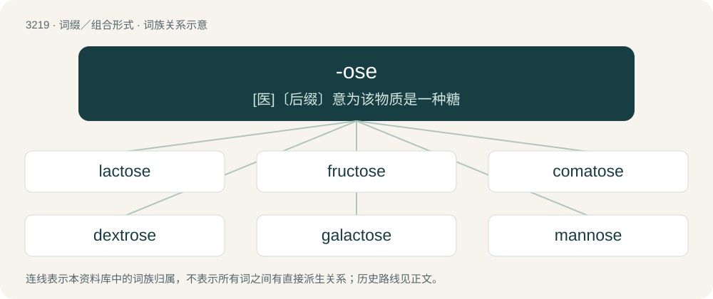

# 3317 · -ose — \[医\]〔后缀〕意为该物质是一种糖

[总目录](../00_总目录_按常用程度.md)

**类型**：词缀／组合形式　｜　**来源语言**：见词源记录

## 核心含义与来源

- 核心含义：\[医\]〔后缀〕意为该物质是一种糖
- 英文含义：full of
- 词形：-ose

**多个词源／构词路径**：同一拼写可能有不同来源；以下按词性和含义分别列出。

**来源记录 1**（后缀／后置成分；full of）

Borrowed from Latin -ōsus. Doublet of -ous in stressed position.

**来源记录 2**（后缀／后置成分；Used to form the names of sugars.）

Back-formation from glucose.

## 词族图

## 单词速览（常用到不常用）

| 单词 | 音标 | 释义 |
|---|---|---|
| [lactose](#w-1) | 英 /ˈlæk.təʊs/；美 /ˈlæk.toʊs/ | n. 乳糖；\[化\] 乳糖 |
| [fructose](#w-2) | 英 /ˈfɹʌk.təʊz/；美 /ˈfɹʌk.toʊs/ | n. 果糖；\[化\] 果糖; 左旋糖 |
| [comatose](#w-3) | 英 /ˈkəʊ.məˌtoʊs/；美 /ˈkoʊ.məˌtoʊs/ | a. 昏睡的, 昏睡状态的；\[医\] 昏迷的 |
| [dextrose](#w-4) | 英 /ˈdɛkstɹəʊz/ | n. 葡萄糖, 右旋糖；\[化\] 葡萄糖; 葡糖 |
| [galactose](#w-5) | 美 /ɡəˈlaktəʊz/ | n. 半乳糖；\[化\] 半乳糖 |
| [mannose](#w-6) | /ˈmænəus/ | n. \[生化\]甘露糖 |
| [agarose](#w-7) | /ˈɑː^ərəjs/ | \[化\] 琼脂糖 |
| [maltose](#w-8) | /ˈmɔːltəʊz/ | n. 麦芽糖；\[化\] 麦芽糖 |
| [xylose](#w-9) | /ˈzailəus/ | n. 木糖；\[化\] 木糖 |

## 逐词详解

### 1. lactose

**词性**：名词　｜　**音标**：英 /ˈlæk.təʊs/；美 /ˈlæk.toʊs/

**中文释义**：n. 乳糖；\[化\] 乳糖

**英文义项**：The disaccharide sugar of milk and dairy products, C₁₂H₂₂O₁₁, a product of glucose and galactose used as a food and in medicinal compounds.

**构词拆分**：Latin lac (“milk”) + -ose

**词源与演化**：

Borrowed from French lactose, from Latin lac (“milk”) + -ose (derivation of glucose). Coined by French chemist Marcelin Berthelot.

**例句**：

> Cow's milk contains about 4.7% lactose.

该用例对应义项：a sugar comprising one glucose molecule linked to a galactose molecule; occurs only in milk

### 2. fructose

**词性**：名词　｜　**音标**：英 /ˈfɹʌk.təʊz/；美 /ˈfɹʌk.toʊs/

**中文释义**：n. 果糖；\[化\] 果糖; 左旋糖

**英文义项**：A monosaccharide ketose sugar, formula C₆H₁₂O₆.

**词源与演化**：

From Latin fructus (“fruit”) + -ose (“sugar”) (derivation of sucrose).

**例句**：

> High fructose corn syrup is found in about everything you eat these days.

### 3. comatose

**词性**：形容词　｜　**音标**：英 /ˈkəʊ.məˌtoʊs/；美 /ˈkoʊ.məˌtoʊs/

**中文释义**：a. 昏睡的, 昏睡状态的；\[医\] 昏迷的

**英文义项**：In a coma: unconscious. / Drowsy or lethargic.

**构词拆分**：coma + -ose (“full of”)

**词源与演化**：

Perhaps from French comateux, or from Ancient Greek κῶμα (kôma, “deep sleep”) (genitive κώματος (kṓmatos)). Equivalent to coma + -ose (“full of”)

**例句**：

> the patient was comatose for 2 weeks before finally passing away.

该用例对应义项：In a coma: unconscious.

### 4. dextrose

**词性**：名词　｜　**音标**：英 /ˈdɛkstɹəʊz/

**中文释义**：n. 葡萄糖, 右旋糖；\[化\] 葡萄糖; 葡糖

**英文义项**：The naturally occurring dextrorotatory form of glucose monosaccharide molecule.

**构词拆分**：dextro- + -ose

**词源与演化**：

From dextro- + -ose (“right-handed sugar”).

### 5. galactose

**词性**：名词　｜　**音标**：美 /ɡəˈlaktəʊz/

**中文释义**：n. 半乳糖；\[化\] 半乳糖

**英文义项**：A monosaccharide found, along with lactose, in dairy products, and is synthesized by the body where it is found associated with glycolipids and glycoproteins.

**词源与演化**：

From Ancient Greek γάλακτος (gálaktos, “milk”) + -ose (“sugar”).

### 6. mannose

**词性**：名词　｜　**音标**：/ˈmænəus/

**中文释义**：n. \[生化\]甘露糖

**英文义项**：A monosaccharide aldohexose found in manna and other legumes.

**构词拆分**：manna + -ose

**词源与演化**：

From manna + -ose.

### 7. agarose

**词性**：名词　｜　**音标**：/ˈɑː^ərəjs/

**中文释义**：\[化\] 琼脂糖

**英文义项**：A polymeric cross-linked polysaccharide extracted from the seaweed agar; used to make gels that are used in electrophoresis.

**构词拆分**：agar + -ose

**词源与演化**：

From agar + -ose.

**例句**：

> Once it cools, the agarose solidifies and the optical fibers are selectively removed using solvents.

### 8. maltose

**词性**：名词　｜　**音标**：/ˈmɔːltəʊz/

**中文释义**：n. 麦芽糖；\[化\] 麦芽糖

**英文义项**：A disaccharide, C₁₂H₂₂O₁₁ formed from the digestion of starch by amylase; is converted to glucose by maltase; it is an isomer of trehalose

**构词拆分**：malt + -ose

**词源与演化**：

From malt + -ose.

### 9. xylose

**词性**：名词　｜　**音标**：/ˈzailəus/

**中文释义**：n. 木糖；\[化\] 木糖

**英文义项**：One of the pentoses, C₅H₁₀O₅, a white crystalline sugar, derived from wood.

**构词拆分**：xylo- + -ose

**词源与演化**：

From xylo- + -ose.
