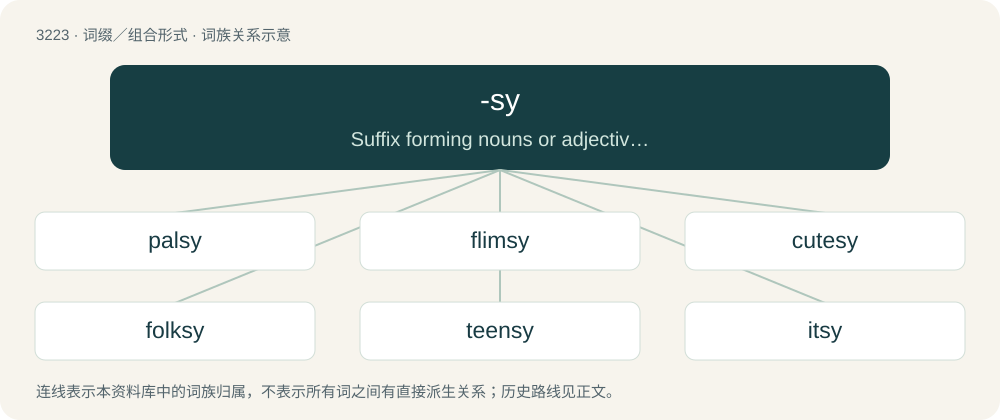

# 3320 · -sy — Suffix forming nouns or adjectives, sometimes diminutive and usually informal or jocular.

[总目录](../00_总目录_按常用程度.md)

**类型**：词缀／组合形式　｜　**来源语言**：见词源记录

## 核心含义与来源

- 核心含义：Suffix forming nouns or adjectives, sometimes diminutive and usually informal or jocular.
- 英文含义：Suffix forming nouns or adjectives, sometimes diminutive and usually informal or jocular.
- 词形：-sy

**来源记录 1**（后缀／后置成分；Suffix forming nouns or adjectives, sometimes diminutive and usually informal or jocular.）

Perhaps originally two distinct suffixes, one diminutive and the other adjectival; sources of both are uncertain. If so, then equivalent to -s + -y.

## 词族图

## 单词速览（常用到不常用）

| 单词 | 音标 | 释义 |
|---|---|---|
| [palsy](#w-1) | 英 /ˈpælzi/ | 【英文】Chummy, friendly. |
| [flimsy](#w-2) | 英 /ˈflɪmzi/ | a. 易坏的, 脆弱的, 浅薄的；n. 易损坏的东西(或材料), 薄纸, 描图用薄纸, 薄纸稿纸 |
| [cutesy](#w-3) | 英 /ˈkjuːtsi/；美 /ˈkjutsi/ | a. 矫揉造作的,忸怩作态的 |
| [folksy](#w-4) | 英 /fəʊksi/；美 /foʊksi/ | a. 和气的, 有民间风味的 |
| [teensy](#w-5) | 英 /ˈtiːn.si/；美 /ˈtin.si/ | a. 很小的, 小小的 |
| [itsy](#w-6) |  | 【英文】Very small; itty |

## 逐词详解

### 1. palsy

**词性**：形容词　｜　**音标**：英 /ˈpælzi/

**英文义项**：Chummy, friendly.

**构词拆分**：From pal + -sy.

**词源与演化**：

From pal + -sy.

### 2. flimsy

**词性**：形容词　｜　**音标**：英 /ˈflɪmzi/

**中文释义**：a. 易坏的, 脆弱的, 浅薄的；n. 易损坏的东西(或材料), 薄纸, 描图用薄纸, 薄纸稿纸

**英文义项**：Likely to bend or break under pressure; easily damaged; frail, unsubstantial. / Of clothing: very light and thin.

**词源与演化**：

The origin of the adjective is uncertain; it is possibly from flim(-flam) (“(noun) false information presented as true, misinformation, nonsense; poor attempt at deception, confidence trick, pretence; (adjective) frivolous, nonsensical; deceptive; fictitious”) or a metathesis of film (“thin layer of a substance; slender thread”) + -sy (suffix forming adjectives and nouns). The noun and verb are derived from the noun. Noun sense 4 (“metal container”) refers to the fact that the containers often split along their seams and leaked.

**例句**：

> He expected the flimsy structure to collapse at any moment.

该用例对应义项：Likely to bend or break under pressure; easily damaged; frail, unsubstantial.

### 3. cutesy

**词性**：形容词　｜　**音标**：英 /ˈkjuːtsi/；美 /ˈkjutsi/

**中文释义**：a. 矫揉造作的,忸怩作态的

**英文义项**：Overly, affectedly or unnecessarily cute; too cute to be taken seriously.

**构词拆分**：cute + -sy

**词源与演化**：

From cute + -sy.

**例句**：

> The couple called each other cutesy pet names like "honeypot" and "smoochie-poochie" that disgusted everyone else.

该用例对应义项：Overly, affectedly or unnecessarily cute; too cute to be taken seriously.

### 4. folksy

**词性**：形容词　｜　**音标**：英 /fəʊksi/；美 /foʊksi/

**中文释义**：a. 和气的, 有民间风味的

**英文义项**：Characteristic of common folk. / Characteristic of simple country life.

**构词拆分**：folks + -y；folk + -sy

**词源与演化**：

From folks + -y or folk + -sy.

**例句**：

> A folksy radio commentator.

该用例对应义项：very informal and familiar

### 5. teensy

**词性**：形容词　｜　**音标**：英 /ˈtiːn.si/；美 /ˈtin.si/

**中文释义**：a. 很小的, 小小的

**英文义项**：tiny

**词源与演化**：

Baby-talk alteration of teeny, from tiny, probably modelled after itsy, itsy-bitsy, etc.; see -sy.

**例句**：

> There's only a teensy chance that I'll be able to make your party, as I'm up to my eyeballs in work.

该用例对应义项：tiny

### 6. itsy

**词性**：形容词

**英文义项**：Very small; itty

**词源与演化**：

Baby-talk form of little + -sy.

**例句**：

> The itsy bitsy spider climbed up the waterspout.
