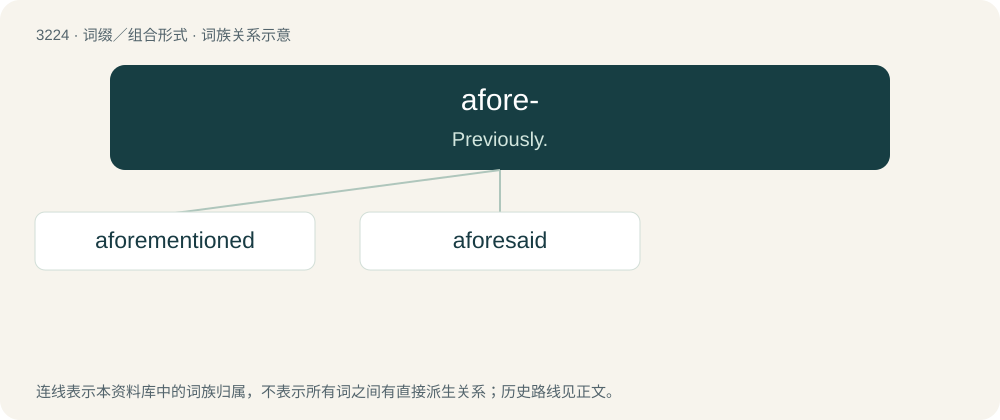

# 3321 · afore- — Previously.

[总目录](../00_总目录_按常用程度.md)

**类型**：词缀／组合形式　｜　**来源语言**：见词源记录

## 核心含义与来源

- 核心含义：Previously.
- 英文含义：Previously.
- 词形：afore-

**来源记录 1**（前缀／前置成分；Previously.）

From a- + fore-.

## 词族图

## 单词速览（常用到不常用）

| 单词 | 音标 | 释义 |
|---|---|---|
| [aforementioned](#w-1) | 英 /əˈfɔːˌmɛn.ʃənd/；美 /əˈfɔɹˌmɛn.ʃənd/ | a. 上述的, 前述的；\[法\] 前面提到过的, 前述的 |
| [aforesaid](#w-2) | 英 /əˈfɔːsɛd/；美 /əˈfɔɹsɛd/ | a. 上述的, 前述的；\[法\] 如上所述的, 上面提到的 |

## 逐词详解

### 1. aforementioned

**词性**：形容词　｜　**音标**：英 /əˈfɔːˌmɛn.ʃənd/；美 /əˈfɔɹˌmɛn.ʃənd/

**中文释义**：a. 上述的, 前述的；\[法\] 前面提到过的, 前述的

**英文义项**：Previously mentioned.

**构词拆分**：From afore- + mentioned.

**词源与演化**：

From afore- + mentioned.

**例句**：

> It wasn't until later that we realized that the aforementioned caller and this taciturn man were the same person.

该用例对应义项：Previously mentioned.

### 2. aforesaid

**词性**：形容词　｜　**音标**：英 /əˈfɔːsɛd/；美 /əˈfɔɹsɛd/

**中文释义**：a. 上述的, 前述的；\[法\] 如上所述的, 上面提到的

**英文义项**：Previously stated; said or named before.

**构词拆分**：afore- + said

**词源与演化**：

From Middle English aforesaid(e), aforeseid(e), past participle of aforesayen, aforeseyen, aforeseien, aforeseggen; formed with the prefix afore- and the several forms of seien (“to say”). Equivalent to afore- + said.

**例句**：

> Once the aforesaid issues have been rectified, construction may continue.
