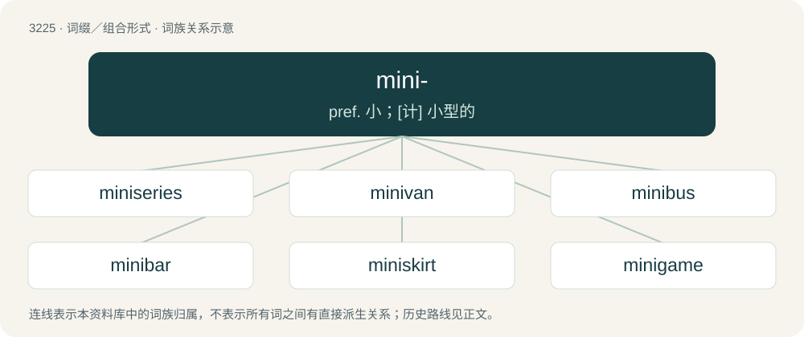

# 3322 · mini- — pref. 小；\[计\] 小型的

[总目录](../00_总目录_按常用程度.md)

**类型**：词缀／组合形式　｜　**来源语言**：见词源记录

## 核心含义与来源

- 核心含义：pref. 小；\[计\] 小型的
- 英文含义：Smaller version of an item than usual.
- 词形：mini-

## 词族图

## 单词速览（常用到不常用）

| 单词 | 音标 | 释义 |
|---|---|---|
| [miniseries](#w-1) | /ˈmɪnisɪəriːz/ | n. 电视连续短剧 |
| [minivan](#w-2) | /ˈminivæn/ | n. 小型货车 |
| [minibus](#w-3) | 美 /ˈmɪ.ni.bəs/ | n. 中客车, 小型公共汽车 |
| [minibar](#w-4) | /ˈminibɑː/ | n. 小型条信号发生器 |
| [miniskirt](#w-5) | 英 /ˈmɪnɪskəːt/ | n. 超短裙 |
| [minigame](#w-6) | 美 /ˈmɪniˌɡeɪm/ | 【英文】A small and simple game, especially an incidental game within a larger video game. |
| [minicab](#w-7) | /ˈminikæb/ | n. 微型出租汽车 |
| [minifigure](#w-8) |  | 【英文】A small figure of a person, especially in toys such as Lego. |

## 逐词详解

### 1. miniseries

**词性**：名词　｜　**音标**：/ˈmɪnisɪəriːz/

**中文释义**：n. 电视连续短剧

**英文义项**：A radio or television series with a small number of episodes not intended to last a complete season. / A relatively short comic book series with a predetermined number of instalments.

**构词拆分**：mini- + series

**词源与演化**：

From mini- + series.

**例句**：

> My favorite miniseries of all time is the old BBC adaptation of "I, Claudius".

该用例对应义项：A radio or television series with a small number of episodes not intended to last a complete season.

### 2. minivan

**词性**：名词　｜　**音标**：/ˈminivæn/

**中文释义**：n. 小型货车

**英文义项**：A small van, especially (Canada, US, Australia, New Zealand, Philippines) one primarily used for family transport.

**构词拆分**：mini- + van

**词源与演化**：

From mini- + van. First widely used in the 1980s, when this class of vehicles became widely popular as an alternative to station wagons (estate cars). Attested earlier in technical usage, usually as mini-van.

**例句**：

> Sami's minivan was found with a flat tire in a parking lot.

### 3. minibus

**词性**：名词　｜　**音标**：美 /ˈmɪ.ni.bəs/

**中文释义**：n. 中客车, 小型公共汽车

**英文义项**：A small bus, especially one used as transport for small groups. / A sixteen-seater vehicle used as a taxi.

**构词拆分**：mini- + bus

**词源与演化**：

From mini- + bus. In the political sense, probably a back-formation from omnibus.

**例句**：

> Yanni was picked up by a minibus.

### 4. minibar

**词性**：名词　｜　**音标**：/ˈminibɑː/

**中文释义**：n. 小型条信号发生器

**英文义项**：A small refrigerator in a hotel room, containing drinks and snacks that the guest may choose to purchase during their stay.

**构词拆分**：mini- + bar

**词源与演化**：

From mini- + bar.

**例句**：

> Now there's a minibar where my liver was.

### 5. miniskirt

**词性**：名词　｜　**音标**：英 /ˈmɪnɪskəːt/

**中文释义**：n. 超短裙

**英文义项**：A short skirt with its hemline well above the knees, generally at mid-thigh level.

**构词拆分**：mini- + skirt

**词源与演化**：

From mini- + skirt.

**例句**：

> I think that Tom's grandmother is too old to wear a miniskirt.

### 6. minigame

**词性**：名词　｜　**音标**：美 /ˈmɪniˌɡeɪm/

**英文义项**：A small and simple game, especially an incidental game within a larger video game.

**构词拆分**：mini- + game

**词源与演化**：

From mini- + game.

**例句**：

> If you collect 100 coins, you get to play a balloon-popping minigame.

该用例对应义项：A small and simple game, especially an incidental game within a larger video game.

### 7. minicab

**词性**：名词　｜　**音标**：/ˈminikæb/

**中文释义**：n. 微型出租汽车

**英文义项**：A small car used as a taxi (rather than a traditional black cab). / Synonym of gypsy cab, an unlicensed taxi.

**构词拆分**：mini- + cab

**词源与演化**：

From mini- + cab.

### 8. minifigure

**词性**：名词

**英文义项**：A small figure of a person, especially in toys such as Lego.

**构词拆分**：mini- + figure

**词源与演化**：

From mini- + figure.
