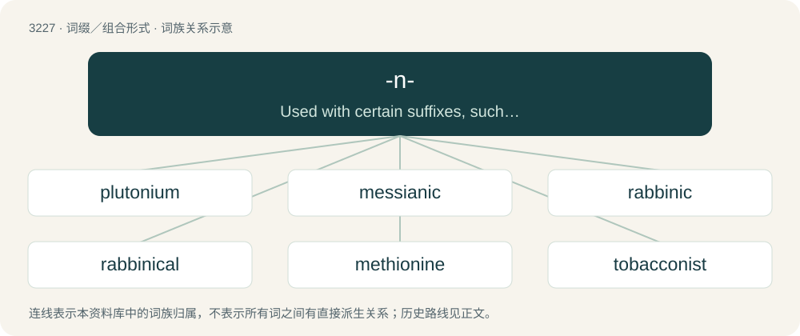

# 3324 · -n- — Used with certain suffixes, such as -ian and -ese, when the base word ends in a vowel that is not readily elided.

[总目录](../00_总目录_按常用程度.md)

**类型**：词缀／组合形式　｜　**来源语言**：见词源记录

## 核心含义与来源

- 核心含义：Used with certain suffixes, such as -ian and -ese, when the base word ends in a vowel that is not readily elided.
- 英文含义：Used with certain suffixes, such as -ian and -ese, when the base word ends in a vowel that is not readily elided.
- 词形：-n-

## 词族图

## 单词速览（常用到不常用）

| 单词 | 音标 | 释义 |
|---|---|---|
| [plutonium](#w-1) | /pluːˈtoʊniəm/ | n. 钚；\[化\] 钚Pu |
| [messianic](#w-2) | /ˌmɛsaɪˈænɪk/ | 【英文】Of, relating to, or resembling a messiah or the Messiah. |
| [rabbinic](#w-3) | /ɹəˈbɪnɪk/ | \[法\] 犹太教法学博士的, 犹太法学博士的教义 |
| [rabbinical](#w-4) | /ɹəˈbɪnəkəl/ | a. 希伯莱语的 |
| [methionine](#w-5) | 英 /mɪˈθʌɪəniːn/；美 /mɛˈθaɪəˌniːn/ | \[化\] 甲硫氨酸; 蛋氨酸；\[医\] 蛋氨酸, 甲硫丁氨酸 |
| [tobacconist](#w-6) | /təˈbækənist/ | n. 烟草商 |

## 逐词详解

### 1. plutonium

**词性**：名词　｜　**音标**：/pluːˈtoʊniəm/

**中文释义**：n. 钚；\[化\] 钚Pu

**英文义项**：The transuranic chemical element with atomic number 94 and symbol Pu: a silvery-gray fissile radioactive actinide metal that tarnishes when exposed to air. / An atom of this element.

**构词拆分**：Pluto + -n- + -ium；Pluto (dwarf planet) + -n- + -ium

**例句**：

> Plutonium-244 has a half-life of 80 million years.

### 2. messianic

**词性**：形容词　｜　**音标**：/ˌmɛsaɪˈænɪk/

**英文义项**：Of, relating to, or resembling a messiah or the Messiah. / Of, relating to, or resembling messianism.

**构词拆分**：Messiah + -n- + -ic

**词源与演化**：

From Messiah + -n- + -ic.

**例句**：

> I do not opine that Hinduism is like a messianic complex.

### 3. rabbinic

**词性**：形容词　｜　**音标**：/ɹəˈbɪnɪk/

**中文释义**：\[法\] 犹太教法学博士的, 犹太法学博士的教义

**英文义项**：Relating to rabbis. / Formulated or enacted by rabbis.

**构词拆分**：rabbi + -n- + -ic

**词源与演化**：

From rabbi + -n- + -ic.

**例句**：

> Yoni was hired as the shul's cantor, but he has a very rabbinic attitude.

该用例对应义项：Relating to rabbis.

### 4. rabbinical

**词性**：形容词　｜　**音标**：/ɹəˈbɪnəkəl/

**中文释义**：a. 希伯莱语的

**英文义项**：Of or relating to rabbis, their writings, or their work.

**构词拆分**：rabbi + -n- + -ical

**词源与演化**：

From rabbi + -n- + -ical.

### 5. methionine

**词性**：名词　｜　**音标**：英 /mɪˈθʌɪəniːn/；美 /mɛˈθaɪəˌniːn/

**中文释义**：\[化\] 甲硫氨酸; 蛋氨酸；\[医\] 蛋氨酸, 甲硫丁氨酸

**英文义项**：A sulphur-containing amino acid, C₅H₁₁NO₂S, in L- and D-forms. / The L-form thereof, a lipotropic molecule widely occurring in living organisms and found in most protein; in humans it is an essential amino acid.

**构词拆分**：methyl + thio- + -n- + -ine

**词源与演化**：

From methyl + thio- + -n- + -ine.

### 6. tobacconist

**词性**：名词　｜　**音标**：/təˈbækənist/

**中文释义**：n. 烟草商

**英文义项**：A person who sells tobacco, cigarettes, cigars, snuff and sundry items. / A tobacconist's shop.

**构词拆分**：tobacco + -n- + -ist

**词源与演化**：

From tobacco + -n- + -ist.

**例句**：

> People used to buy their smokes at a tobacconist. Now they buy them at a convenience store.
