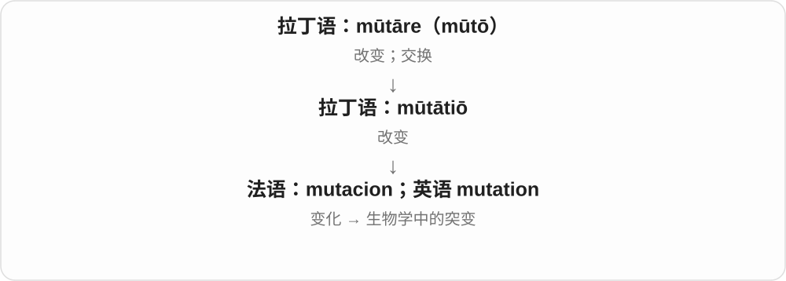

# 3325 · muta- — 改变、突变相关

[逐词精讲目录](../00_逐词精讲目录.md) · [总目录](../00_总目录_按常用程度.md)

## 核心词根与来源

接 mutation 突变词族，远接拉丁 mutatio 改变；近代科学类比其他组合形式采用 muta-。

**MUTA-：把对象接到遗传改变这一词族**

mutagen 是能导致突变的因素，mutagenic 形容这种性质，mutagenesis 则说突变发生、产生的过程。

- **改变、突变的基础名称**：mutation
- **致突变因素、性质与过程**：mutagen · mutagenic · mutagenesis

## 词形与演化规律

muta- + -gen 产生相关 → mutagen → mutagenic；muta- + -genesis 发生、生成 → mutagenesis。

## 单词速览（按词族由简到繁）

同一基础词的相关扩展放在一起，先读基础形式，再读扩展；各组之间优先读常用的。具体词源关系见各词讲解。

| 单词 | 音标 | 核心意思 |
|---|---|---|
| [mutation](#w-4) | /mjuːˈteɪʃən/ | 突变；变异；变化 |
| [mutagenesis](#w-1) | /ˌmjuːtəˈdʒenəsɪs/ | 突变发生；诱变过程 |
| [mutagen](#w-2) | /ˈmjuːtədʒən/ | 诱变剂；致突变因子 |
| [mutagenic](#w-3) | /ˌmjuːtəˈdʒenɪk/ | 致突变的；诱变的 |

## 逐词讲解

### 1. mutation — 突变；变异；变化

**音标**：/mjuːˈteɪʃən/

**先抓住这个画面**

mutation 先抓住“原来的内容发生了改变”，生物学里常指遗传物质序列出现变化。

**怎么拆**

来自拉丁语 mūtātiō“改变”，可经法语或直接借入，属于 mūtāre 支线。

**怎么变成今天的意思**

现代生物学义比古代一般变化义更专门。变化不自动等于更强、更坏，也不意味着能看见巨大的外形变化。

**常见搭配与例句**

a genetic mutation；a mutation in a gene；a new mutation。

> The study identified a mutation in the gene.

研究发现了这个基因中的一处突变。

> The novel uses mutation as a metaphor for social change.

小说用变异比喻社会变化。

**别混淆**

mutation 是变化本身；mutant 是带有变异的个体或相关形容词。

### 2. mutagenesis — 突变发生；诱变过程

**音标**：/ˌmjuːtəˈdʒenəsɪs/

**先抓住这个画面**

把镜头从“什么引起突变”转到“突变怎样产生的整个过程”。

**怎么拆**

muta- 改变 + genesis 产生。

**怎么变成今天的意思**

**希腊 gígnesthai / génos / génesis**  
产生、出生；出身和种类；形成过程

↓

**现代科学词 muta- + genesis → mutagenesis**  
遗传物质发生突变的过程

mutagenesis 可以指自发突变的产生，也可以指实验中诱导突变。说研究某种 mutagenesis，是研究改变的来源或过程，不一定是在做治疗。

**常见搭配与例句**

spontaneous mutagenesis；induced mutagenesis。

> The chapter explains mechanisms of mutagenesis.

这一章解释突变发生的机制。

> The experiment compared spontaneous and induced mutagenesis.

实验比较了自发突变与诱导突变的发生。

**别混淆**

mutagen 是因子，mutation 是变化，mutagenesis 是变化产生的过程。

### 3. mutagen — 诱变剂；致突变因子

**音标**：/ˈmjuːtədʒən/

**先抓住这个画面**

让遗传文本发生改变的外部因素，像会增加文字改动机会的干扰。

**怎么拆**

muta- 改变，联系 mutation + -gen 引起者。

**怎么变成今天的意思**

**希腊 gígnesthai / génos / génesis**  
产生、出生；出身和种类；形成过程

↓

**拉丁“改变”词族成分 muta- + 希腊来源 -gen → mutagen**  
引起遗传物质突变的因素

mutagen 可以是某些化学物质，也可以是辐射等物理因素，不一定是装在瓶里的药剂。它是造成改变的因素，mutation 是改变本身。

**常见搭配与例句**

a chemical mutagen；exposure to a mutagen。

> The chemical was tested as a possible mutagen.

研究测试了这种化学物质是否可能具有致突变作用。

> Ultraviolet radiation can act as a mutagen.

紫外线辐射可成为致突变因素。

**别混淆**

mutant 是出现突变的个体或细胞；mutagen 是促成突变的东西。

### 4. mutagenic — 致突变的；诱变的

**音标**：/ˌmjuːtəˈdʒenɪk/

**先抓住这个画面**

说的不是东西已经变了，而是它具有促使遗传材料改变的作用。

**怎么拆**

muta- 改变 + -genic 引起的，与 mutagen 对应。

**怎么变成今天的意思**

**希腊 gígnesthai / génos / génesis**  
产生、出生；出身和种类；形成过程

↓

**英语 muta- + -genic → mutagenic**  
能够引起突变的

mutagenic effect 是致突变作用；mutagenic activity 是实验里考察的诱变活性。修饰的通常是物质、暴露或作用，而非一个普通拼写错误。

**常见搭配与例句**

mutagenic activity；mutagenic effects。

> The researchers measured the compound’s mutagenic activity.

研究人员测量了这种化合物的诱变活性。

> The paper reports no mutagenic effect under the tested conditions.

论文报告在所测试条件下未观察到致突变作用。

**别混淆**

genetic 是遗传相关的广义词；mutagenic 特别指出引起突变这一作用。

## 这一组要分清什么

mutagen 是因素，mutagenesis 是过程；mutation 是发生的改变。后部不同，谈论对象也不同。

## 串起来练习

The glossary distinguishes a mutagen from a mutation.

词汇表区分了致突变因素与突变。
