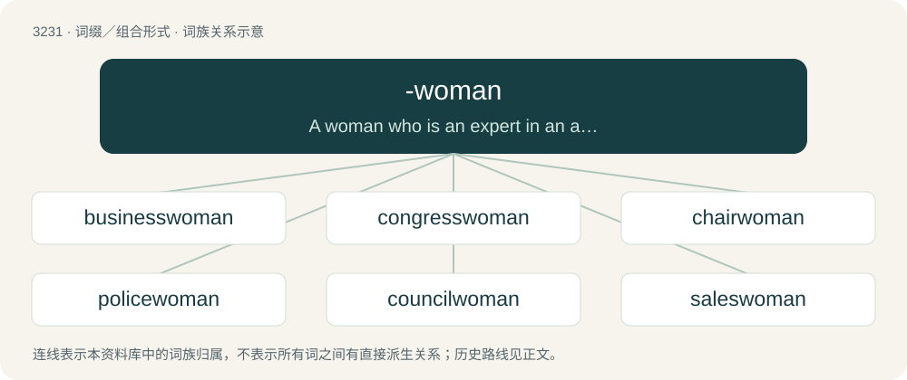

# 3326 · -woman — A woman who is an expert in an area.

[总目录](../00_总目录_按常用程度.md)

**类型**：词缀／组合形式　｜　**来源语言**：见词源记录

## 核心含义与来源

- 核心含义：A woman who is an expert in an area.
- 英文含义：A woman who is an expert in an area.
- 词形：-woman

**来源记录 1**（后缀／后置成分；A woman who is an expert in an area.）

From Middle English -woman, from the noun woman.

## 词族图

## 单词速览（常用到不常用）

| 单词 | 音标 | 释义 |
|---|---|---|
| [businesswoman](#w-1) | /ˈbizniswjmæn/ | n. 商人, 办理实务的人, 经商者 |
| [congresswoman](#w-2) | /ˈkɒŋgreswumən/ | n. 国会女议员, 众议院女议员 |
| [chairwoman](#w-3) | /ˈtʃєəwumən/ | n. 女主席, 女议长 |
| [policewoman](#w-4) | /pəˈliːswumən/ | n. 女警察；\[法\] 女警察 |
| [councilwoman](#w-5) | /ˈkajnsəl,wjmən/ | \[法\] 女议员 |
| [saleswoman](#w-6) | /ˈseilzwumən/ | n. 女售货员, 女店员 |
| [assemblywoman](#w-7) | /əˈsembli,wjmən/ | n. 女议员 |
| [noblewoman](#w-8) | /ˈnəublwumən/ | n. 女贵族, 贵妇人 |
| [gentlewoman](#w-9) | /ˈd͡ʒɛn.təlˌwʊm.ən/ | n. 良家妇女, 淑女, 贵妇人 |
| [madwoman](#w-10) | /ˈmædwumən/ | n. 狂女, 疯女 |

## 逐词详解

### 1. businesswoman

**词性**：名词　｜　**音标**：/ˈbizniswjmæn/

**中文释义**：n. 商人, 办理实务的人, 经商者

**英文义项**：A woman involved in business.

**构词拆分**：business + -woman

**词源与演化**：

From business + -woman.

**例句**：

> A businesswoman by day, Natasja leads a nightlife unfit for print.

### 2. congresswoman

**词性**：名词　｜　**音标**：/ˈkɒŋgreswumən/

**中文释义**：n. 国会女议员, 众议院女议员

**英文义项**：A female member of congress. / A female member of the House of Representatives.

**构词拆分**：congress + -woman

**词源与演化**：

From congress + -woman.

**例句**：

> The Arizona congresswoman was shot at a 2011 event in Tucson.

### 3. chairwoman

**词性**：名词　｜　**音标**：/ˈtʃєəwumən/

**中文释义**：n. 女主席, 女议长

**英文义项**：A female chairperson

**构词拆分**：chair + -woman

**词源与演化**：

From chair + -woman.

**例句**：

> The chairwoman of the commission presented its final report.

### 4. policewoman

**词性**：名词　｜　**音标**：/pəˈliːswumən/

**中文释义**：n. 女警察；\[法\] 女警察

**英文义项**：A female police officer.

**构词拆分**：police + -woman

**词源与演化**：

From police + -woman.

**例句**：

> A Californian policewoman pulled a car over and spoke to the driver.

### 5. councilwoman

**词性**：名词　｜　**音标**：/ˈkajnsəl,wjmən/

**中文释义**：\[法\] 女议员

**英文义项**：A feminine member of a council, especially a city council or town council.

**构词拆分**：council + -woman

**词源与演化**：

From council + -woman.

**例句**：

> The councilwoman was caught stealing tampons from a woman's purse in a local bar.

### 6. saleswoman

**词性**：名词　｜　**音标**：/ˈseilzwumən/

**中文释义**：n. 女售货员, 女店员

**英文义项**：A woman whose occupation it is to sell things.

**构词拆分**：sales + -woman

**词源与演化**：

From sales + -woman.

**例句**：

> One month later, the 28-year-old real-estate saleswoman said her world had collapsed.

### 7. assemblywoman

**词性**：名词　｜　**音标**：/əˈsembli,wjmən/

**中文释义**：n. 女议员

**英文义项**：A female member of an assembly. / A member of the lower house of certain US state legislatures.

**构词拆分**：assembly + -woman

**词源与演化**：

From assembly + -woman.

### 8. noblewoman

**词性**：名词　｜　**音标**：/ˈnəublwumən/

**中文释义**：n. 女贵族, 贵妇人

**英文义项**：A woman having a noble rank, especially one belonging to the peerage; a Lady.

**构词拆分**：noble + -woman

**词源与演化**：

From noble + -woman.

**例句**：

> The noblewoman's manner of talking makes me nervous.

### 9. gentlewoman

**词性**：名词　｜　**音标**：/ˈd͡ʒɛn.təlˌwʊm.ən/

**中文释义**：n. 良家妇女, 淑女, 贵妇人

**英文义项**：A female member of a legislature, especially a female member of a House of Representatives.

**构词拆分**：gentle + -woman

**词源与演化**：

From Middle English gentilwoman, modelled after gentilman (“gentleman”), equivalent to gentle + -woman.

### 10. madwoman

**词性**：名词　｜　**音标**：/ˈmædwumən/

**中文释义**：n. 狂女, 疯女

**英文义项**：A woman who is insane or mentally disturbed.

**构词拆分**：mad + -woman

**词源与演化**：

From mad + -woman.
