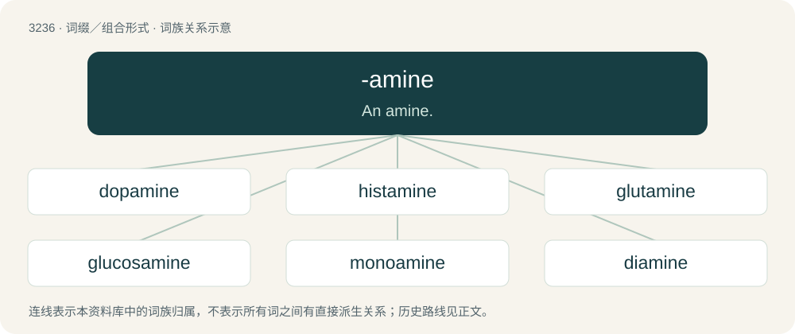

# 3329 · -amine — An amine.

[总目录](../00_总目录_按常用程度.md)

**类型**：词缀／组合形式　｜　**来源语言**：见词源记录

## 核心含义与来源

- 核心含义：An amine.
- 英文含义：An amine.
- 词形：-amine

**来源记录 1**（后缀／后置成分；An amine.）

From amine.

## 词族图

## 单词速览（常用到不常用）

| 单词 | 音标 | 释义 |
|---|---|---|
| [dopamine](#w-1) | 英 /ˈdəʊ.pə.miːn/；美 /ˈdoʊ.pəˌmin/ | \[化\] 多巴胺 |
| [histamine](#w-2) | /ˈhɪstəmiːn/ | n. 组胺；\[化\] 麦胺; 组胺 |
| [glutamine](#w-3) | /ˈɡlutəmiːn/ | n. 谷氨酸盐；\[医\] 谷酰胺 |
| [glucosamine](#w-4) | /^luːkəuˈsæmiːn/ | \[化\] 壳糖胺; 氨基葡糖; 葡糖胺；\[医\] 氨基葡萄糖, 葡萄糖胺 |
| [monoamine](#w-5) | /mɒnəʊˈeɪmiːn/ | \[化\] 一元胺 |
| [diamine](#w-6) | /ˈdaɪ.ə.miːn/ | \[化\] 二元胺；\[医\] 二胺; 胼, 联胺 |
| [diphenhydramine](#w-7) | 英 /ˌdʌɪ.fɛnˈhʌɪ.dɹəm.iːn/；美 /ˌdaɪˌfɛnˈhaɪ.dɹəˌmiːn/ | \[化\] 苯海拉明；\[医\] 苯海拉明 |

## 逐词详解

### 1. dopamine

**词性**：名词　｜　**音标**：英 /ˈdəʊ.pə.miːn/；美 /ˈdoʊ.pəˌmin/

**中文释义**：\[化\] 多巴胺

**英文义项**：A monoamine C₈H₁₁NO₂ that is a decarboxylated form of dopa, present in the body as a neurotransmitter and a precursor of other substances including adrenalin.

**构词拆分**：DOPA (“dihydroxyphenylalanine”) + -amine

**词源与演化**：

From DOPA (“dihydroxyphenylalanine”) + -amine. Etymologically unrelated to dope.

**例句**：

> All drugs of addiction increase the release of dopamine in the brain.

### 2. histamine

**词性**：名词　｜　**音标**：/ˈhɪstəmiːn/

**中文释义**：n. 组胺；\[化\] 麦胺; 组胺

**英文义项**：An amine, C₅H₉N₃, formed by decarboxylation of histidine, that causes dilatation of capillaries, contraction of smooth muscle, and stimulation of gastric acid secretion; it is released during allergic reactions.

**构词拆分**：histidine + -amine

**词源与演化**：

From hist(idine) + -amine.

**例句**：

> Histamine is an essential part of the immune system in the body.

### 3. glutamine

**词性**：名词　｜　**音标**：/ˈɡlutəmiːn/

**中文释义**：n. 谷氨酸盐；\[医\] 谷酰胺

**英文义项**：A nonessential amino acid C₅H₁₀N₂O₃ found in most animal and plant proteins.

**构词拆分**：gluta- + -amine

**词源与演化**：

From gluta- + -amine.

### 4. glucosamine

**词性**：名词　｜　**音标**：/^luːkəuˈsæmiːn/

**中文释义**：\[化\] 壳糖胺; 氨基葡糖; 葡糖胺；\[医\] 氨基葡萄糖, 葡萄糖胺

**英文义项**：An amino derivative of glucose that is a component of polysaccharides such as chitin; it is marketed as a dietary supplement supposedly to reduce the symptoms of arthritis.

**构词拆分**：glucose + -amine

**词源与演化**：

From glucose + -amine.

### 5. monoamine

**词性**：名词　｜　**音标**：/mɒnəʊˈeɪmiːn/

**中文释义**：\[化\] 一元胺

**英文义项**：Any compound having a single amino functional group, especially a neurotransmitter.

**构词拆分**：mono- + -amine

**词源与演化**：

From mono- + -amine.

### 6. diamine

**词性**：名词　｜　**音标**：/ˈdaɪ.ə.miːn/

**中文释义**：\[化\] 二元胺；\[医\] 二胺; 胼, 联胺

**英文义项**：Any compound containing two amino functional groups.

**构词拆分**：di- + -amine

**词源与演化**：

From di- + -amine.

### 7. diphenhydramine

**词性**：名词　｜　**音标**：英 /ˌdʌɪ.fɛnˈhʌɪ.dɹəm.iːn/；美 /ˌdaɪˌfɛnˈhaɪ.dɹəˌmiːn/

**中文释义**：\[化\] 苯海拉明；\[医\] 苯海拉明

**英文义项**：An antihistamine and anticholinergic drug that blocks the effect of histamine at H₁ receptor sites, relieving allergy symptoms. It also reduces smooth muscle contraction, increases heart rate, and sedates the user by blocking muscarinic acetylcholine receptors (mAChRs).

**构词拆分**：diphenyl + benzhydryl + -amine

**词源与演化**：

From diphen(yl) + (benz)hydr(yl) + -amine.

**例句**：

> Diphenhydramine is a convenient and cheap antihistamine for use, but there are other drugs that do not make the user tired.

该用例对应义项：An antihistamine and anticholinergic drug that blocks the effect of histamine at H₁ receptor sites, relieving allergy symptoms. It also reduces smooth muscle contraction, increases heart rate, and sedates the user by blocking muscarinic acetylcholine receptors (mAChRs).
