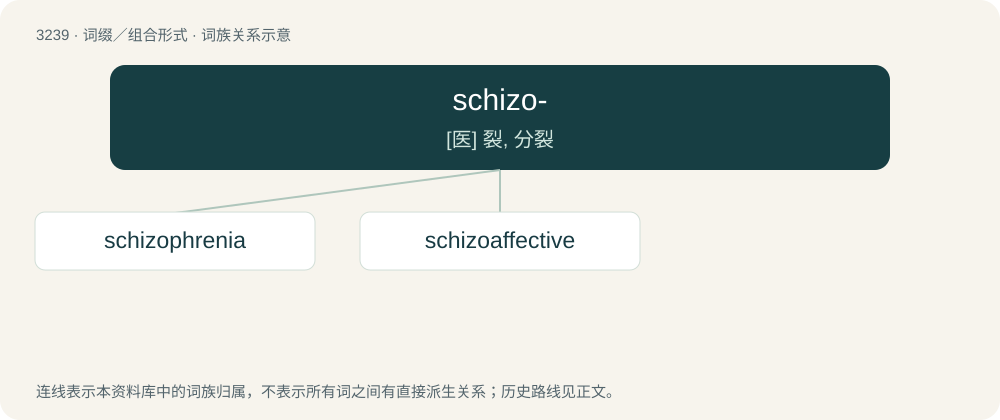

# 3333 · schizo- — \[医\] 裂, 分裂

[总目录](../00_总目录_按常用程度.md)

**类型**：词缀／组合形式　｜　**来源语言**：见词源记录

## 核心含义与来源

- 核心含义：\[医\] 裂, 分裂
- 英文含义：split, cleft
- 词形：schizo-

**来源记录 1**（前缀／前置成分；split, cleft）

From Ancient Greek σχίζω (skhízō, “I split”).

## 词族图

## 单词速览（常用到不常用）

| 单词 | 音标 | 释义 |
|---|---|---|
| [schizophrenia](#w-1) | 英 /skɪtsə(ʊ)ˈfɹiːniə/；美 /ˌskɪtsəˈfɹiniə/ | n. 精神分裂症；\[医\] 精神分裂症 |
| [schizoaffective](#w-2) | /skɪzəʊˈfektɪv/ | \[医\]情感性分裂的：关于或表现精神分裂症性及情绪失调（躁狂和抑郁）两方面特征的 |

## 逐词详解

### 1. schizophrenia

**词性**：名词　｜　**音标**：英 /skɪtsə(ʊ)ˈfɹiːniə/；美 /ˌskɪtsəˈfɹiniə/

**中文释义**：n. 精神分裂症；\[医\] 精神分裂症

**英文义项**：A psychiatric diagnosis denoting a persistent, often chronic, mental illness characterised by abnormal perception, thinking, behavior and emotion, often marked by delusions. / A condition in which a person is supposed to have several distinct personalities; dissociative identity disorder.

**构词拆分**：schizo- + -phrenia

**词源与演化**：

From German Schizophrenie (coined by Eugen Bleuler), from Ancient Greek σχίζω (skhízō, “to split”) + φρήν (phrḗn, “mind, heart, diaphragm”) + English -ia. A combination of schizo- + -phrenia.

**例句**：

> "Dementia praecox" was the original name of what is today called schizophrenia.

### 2. schizoaffective

**词性**：形容词　｜　**音标**：/skɪzəʊˈfektɪv/

**中文释义**：\[医\]情感性分裂的：关于或表现精神分裂症性及情绪失调（躁狂和抑郁）两方面特征的

**英文义项**：Combining the symptoms of schizophrenia with those of bipolar disorder.

**构词拆分**：From schizo- + affective.

**词源与演化**：

From schizo- + affective.

**例句**：

> Schizoaffective disorder is similar to bipolar disorder.
