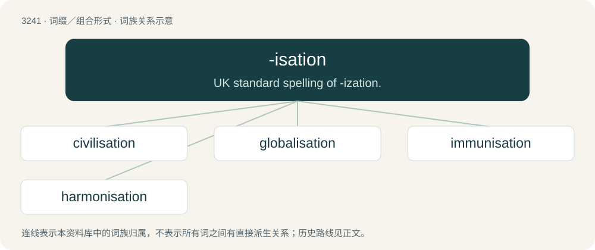

# 3335 · -isation — UK standard spelling of -ization.

[总目录](../00_总目录_按常用程度.md)

**类型**：词缀／组合形式　｜　**来源语言**：见词源记录

## 核心含义与来源

- 核心含义：UK standard spelling of -ization.
- 英文含义：UK standard spelling of -ization.
- 词形：-isation

**来源记录 1**（后缀／后置成分；UK standard spelling of -ization.）

From -ise + -ation.

## 词族图

## 单词速览（常用到不常用）

| 单词 | 音标 | 释义 |
|---|---|---|
| [civilisation](#w-1) | 英 /ˌsɪv.ɪ.laɪˈzeɪ.ʃən/；美 /ˌsɪv.ɪ.lɪˈzeɪ.ʃən/ | n. 文明, 文明世界, 文化, 开化, 教化 |
| [globalisation](#w-2) | 英 /ˌɡləʊ.bə.laɪˈzeɪ.ʃən/；美 /ˌɡloʊ.bə.lɪˈzeɪ.ʃən/ | n. 全球化, =globalization |
| [immunisation](#w-3) | /ˌɪmjʊnaɪˈzeɪʃən/ | n. 免疫(immunization) |
| [harmonisation](#w-4) | /ˌhaːmənaɪˈzeɪʃən/ | n. 和谐, 协调, 相称； \[医\]调谐 |

## 逐词详解

### 1. civilisation

**词性**：名词　｜　**音标**：英 /ˌsɪv.ɪ.laɪˈzeɪ.ʃən/；美 /ˌsɪv.ɪ.lɪˈzeɪ.ʃən/

**中文释义**：n. 文明, 文明世界, 文化, 开化, 教化

**英文义项**：UK, Ireland, Australia, New Zealand, South Africa, Hong Kong, and Commonwealth spelling of civilization.

**构词拆分**：civilise + -ation；civil + -isation

**词源与演化**：

Borrowed from French civilisation, equivalent to civilise + -ation or civil + -isation.

**例句**：

> Tom's log cabin is situated in a lonely bay far from civilisation.

### 2. globalisation

**词性**：名词　｜　**音标**：英 /ˌɡləʊ.bə.laɪˈzeɪ.ʃən/；美 /ˌɡloʊ.bə.lɪˈzeɪ.ʃən/

**中文释义**：n. 全球化, =globalization

**英文义项**：The process of becoming a more interconnected world. / The process of the world economy becoming dominated by capitalist models, according to the World System Theory.

**构词拆分**：global + -isation；globalise + -ation

**词源与演化**：

From global + -isation or globalise + -ation. Popularized by German-American economist and professor at Harvard Business School Theodore Levitt.

**例句**：

> Does globalisation mean the disappearance of local sluts?

### 3. immunisation

**词性**：名词　｜　**音标**：/ˌɪmjʊnaɪˈzeɪʃən/

**中文释义**：n. 免疫(immunization)

**英文义项**：The process of immunising signalling and traction power supplies so they don't interfere with each other.

**构词拆分**：immunise + -ation；immune + -isation

**词源与演化**：

From French immunisation. Equivalent to immunise + -ation or immune + -isation.

### 4. harmonisation

**词性**：名词　｜　**音标**：/ˌhaːmənaɪˈzeɪʃən/

**中文释义**：n. 和谐, 协调, 相称； \[医\]调谐

**英文义项**：Non-Oxford British standard spelling of harmonization.

**构词拆分**：harmony + -isation

**词源与演化**：

From harmony + -isation.
