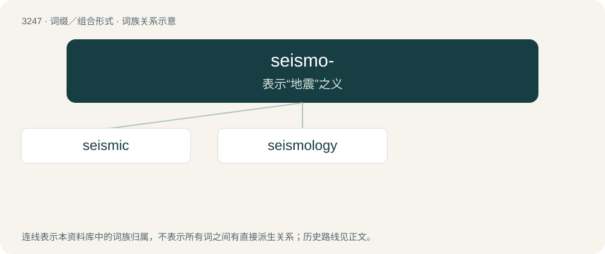

# 3339 · seismo- — 表示“地震”之义

[总目录](../00_总目录_按常用程度.md)

**类型**：词缀／组合形式　｜　**来源语言**：见词源记录

## 核心含义与来源

- 核心含义：表示“地震”之义
- 英文含义：Pertaining to an earthquake.
- 词形：seismo-

**来源记录 1**（前缀／前置成分；Pertaining to an earthquake.）

From Ancient Greek σεισμός (seismós, “earthquake”).

## 词族图

## 单词速览（常用到不常用）

| 单词 | 音标 | 释义 |
|---|---|---|
| [seismic](#w-1) | /ˈsaɪzmɪk/ | a. 地震的 |
| [seismology](#w-2) | 英 /saɪzˈmɒl.ə.d͡ʒi/；美 /saɪzˈmɑl.ə.d͡ʒi/ | n. 地震学 |

## 逐词详解

### 1. seismic

**词性**：形容词　｜　**音标**：/ˈsaɪzmɪk/

**中文释义**：a. 地震的

**英文义项**：Related to, or caused by an earthquake or other vibration of the Earth. / Subject to earthquakes.

**构词拆分**：seismo- + -ic

**词源与演化**：

Based on Ancient Greek σεισμός (seismós, “shaking, earthquake”) + -ic, equivalent to seismo- + -ic.

**用法示例／搭配（非完整句）**：

> seismic activity

该用例对应义项：Related to, or caused by an earthquake or other vibration of the Earth.

### 2. seismology

**词性**：名词　｜　**音标**：英 /saɪzˈmɒl.ə.d͡ʒi/；美 /saɪzˈmɑl.ə.d͡ʒi/

**中文释义**：n. 地震学

**英文义项**：The study of the vibration of the Earth's interior caused by natural and unnatural sources, such as earthquakes.

**构词拆分**：seismo- + -logy

**词源与演化**：

From seismo- + -logy.
