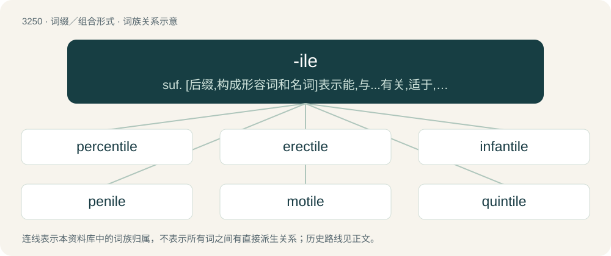

# 3342 · -ile — suf. \[后缀,构成形容词和名词\]表示能,与...有关,适于,倾向：docile,fragile,prehensile,volatile\[亦作-il\]

[总目录](../00_总目录_按常用程度.md)

**类型**：词缀／组合形式　｜　**来源语言**：见词源记录

## 核心含义与来源

- 核心含义：suf. \[后缀,构成形容词和名词\]表示能,与...有关,适于,倾向：docile,fragile,prehensile,volatile\[亦作-il\]
- 英文含义：Tending to, or capable of.
- 词形：-ile

## 词族图

## 单词速览（常用到不常用）

| 单词 | 音标 | 释义 |
|---|---|---|
| [percentile](#w-1) | 英 /pəˈsɛn.taɪl/；美 /pɚˈsɛn.taɪl/ | \[医\] 百分率的；\[经\] 百分之一, 按百等分排列的 |
| [erectile](#w-2) | 美 /əˈɹɛktaɪl/ | a. 可直立的, 能勃起的；\[医\] 能勃起的, 能竖立的 |
| [infantile](#w-3) | /ˈɪnfəntaɪl/ | a. 婴儿的, 幼稚的, 初期的；\[医\] 婴儿的, 幼稚的 |
| [penile](#w-4) | /ˈpiː.naɪ.əl/ | \[医\] 阴茎的 |
| [motile](#w-5) | 英 /ˈməʊtaɪl/ | a. 能动的, 运动表象型的；n. 运动表象型 |
| [quintile](#w-6) | /ˈkwintil, -tail/ | a. \[占星术\] 五分之一对座的(相隔72度)；n. \[天\]五分之一对座 |
| [prehensile](#w-7) | 英 /pɹɪˈhɛn.saɪl/；美 /pɹiˈhɛnsəl/ | a. 能抓的, 善于领会的, 贪得无厌的；\[医\] 抓握的, 捕捉的 |
| [decile](#w-8) | 美 /ˈdɛs.əl/ | n. & adj.\[数\]\[统\]十分位数(的) |

## 逐词详解

### 1. percentile

**词性**：名词　｜　**音标**：英 /pəˈsɛn.taɪl/；美 /pɚˈsɛn.taɪl/

**中文释义**：\[医\] 百分率的；\[经\] 百分之一, 按百等分排列的

**英文义项**：Any of the ninety-nine points that divide an ordered distribution into one hundred parts, each containing one per cent of the population. / Any one of the hundred groups so divided.

**构词拆分**：percent + -ile

**词源与演化**：

Coined by Francis Galton in 1885, from percent + -ile.

**例句**：

> She is highly intelligent—she has an IQ in the top percentile.

该用例对应义项：Any one of the hundred groups so divided.

### 2. erectile

**词性**：形容词　｜　**音标**：美 /əˈɹɛktaɪl/

**中文释义**：a. 可直立的, 能勃起的；\[医\] 能勃起的, 能竖立的

**英文义项**：Capable of being raised to an upright position. / Capable of filling with blood and becoming rigid.

**构词拆分**：erect + -ile

**词源与演化**：

From French érectile, from Latin erectus, past participle of erigere, equivalent to erect + -ile.

**例句**：

> The penis and clitoris contain erectile tissue which responds to sexual stimulation.

该用例对应义项：Capable of filling with blood and becoming rigid.

### 3. infantile

**词性**：形容词　｜　**音标**：/ˈɪnfəntaɪl/

**中文释义**：a. 婴儿的, 幼稚的, 初期的；\[医\] 婴儿的, 幼稚的

**英文义项**：Pertaining to infants. / Childish; immature.

**构词拆分**：infant + -ile

**词源与演化**：

Mid-15th century, "pertaining to infants," from Latin infantilis (“pertaining to an infant”), equivalent to infant + -ile, from īnfāns. Sense of "infant-like" is from 1772.

**用法示例／搭配（非完整句）**：

> infantile paralysis

该用例对应义项：Pertaining to infants.

### 4. penile

**词性**：形容词　｜　**音标**：/ˈpiː.naɪ.əl/

**中文释义**：\[医\] 阴茎的

**英文义项**：Of or pertaining to the penis.

**构词拆分**：penis + -ile

**词源与演化**：

From pen(is) + -ile.

**用法示例／搭配（非完整句）**：

> penile strength

该用例对应义项：Of or pertaining to the penis.

### 5. motile

**词性**：形容词　｜　**音标**：英 /ˈməʊtaɪl/

**中文释义**：a. 能动的, 运动表象型的；n. 运动表象型

**英文义项**：In organisms: having the power to move spontaneously. / In organs or organelles: capable of producing motion.

**词源与演化**：

From Latin mōtus, perfect passive participle of moveō (“to move”, whence English move), + -ile.

**例句**：

> The gametes produced by the male are motile.

### 6. quintile

**词性**：名词　｜　**音标**：/ˈkwintil, -tail/

**中文释义**：a. \[占星术\] 五分之一对座的(相隔72度)；n. \[天\]五分之一对座

**英文义项**：Any of the quantiles which divide an ordered sample population into five equally numerous subsets. / A subset thus obtained.

**构词拆分**：quint- + -ile

**词源与演化**：

From quint- + -ile.

### 7. prehensile

**词性**：形容词　｜　**音标**：英 /pɹɪˈhɛn.saɪl/；美 /pɹiˈhɛnsəl/

**中文释义**：a. 能抓的, 善于领会的, 贪得无厌的；\[医\] 抓握的, 捕捉的

**英文义项**：Able to take hold of and clasp objects; adapted for grasping especially by wrapping around an object.

**词源与演化**：

Borrowed from French préhensile, from Latin perfect passive participle prehēnsus, from prehendō (“grasp, seize”) + adjective suffix -ile, from Latin -ilis.

**例句**：

> Some monkeys have prehensile tails which they use to pick things up.

该用例对应义项：Able to take hold of and clasp objects; adapted for grasping especially by wrapping around an object.

### 8. decile

**词性**：名词　｜　**音标**：美 /ˈdɛs.əl/

**中文释义**：n. & adj.\[数\]\[统\]十分位数(的)

**英文义项**：Any of the values in a series that divides the distribution of individuals in that series into ten groups of equal frequency. / Any one of the ten subsets or groups so divided.

**构词拆分**：dec- + -ile

**词源与演化**：

From Latin decilis, equivalent to dec- + -ile.

**例句**：

> Although few people scored high marks, everyone did quite well—the lowest decile was over 50%.

该用例对应义项：Any of the values in a series that divides the distribution of individuals in that series into ten groups of equal frequency.
